# VP08 — Channel contracts and sequences

Revision: `e2a2f39e5c78476bb1bba08e406114367eb59953f02a63e952e435c880d24007`.

Explicit scenario steps validated against permits, participation, mode and request/result correlation.

## Channel participation — mode NormalDesktop

```mermaid
flowchart LR
    n_Application["Application (unit)"]
    n_ContextInteraction["ContextInteraction (channel)"]
    n_DiagramInterpretation["DiagramInterpretation (channel)"]
    n_DiagramLayoutCalls["DiagramLayoutCalls (channel)"]
    n_DocumentCalls["DocumentCalls (channel)"]
    n_DocumentIndexService["DocumentIndexService (unit)"]
    n_DocumentNotifications["DocumentNotifications (channel)"]
    n_DocumentStateChanges["DocumentStateChanges (channel)"]
    n_DocumentStorage["DocumentStorage (unit)"]
    n_Documents["Documents (unit)"]
    n_EditIntents["EditIntents (channel)"]
    n_EventLoop["EventLoop (unit)"]
    n_ExportInterpretation["ExportInterpretation (channel)"]
    n_ExportLayout["ExportLayout (channel)"]
    n_ExternalLauncher["ExternalLauncher (unit)"]
    n_ExternalOpening["ExternalOpening (channel)"]
    n_ExternalViewBroker["ExternalViewBroker (unit)"]
    n_ExternalViewGenerator["ExternalViewGenerator (unit)"]
    n_GeneratedAdmission["GeneratedAdmission (channel)"]
    n_GeneratedDelivery["GeneratedDelivery (channel)"]
    n_GeneratedDocumentCalls["GeneratedDocumentCalls (channel)"]
    n_GeneratedIntents["GeneratedIntents (channel)"]
    n_GeneratedViews["GeneratedViews (unit)"]
    n_GenerationLifecycle["GenerationLifecycle (channel)"]
    n_IndexChanges["IndexChanges (channel)"]
    n_IndexIntents["IndexIntents (channel)"]
    n_InterpretationCalls["InterpretationCalls (channel)"]
    n_Interpreter["Interpreter (unit)"]
    n_LayoutCalls["LayoutCalls (channel)"]
    n_LeaseLifecycle["LeaseLifecycle (channel)"]
    n_LeaseNotifications["LeaseNotifications (channel)"]
    n_NativeShell["NativeShell (unit)"]
    n_Navigation["Navigation (unit)"]
    n_NavigationCalls["NavigationCalls (channel)"]
    n_OpeningPolicy["OpeningPolicy (channel)"]
    n_PreferenceChanges["PreferenceChanges (channel)"]
    n_Preferences["Preferences (unit)"]
    n_PresentationEvents["PresentationEvents (channel)"]
    n_Preview["Preview (unit)"]
    n_PreviewAdmission["PreviewAdmission (channel)"]
    n_Publication["Publication (unit)"]
    n_PublicationDrawing["PublicationDrawing (channel)"]
    n_PublicationInputs["PublicationInputs (channel)"]
    n_PublicationIntents["PublicationIntents (channel)"]
    n_PublicationState["PublicationState (channel)"]
    n_ReferenceInterpretation["ReferenceInterpretation (channel)"]
    n_ReferenceStorage["ReferenceStorage (channel)"]
    n_Renderer["Renderer (unit)"]
    n_ResourcePreparation["ResourcePreparation (channel)"]
    n_ScheduledWork["ScheduledWork (channel)"]
    n_StorageCalls["StorageCalls (channel)"]
    n_Typography["Typography (unit)"]
    n_UnsavedAdmission["UnsavedAdmission (channel)"]
    n_Viewport["Viewport (unit)"]
    n_ViewportChanges["ViewportChanges (channel)"]
    n_VisualResources["VisualResources (unit)"]
    n_WindowPresentation["WindowPresentation (channel)"]
    n_Workspace["Workspace (unit)"]
    n_WorkspaceChanges["WorkspaceChanges (channel)"]
    n_WorkspaceIntents["WorkspaceIntents (channel)"]
    n_ContextInteraction -->|receiver| n_NativeShell
    n_NativeShell -->|sender| n_ContextInteraction
    n_DiagramInterpretation -->|receiver| n_Interpreter
    n_Interpreter -->|sender| n_DiagramInterpretation
    n_DiagramLayoutCalls -->|receiver| n_Renderer
    n_Renderer -->|sender| n_DiagramLayoutCalls
    n_DiagramLayoutCalls -->|receiver| n_VisualResources
    n_VisualResources -->|sender| n_DiagramLayoutCalls
    n_DocumentCalls -->|receiver| n_Documents
    n_Documents -->|sender| n_DocumentCalls
    n_DocumentCalls -->|receiver| n_Navigation
    n_Navigation -->|sender| n_DocumentCalls
    n_Documents -->|sender| n_DocumentNotifications
    n_DocumentNotifications -->|receiver| n_GeneratedViews
    n_DocumentNotifications -->|receiver| n_Navigation
    n_DocumentNotifications -->|receiver| n_Preview
    n_DocumentStateChanges -->|receiver| n_Documents
    n_Documents -->|sender| n_DocumentStateChanges
    n_EditIntents -->|receiver| n_Documents
    n_NativeShell -->|sender| n_EditIntents
    n_ExportInterpretation -->|receiver| n_Interpreter
    n_Interpreter -->|sender| n_ExportInterpretation
    n_ExportInterpretation -->|receiver| n_Publication
    n_Publication -->|sender| n_ExportInterpretation
    n_ExportLayout -->|receiver| n_Publication
    n_Publication -->|sender| n_ExportLayout
    n_ExportLayout -->|receiver| n_Renderer
    n_Renderer -->|sender| n_ExportLayout
    n_Application -->|sender| n_ExternalOpening
    n_ExternalOpening -->|receiver| n_ExternalLauncher
    n_GeneratedAdmission -->|receiver| n_Documents
    n_GeneratedAdmission -->|receiver| n_GeneratedViews
    n_GeneratedViews -->|sender| n_GeneratedAdmission
    n_GeneratedDelivery -->|receiver| n_ExternalViewGenerator
    n_ExternalViewGenerator -->|sender| n_GeneratedDelivery
    n_GeneratedDelivery -->|receiver| n_GeneratedViews
    n_GeneratedViews -->|sender| n_GeneratedDelivery
    n_GeneratedDocumentCalls -->|receiver| n_Documents
    n_Documents -->|sender| n_GeneratedDocumentCalls
    n_GeneratedDocumentCalls -->|receiver| n_GeneratedViews
    n_GeneratedViews -->|sender| n_GeneratedDocumentCalls
    n_GeneratedIntents -->|receiver| n_GeneratedViews
    n_NativeShell -->|sender| n_GeneratedIntents
    n_GenerationLifecycle -->|receiver| n_ExternalViewGenerator
    n_GeneratedViews -->|sender| n_GenerationLifecycle
    n_IndexChanges -->|receiver| n_DocumentIndexService
    n_DocumentIndexService -->|sender| n_IndexChanges
    n_IndexChanges -->|receiver| n_NativeShell
    n_IndexIntents -->|receiver| n_DocumentIndexService
    n_NativeShell -->|sender| n_IndexIntents
    n_InterpretationCalls -->|receiver| n_Interpreter
    n_Interpreter -->|sender| n_InterpretationCalls
    n_InterpretationCalls -->|receiver| n_Preview
    n_Preview -->|sender| n_InterpretationCalls
    n_LayoutCalls -->|receiver| n_Preview
    n_Preview -->|sender| n_LayoutCalls
    n_LayoutCalls -->|receiver| n_Renderer
    n_Renderer -->|sender| n_LayoutCalls
    n_LeaseLifecycle -->|receiver| n_GeneratedViews
    n_GeneratedViews -->|sender| n_LeaseLifecycle
    n_LeaseNotifications -->|receiver| n_ExternalViewBroker
    n_GeneratedViews -->|sender| n_LeaseNotifications
    n_NavigationCalls -->|receiver| n_Application
    n_Application -->|sender| n_NavigationCalls
    n_NavigationCalls -->|receiver| n_Navigation
    n_Navigation -->|sender| n_NavigationCalls
    n_OpeningPolicy -->|receiver| n_Application
    n_Application -->|sender| n_OpeningPolicy
    n_PreferenceChanges -->|receiver| n_NativeShell
    n_NativeShell -->|sender| n_PreferenceChanges
    n_PreferenceChanges -->|receiver| n_Preferences
    n_Preferences -->|sender| n_PreferenceChanges
    n_GeneratedViews -->|sender| n_PresentationEvents
    n_PresentationEvents -->|receiver| n_NativeShell
    n_Preview -->|sender| n_PresentationEvents
    n_PreviewAdmission -->|receiver| n_Preview
    n_Preview -->|sender| n_PreviewAdmission
    n_Publication -->|sender| n_PublicationDrawing
    n_PublicationDrawing -->|receiver| n_Typography
    n_Documents -->|sender| n_PublicationInputs
    n_PublicationInputs -->|receiver| n_Publication
    n_NativeShell -->|sender| n_PublicationIntents
    n_PublicationIntents -->|receiver| n_Publication
    n_PublicationState -->|receiver| n_Publication
    n_Publication -->|sender| n_PublicationState
    n_ReferenceInterpretation -->|receiver| n_DocumentIndexService
    n_DocumentIndexService -->|sender| n_ReferenceInterpretation
    n_ReferenceInterpretation -->|receiver| n_Interpreter
    n_Interpreter -->|sender| n_ReferenceInterpretation
    n_ReferenceStorage -->|receiver| n_DocumentIndexService
    n_DocumentIndexService -->|sender| n_ReferenceStorage
    n_ReferenceStorage -->|receiver| n_DocumentStorage
    n_DocumentStorage -->|sender| n_ReferenceStorage
    n_Preview -->|sender| n_ResourcePreparation
    n_Publication -->|sender| n_ResourcePreparation
    n_ResourcePreparation -->|receiver| n_VisualResources
    n_VisualResources -->|sender| n_ResourcePreparation
    n_ScheduledWork -->|receiver| n_EventLoop
    n_EventLoop -->|sender| n_ScheduledWork
    n_ScheduledWork -->|receiver| n_GeneratedViews
    n_ScheduledWork -->|receiver| n_Preview
    n_Preview -->|sender| n_ScheduledWork
    n_StorageCalls -->|receiver| n_DocumentStorage
    n_DocumentStorage -->|sender| n_StorageCalls
    n_StorageCalls -->|receiver| n_Documents
    n_Documents -->|sender| n_StorageCalls
    n_UnsavedAdmission -->|receiver| n_Documents
    n_Documents -->|sender| n_UnsavedAdmission
    n_UnsavedAdmission -->|receiver| n_NativeShell
    n_NativeShell -->|sender| n_UnsavedAdmission
    n_ViewportChanges -->|receiver| n_NativeShell
    n_NativeShell -->|sender| n_ViewportChanges
    n_ViewportChanges -->|receiver| n_Viewport
    n_Viewport -->|sender| n_ViewportChanges
    n_WindowPresentation -->|receiver| n_NativeShell
    n_NativeShell -->|sender| n_WindowPresentation
    n_Application -->|sender| n_WorkspaceChanges
    n_WorkspaceChanges -->|receiver| n_NativeShell
    n_WorkspaceChanges -->|receiver| n_Workspace
    n_Workspace -->|sender| n_WorkspaceChanges
    n_WorkspaceIntents -->|receiver| n_Application
    n_NativeShell -->|sender| n_WorkspaceIntents
    n_WorkspaceIntents -->|receiver| n_Workspace
```

Source facts: [f0035](sdl-source://s0/10508/10600), [f0036](sdl-source://s0/10601/10684), [f0037](sdl-source://s0/10685/10764), [f0038](sdl-source://s0/10765/10856), [f0039](sdl-source://s0/10857/10946), [f0040](sdl-source://s0/10947/11036), [f0041](sdl-source://s0/11037/11127), [f0042](sdl-source://s0/11128/11222), [f0043](sdl-source://s0/11223/11313), [f0044](sdl-source://s0/11314/11404), [f0182](sdl-source://s0/19678/19779), [f0183](sdl-source://s0/19780/19879), [f0184](sdl-source://s0/19880/19979), [f0185](sdl-source://s0/19980/20072), [f0186](sdl-source://s0/20073/20176), [f0187](sdl-source://s0/20177/20277), [f0188](sdl-source://s0/20278/20372), [f0189](sdl-source://s0/20373/20465), [f0223](sdl-source://s0/22084/22173), [f0224](sdl-source://s0/22174/22261), [f0225](sdl-source://s0/22262/22347), [f0226](sdl-source://s0/22348/22432), [f0227](sdl-source://s0/22433/22516), [f0228](sdl-source://s0/22517/22606), [f0229](sdl-source://s0/22607/22691), [f0234](sdl-source://s0/22821/22901), [f0235](sdl-source://s0/22902/22981), [f0236](sdl-source://s0/22982/23063), [f0237](sdl-source://s0/23064/23148), [f0238](sdl-source://s0/23149/23237), [f0239](sdl-source://s0/23238/23335), [f0240](sdl-source://s0/23336/23426), [f0241](sdl-source://s0/23427/23516), [f0242](sdl-source://s0/23517/23605), [f0243](sdl-source://s0/23606/23693), [f0244](sdl-source://s0/23694/23772), [f0245](sdl-source://s0/23773/23861), [f0246](sdl-source://s0/23862/23960), [f0247](sdl-source://s0/23961/24058), [f0248](sdl-source://s0/24059/24148), [f0249](sdl-source://s0/24149/24228), [f0250](sdl-source://s0/24229/24314), [f0251](sdl-source://s0/24315/24395), [f0252](sdl-source://s0/24396/24473), [f0253](sdl-source://s0/24474/24550), [f0254](sdl-source://s0/24551/24633), [f0255](sdl-source://s0/24634/24714), [f0256](sdl-source://s0/24715/24796), [f0277](sdl-source://s0/26332/26414), [f0278](sdl-source://s0/26415/26495), [f0279](sdl-source://s0/26496/26577), [f0311](sdl-source://s0/28042/28141), [f0321](sdl-source://s0/28794/28889), [f0322](sdl-source://s0/28890/28994), [f0323](sdl-source://s0/28995/29099), [f0324](sdl-source://s0/29100/29201), [f0325](sdl-source://s0/29202/29306), [f0326](sdl-source://s0/29307/29407), [f0425](sdl-source://s0/36461/36565), [f0426](sdl-source://s0/36566/36668), [f0427](sdl-source://s0/36669/36768), [f0428](sdl-source://s0/36769/36863), [f0429](sdl-source://s0/36864/36964), [f0430](sdl-source://s0/36965/37056), [f0431](sdl-source://s0/37057/37154), [f0432](sdl-source://s0/37155/37247), [f0433](sdl-source://s0/37248/37344), [f0434](sdl-source://s0/37345/37440), [f0435](sdl-source://s0/37441/37536), [f0436](sdl-source://s0/37537/37641), [f0437](sdl-source://s0/37642/37743), [f0438](sdl-source://s0/37744/37836), [f0439](sdl-source://s0/37837/37932), [f0440](sdl-source://s0/37933/38028), [f0441](sdl-source://s0/38029/38120), [f0442](sdl-source://s0/38121/38209), [f0443](sdl-source://s0/38210/38300), [f0444](sdl-source://s0/38301/38392), [f0445](sdl-source://s0/38393/38483), [f0446](sdl-source://s0/38484/38570), [f0447](sdl-source://s0/38571/38659), [f0448](sdl-source://s0/38660/38749), [f0449](sdl-source://s0/38750/38838), [f0450](sdl-source://s0/38839/38928), [f0451](sdl-source://s0/38929/39022), [f0452](sdl-source://s0/39023/39111), [f0486](sdl-source://s0/40709/40803), [f0487](sdl-source://s0/40804/40896), [f0488](sdl-source://s0/40897/40992), [f0489](sdl-source://s0/40993/41087), [f0490](sdl-source://s0/41088/41176), [f0491](sdl-source://s0/41177/41264), [f0492](sdl-source://s0/41265/41358), [f0493](sdl-source://s0/41359/41451), [f0546](sdl-source://s0/44177/44271), [f0547](sdl-source://s0/44272/44364), [f0548](sdl-source://s0/44365/44458), [f0549](sdl-source://s0/44459/44551), [f0550](sdl-source://s0/44552/44642), [f0551](sdl-source://s0/44643/44734), [f0552](sdl-source://s0/44735/44813), [f0553](sdl-source://s0/44814/44901), [f0554](sdl-source://s0/44902/44992), [f0555](sdl-source://s0/44993/45085), [f0556](sdl-source://s0/45086/45167), [f0557](sdl-source://s0/45168/45263), [f0558](sdl-source://s0/45264/45356), [f0559](sdl-source://s0/45357/45443), [f0560](sdl-source://s0/45444/45536), [f0561](sdl-source://s0/45537/45625), [f0562](sdl-source://s0/45626/45714), [f0563](sdl-source://s0/45715/45800), [f0564](sdl-source://s0/45801/45883), [f0565](sdl-source://s0/45884/45964), [f0566](sdl-source://s0/45965/46051), [f0567](sdl-source://s0/46052/46144), [f0568](sdl-source://s0/46145/46231), [f0569](sdl-source://s0/46232/46322), [f0570](sdl-source://s0/46323/46411), [f0571](sdl-source://s0/46412/46502), [f0572](sdl-source://s0/46503/46595), [f0573](sdl-source://s0/46596/46684), [f0574](sdl-source://s0/46685/46773), [f0575](sdl-source://s0/46774/46864), [f0577](sdl-source://s0/46900/46982), [f0578](sdl-source://s0/46983/47067), [f0579](sdl-source://s0/47068/47147), [f0580](sdl-source://s0/47148/47235), [f0581](sdl-source://s0/47236/47316), [f0582](sdl-source://s0/47317/47397), [f0653](sdl-source://s0/51640/51734), [f0654](sdl-source://s0/51735/51829), [f0655](sdl-source://s0/51830/51926), [f0656](sdl-source://s0/51927/52024), [f0657](sdl-source://s0/52025/52117), [f0658](sdl-source://s0/52118/52211), [f0659](sdl-source://s0/52212/52306), [f0660](sdl-source://s0/52307/52402), [f0689](sdl-source://s0/54132/54220), [f0690](sdl-source://s0/54221/54306), [f0691](sdl-source://s0/54307/54389), [f0692](sdl-source://s0/54390/54465), [f0693](sdl-source://s0/54466/54538), [f0694](sdl-source://s0/54539/54619), [f0695](sdl-source://s0/54620/54706), [f0696](sdl-source://s0/54707/54793), [f0697](sdl-source://s0/54794/54880), [f0698](sdl-source://s0/54881/54971), [f0699](sdl-source://s0/54972/55065), [f0700](sdl-source://s0/55066/55150), [f0701](sdl-source://s0/55151/55235), [f0702](sdl-source://s0/55236/55320), [f0703](sdl-source://s0/55321/55409), [f0704](sdl-source://s0/55410/55501), [f0705](sdl-source://s0/55502/55591), [f0706](sdl-source://s0/55592/55685), [f0707](sdl-source://s0/55686/55774), [f0708](sdl-source://s0/55775/55855), [f0709](sdl-source://s0/55856/55934), [f0748](sdl-source://s0/58558/58654), [f0749](sdl-source://s0/58655/58748), [f0750](sdl-source://s0/58749/58835), [f0751](sdl-source://s0/58836/58919), [f0752](sdl-source://s0/58920/59009), [f0753](sdl-source://s0/59010/59103), [f0754](sdl-source://s0/59104/59194), [f0755](sdl-source://s0/59195/59285), [f0756](sdl-source://s0/59286/59378), [f0757](sdl-source://s0/59379/59469), [f0758](sdl-source://s0/59470/59561), [f0759](sdl-source://s0/59562/59652), [f0760](sdl-source://s0/59653/59741), [f0761](sdl-source://s0/59742/59831), [f0762](sdl-source://s0/59832/59927), [f0847](sdl-source://s0/64848/64937), [f0848](sdl-source://s0/64938/65026), [f0849](sdl-source://s0/65027/65109), [f0850](sdl-source://s0/65110/65191), [f0851](sdl-source://s0/65192/65267), [f0852](sdl-source://s0/65268/65342), [f0945](sdl-source://s0/70450/70540), [f0967](sdl-source://s0/71564/71651), [f0968](sdl-source://s0/71652/71735), [f0969](sdl-source://s0/71736/71827), [f0970](sdl-source://s0/71828/71913), [f0971](sdl-source://s0/71914/71999), [f0972](sdl-source://s0/72000/72081), [f0973](sdl-source://s0/72082/72163), [f0985](sdl-source://s0/72688/72785), [f0986](sdl-source://s0/72786/72880), [f0987](sdl-source://s0/72881/72980), [f0988](sdl-source://s0/72981/73080), [f0989](sdl-source://s0/73081/73184), [f0990](sdl-source://s0/73185/73286), [f0991](sdl-source://s0/73287/73385), [f0992](sdl-source://s0/73386/73483), [f1001](sdl-source://s0/73871/73963), [f1002](sdl-source://s0/73964/74053), [f1003](sdl-source://s0/74054/74144), [f1004](sdl-source://s0/74145/74235), [f1005](sdl-source://s0/74236/74322), [f1006](sdl-source://s0/74323/74413).

Declarations: [Application](sdl-source://s0/303/320), [ContextInteraction](sdl-source://s0/1144/1171), [DiagramInterpretation](sdl-source://s0/1319/1349), [DiagramLayoutCalls](sdl-source://s0/1453/1480), [DocumentCalls](sdl-source://s0/1795/1817), [DocumentIndexService](sdl-source://s0/1928/1954), [DocumentNotifications](sdl-source://s0/1983/2013), [DocumentStateChanges](sdl-source://s0/2207/2236), [DocumentStorage](sdl-source://s0/2305/2326), [Documents](sdl-source://s0/2327/2342), [EditIntents](sdl-source://s0/2366/2386), [EventLoop](sdl-source://s0/2481/2496), [ExportInterpretation](sdl-source://s0/2594/2623), [ExportLayout](sdl-source://s0/2663/2684), [ExternalLauncher](sdl-source://s0/2844/2866), [ExternalOpening](sdl-source://s0/2899/2923), [ExternalViewBroker](sdl-source://s0/2992/3016), [ExternalViewGenerator](sdl-source://s0/3017/3044), [GeneratedAdmission](sdl-source://s0/3355/3382), [GeneratedDelivery](sdl-source://s0/3420/3446), [GeneratedDocumentCalls](sdl-source://s0/3483/3514), [GeneratedIntents](sdl-source://s0/3666/3691), [GeneratedViews](sdl-source://s0/3908/3928), [GenerationLifecycle](sdl-source://s0/3929/3957), [IndexChanges](sdl-source://s0/4068/4089), [IndexIntents](sdl-source://s0/4121/4142), [InterpretationCalls](sdl-source://s0/4263/4291), [Interpreter](sdl-source://s0/4330/4347), [LayoutCalls](sdl-source://s0/4474/4494), [LeaseLifecycle](sdl-source://s0/4601/4624), [LeaseNotifications](sdl-source://s0/4658/4685), [NativeShell](sdl-source://s0/5038/5055), [NavigationCalls](sdl-source://s0/5100/5124), [Navigation](sdl-source://s0/5083/5099), [OpeningPolicy](sdl-source://s0/5290/5312), [PreferenceChanges](sdl-source://s0/5711/5737), [Preferences](sdl-source://s0/5774/5791), [PresentationEvents](sdl-source://s0/6014/6041), [PreviewAdmission](sdl-source://s0/6093/6118), [Preview](sdl-source://s0/6079/6092), [PublicationDrawing](sdl-source://s0/6316/6343), [PublicationInputs](sdl-source://s0/6381/6407), [PublicationIntents](sdl-source://s0/6444/6471), [PublicationState](sdl-source://s0/6509/6534), [Publication](sdl-source://s0/6298/6315), [ReferenceInterpretation](sdl-source://s0/6799/6831), [ReferenceStorage](sdl-source://s0/6922/6947), [Renderer](sdl-source://s0/7189/7203), [ResourcePreparation](sdl-source://s0/7307/7335), [ScheduledWork](sdl-source://s0/7486/7508), [StorageCalls](sdl-source://s0/7960/7981), [Typography](sdl-source://s0/8213/8229), [UnsavedAdmission](sdl-source://s0/8266/8291), [ViewportChanges](sdl-source://s0/8517/8541), [Viewport](sdl-source://s0/8502/8516), [VisualResources](sdl-source://s0/8576/8597), [WindowPresentation](sdl-source://s0/8632/8659), [WorkspaceChanges](sdl-source://s0/8772/8797), [WorkspaceIntents](sdl-source://s0/8866/8891), [Workspace](sdl-source://s0/8756/8771).

## Scope and notation

Channel topology shows explicit participation in one Mode, not runtime delivery, transport or execution order. Sender arrows point from participant to Channel; receiver arrows point from Channel to participant. Each arrow groups all messages for that participant/channel/role; the register retains every binding and source proof. Modes have no implicit inheritance.

Selected mode: **NormalDesktop**. Mode source: [NormalDesktop](sdl-source://s0/5192/5211).

## Participation register

| Participant | Channel | Role | Message | Source fact |
| --- | --- | --- | --- | --- |
| [Application](sdl-source://s0/303/320) | [ExternalOpening](sdl-source://s0/2899/2923) | sender | [LaunchConfiguredProgram](sdl-source://s0/4441/4473) | [f0035](sdl-source://s0/10508/10600) |
| [Application](sdl-source://s0/303/320) | [NavigationCalls](sdl-source://s0/5100/5124) | receiver | [TargetOpened](sdl-source://s0/8044/8065) | [f0036](sdl-source://s0/10601/10684) |
| [Application](sdl-source://s0/303/320) | [NavigationCalls](sdl-source://s0/5100/5124) | sender | [OpenTarget](sdl-source://s0/5270/5289) | [f0037](sdl-source://s0/10685/10764) |
| [Application](sdl-source://s0/303/320) | [OpeningPolicy](sdl-source://s0/5290/5312) | receiver | [ClassifyExternalTarget](sdl-source://s0/970/1001) | [f0038](sdl-source://s0/10765/10856) |
| [Application](sdl-source://s0/303/320) | [OpeningPolicy](sdl-source://s0/5290/5312) | sender | [ClassifyExternalTarget](sdl-source://s0/970/1001) | [f0039](sdl-source://s0/10857/10946) |
| [Application](sdl-source://s0/303/320) | [WorkspaceChanges](sdl-source://s0/8772/8797) | sender | [SetChosenParentRoot](sdl-source://s0/7786/7814) | [f0040](sdl-source://s0/10947/11036) |
| [Application](sdl-source://s0/303/320) | [WorkspaceChanges](sdl-source://s0/8772/8797) | sender | [ValidateProposedRoot](sdl-source://s0/8411/8440) | [f0041](sdl-source://s0/11037/11127) |
| [Application](sdl-source://s0/303/320) | [WorkspaceIntents](sdl-source://s0/8866/8891) | receiver | [ActivateExternalTarget](sdl-source://s0/118/149) | [f0042](sdl-source://s0/11128/11222) |
| [Application](sdl-source://s0/303/320) | [WorkspaceIntents](sdl-source://s0/8866/8891) | receiver | [ChooseInternalFile](sdl-source://s0/861/888) | [f0043](sdl-source://s0/11223/11313) |
| [Application](sdl-source://s0/303/320) | [WorkspaceIntents](sdl-source://s0/8866/8891) | receiver | [FavoriteFileChosen](sdl-source://s0/3045/3072) | [f0044](sdl-source://s0/11314/11404) |
| [DocumentIndexService](sdl-source://s0/1928/1954) | [IndexChanges](sdl-source://s0/4068/4089) | receiver | [CheckReferenceGeneration](sdl-source://s0/805/838) | [f0182](sdl-source://s0/19678/19779) |
| [DocumentIndexService](sdl-source://s0/1928/1954) | [IndexChanges](sdl-source://s0/4068/4089) | sender | [CheckReferenceGeneration](sdl-source://s0/805/838) | [f0183](sdl-source://s0/19780/19879) |
| [DocumentIndexService](sdl-source://s0/1928/1954) | [IndexChanges](sdl-source://s0/4068/4089) | sender | [PublishReferenceHeadings](sdl-source://s0/6592/6625) | [f0184](sdl-source://s0/19880/19979) |
| [DocumentIndexService](sdl-source://s0/1928/1954) | [IndexIntents](sdl-source://s0/4121/4142) | receiver | [ExpandReference](sdl-source://s0/2528/2552) | [f0185](sdl-source://s0/19980/20072) |
| [DocumentIndexService](sdl-source://s0/1928/1954) | [ReferenceInterpretation](sdl-source://s0/6799/6831) | receiver | [ReferenceParsed](sdl-source://s0/6874/6898) | [f0186](sdl-source://s0/20073/20176) |
| [DocumentIndexService](sdl-source://s0/1928/1954) | [ReferenceInterpretation](sdl-source://s0/6799/6831) | sender | [ParseReference](sdl-source://s0/5485/5508) | [f0187](sdl-source://s0/20177/20277) |
| [DocumentIndexService](sdl-source://s0/1928/1954) | [ReferenceStorage](sdl-source://s0/6922/6947) | receiver | [ReferenceRead](sdl-source://s0/6899/6921) | [f0188](sdl-source://s0/20278/20372) |
| [DocumentIndexService](sdl-source://s0/1928/1954) | [ReferenceStorage](sdl-source://s0/6922/6947) | sender | [ReadReference](sdl-source://s0/6722/6744) | [f0189](sdl-source://s0/20373/20465) |
| [DocumentStorage](sdl-source://s0/2305/2326) | [ReferenceStorage](sdl-source://s0/6922/6947) | receiver | [ReadReference](sdl-source://s0/6722/6744) | [f0223](sdl-source://s0/22084/22173) |
| [DocumentStorage](sdl-source://s0/2305/2326) | [ReferenceStorage](sdl-source://s0/6922/6947) | sender | [ReferenceRead](sdl-source://s0/6899/6921) | [f0224](sdl-source://s0/22174/22261) |
| [DocumentStorage](sdl-source://s0/2305/2326) | [StorageCalls](sdl-source://s0/7960/7981) | receiver | [ReadCandidate](sdl-source://s0/6654/6676) | [f0225](sdl-source://s0/22262/22347) |
| [DocumentStorage](sdl-source://s0/2305/2326) | [StorageCalls](sdl-source://s0/7960/7981) | receiver | [WriteCurrent](sdl-source://s0/8927/8948) | [f0226](sdl-source://s0/22348/22432) |
| [DocumentStorage](sdl-source://s0/2305/2326) | [StorageCalls](sdl-source://s0/7960/7981) | sender | [CandidateRead](sdl-source://s0/667/689) | [f0227](sdl-source://s0/22433/22516) |
| [DocumentStorage](sdl-source://s0/2305/2326) | [StorageCalls](sdl-source://s0/7960/7981) | sender | [CandidateReadFailed](sdl-source://s0/690/718) | [f0228](sdl-source://s0/22517/22606) |
| [DocumentStorage](sdl-source://s0/2305/2326) | [StorageCalls](sdl-source://s0/7960/7981) | sender | [CurrentWritten](sdl-source://s0/1240/1263) | [f0229](sdl-source://s0/22607/22691) |
| [Documents](sdl-source://s0/2327/2342) | [DocumentCalls](sdl-source://s0/1795/1817) | receiver | [AdmitDocument](sdl-source://s0/182/204) | [f0234](sdl-source://s0/22821/22901) |
| [Documents](sdl-source://s0/2327/2342) | [DocumentCalls](sdl-source://s0/1795/1817) | sender | [DocumentOpened](sdl-source://s0/2054/2077) | [f0235](sdl-source://s0/22902/22981) |
| [Documents](sdl-source://s0/2327/2342) | [DocumentCalls](sdl-source://s0/1795/1817) | sender | [DocumentRejected](sdl-source://s0/2126/2151) | [f0236](sdl-source://s0/22982/23063) |
| [Documents](sdl-source://s0/2327/2342) | [DocumentNotifications](sdl-source://s0/1983/2013) | sender | [CommitVisit](sdl-source://s0/1030/1050) | [f0237](sdl-source://s0/23064/23148) |
| [Documents](sdl-source://s0/2327/2342) | [DocumentNotifications](sdl-source://s0/1983/2013) | sender | [DocumentChanged](sdl-source://s0/1850/1874) | [f0238](sdl-source://s0/23149/23237) |
| [Documents](sdl-source://s0/2327/2342) | [DocumentNotifications](sdl-source://s0/1983/2013) | sender | [GeneratedDocumentChanged](sdl-source://s0/3556/3589) | [f0239](sdl-source://s0/23238/23335) |
| [Documents](sdl-source://s0/2327/2342) | [DocumentStateChanges](sdl-source://s0/2207/2236) | receiver | [MarkCurrentSaved](sdl-source://s0/4860/4885) | [f0240](sdl-source://s0/23336/23426) |
| [Documents](sdl-source://s0/2327/2342) | [DocumentStateChanges](sdl-source://s0/2207/2236) | receiver | [ReplaceDocument](sdl-source://s0/7228/7252) | [f0241](sdl-source://s0/23427/23516) |
| [Documents](sdl-source://s0/2327/2342) | [DocumentStateChanges](sdl-source://s0/2207/2236) | sender | [MarkCurrentSaved](sdl-source://s0/4860/4885) | [f0242](sdl-source://s0/23517/23605) |
| [Documents](sdl-source://s0/2327/2342) | [DocumentStateChanges](sdl-source://s0/2207/2236) | sender | [ReplaceDocument](sdl-source://s0/7228/7252) | [f0243](sdl-source://s0/23606/23693) |
| [Documents](sdl-source://s0/2327/2342) | [EditIntents](sdl-source://s0/2366/2386) | receiver | [ApplyTextEdit](sdl-source://s0/394/416) | [f0244](sdl-source://s0/23694/23772) |
| [Documents](sdl-source://s0/2327/2342) | [GeneratedAdmission](sdl-source://s0/3355/3382) | receiver | [InspectDirtyMain](sdl-source://s0/4174/4199) | [f0245](sdl-source://s0/23773/23861) |
| [Documents](sdl-source://s0/2327/2342) | [GeneratedDocumentCalls](sdl-source://s0/3483/3514) | receiver | [AdmitGeneratedDocument](sdl-source://s0/205/236) | [f0246](sdl-source://s0/23862/23960) |
| [Documents](sdl-source://s0/2327/2342) | [GeneratedDocumentCalls](sdl-source://s0/3483/3514) | sender | [GeneratedDocumentOpened](sdl-source://s0/3633/3665) | [f0247](sdl-source://s0/23961/24058) |
| [Documents](sdl-source://s0/2327/2342) | [PublicationInputs](sdl-source://s0/6381/6407) | sender | [FreezeExportSnapshot](sdl-source://s0/3255/3284) | [f0248](sdl-source://s0/24059/24148) |
| [Documents](sdl-source://s0/2327/2342) | [StorageCalls](sdl-source://s0/7960/7981) | receiver | [CandidateRead](sdl-source://s0/667/689) | [f0249](sdl-source://s0/24149/24228) |
| [Documents](sdl-source://s0/2327/2342) | [StorageCalls](sdl-source://s0/7960/7981) | receiver | [CandidateReadFailed](sdl-source://s0/690/718) | [f0250](sdl-source://s0/24229/24314) |
| [Documents](sdl-source://s0/2327/2342) | [StorageCalls](sdl-source://s0/7960/7981) | receiver | [CurrentWritten](sdl-source://s0/1240/1263) | [f0251](sdl-source://s0/24315/24395) |
| [Documents](sdl-source://s0/2327/2342) | [StorageCalls](sdl-source://s0/7960/7981) | sender | [ReadCandidate](sdl-source://s0/6654/6676) | [f0252](sdl-source://s0/24396/24473) |
| [Documents](sdl-source://s0/2327/2342) | [StorageCalls](sdl-source://s0/7960/7981) | sender | [WriteCurrent](sdl-source://s0/8927/8948) | [f0253](sdl-source://s0/24474/24550) |
| [Documents](sdl-source://s0/2327/2342) | [UnsavedAdmission](sdl-source://s0/8266/8291) | receiver | [ChooseCancel](sdl-source://s0/839/860) | [f0254](sdl-source://s0/24551/24633) |
| [Documents](sdl-source://s0/2327/2342) | [UnsavedAdmission](sdl-source://s0/8266/8291) | receiver | [ChooseSave](sdl-source://s0/889/908) | [f0255](sdl-source://s0/24634/24714) |
| [Documents](sdl-source://s0/2327/2342) | [UnsavedAdmission](sdl-source://s0/8266/8291) | sender | [ChooseUnsaved](sdl-source://s0/909/931) | [f0256](sdl-source://s0/24715/24796) |
| [EventLoop](sdl-source://s0/2481/2496) | [ScheduledWork](sdl-source://s0/7486/7508) | receiver | [RestartDebounce](sdl-source://s0/7374/7398) | [f0277](sdl-source://s0/26332/26414) |
| [EventLoop](sdl-source://s0/2481/2496) | [ScheduledWork](sdl-source://s0/7486/7508) | sender | [DebounceElapsed](sdl-source://s0/1264/1288) | [f0278](sdl-source://s0/26415/26495) |
| [EventLoop](sdl-source://s0/2481/2496) | [ScheduledWork](sdl-source://s0/7486/7508) | sender | [PollReleaseQueue](sdl-source://s0/5685/5710) | [f0279](sdl-source://s0/26496/26577) |
| [ExternalLauncher](sdl-source://s0/2844/2866) | [ExternalOpening](sdl-source://s0/2899/2923) | receiver | [LaunchConfiguredProgram](sdl-source://s0/4441/4473) | [f0311](sdl-source://s0/28042/28141) |
| [ExternalViewBroker](sdl-source://s0/2992/3016) | [LeaseNotifications](sdl-source://s0/4658/4685) | receiver | [AttemptRelease](sdl-source://s0/417/440) | [f0321](sdl-source://s0/28794/28889) |
| [ExternalViewGenerator](sdl-source://s0/3017/3044) | [GeneratedDelivery](sdl-source://s0/3420/3446) | receiver | [GeneratedMainAccepted](sdl-source://s0/3727/3757) | [f0322](sdl-source://s0/28890/28994) |
| [ExternalViewGenerator](sdl-source://s0/3017/3044) | [GeneratedDelivery](sdl-source://s0/3420/3446) | receiver | [GeneratedMainRejected](sdl-source://s0/3758/3788) | [f0323](sdl-source://s0/28995/29099) |
| [ExternalViewGenerator](sdl-source://s0/3017/3044) | [GeneratedDelivery](sdl-source://s0/3420/3446) | sender | [DeliverGeneratedMain](sdl-source://s0/1289/1318) | [f0324](sdl-source://s0/29100/29201) |
| [ExternalViewGenerator](sdl-source://s0/3017/3044) | [GenerationLifecycle](sdl-source://s0/3929/3957) | receiver | [CancelPreviousChild](sdl-source://s0/608/636) | [f0325](sdl-source://s0/29202/29306) |
| [ExternalViewGenerator](sdl-source://s0/3017/3044) | [GenerationLifecycle](sdl-source://s0/3929/3957) | receiver | [StartGeneration](sdl-source://s0/7935/7959) | [f0326](sdl-source://s0/29307/29407) |
| [GeneratedViews](sdl-source://s0/3908/3928) | [DocumentNotifications](sdl-source://s0/1983/2013) | receiver | [GeneratedDocumentChanged](sdl-source://s0/3556/3589) | [f0425](sdl-source://s0/36461/36565) |
| [GeneratedViews](sdl-source://s0/3908/3928) | [GeneratedAdmission](sdl-source://s0/3355/3382) | receiver | [AdvanceGenerationSequence](sdl-source://s0/268/302) | [f0426](sdl-source://s0/36566/36668) |
| [GeneratedViews](sdl-source://s0/3908/3928) | [GeneratedAdmission](sdl-source://s0/3355/3382) | receiver | [RejectInvalidSelection](sdl-source://s0/7008/7039) | [f0427](sdl-source://s0/36669/36768) |
| [GeneratedViews](sdl-source://s0/3908/3928) | [GeneratedAdmission](sdl-source://s0/3355/3382) | receiver | [ValidateSelection](sdl-source://s0/8441/8467) | [f0428](sdl-source://s0/36769/36863) |
| [GeneratedViews](sdl-source://s0/3908/3928) | [GeneratedAdmission](sdl-source://s0/3355/3382) | sender | [AdvanceGenerationSequence](sdl-source://s0/268/302) | [f0429](sdl-source://s0/36864/36964) |
| [GeneratedViews](sdl-source://s0/3908/3928) | [GeneratedAdmission](sdl-source://s0/3355/3382) | sender | [InspectDirtyMain](sdl-source://s0/4174/4199) | [f0430](sdl-source://s0/36965/37056) |
| [GeneratedViews](sdl-source://s0/3908/3928) | [GeneratedAdmission](sdl-source://s0/3355/3382) | sender | [RejectInvalidSelection](sdl-source://s0/7008/7039) | [f0431](sdl-source://s0/37057/37154) |
| [GeneratedViews](sdl-source://s0/3908/3928) | [GeneratedAdmission](sdl-source://s0/3355/3382) | sender | [ValidateSelection](sdl-source://s0/8441/8467) | [f0432](sdl-source://s0/37155/37247) |
| [GeneratedViews](sdl-source://s0/3908/3928) | [GeneratedDelivery](sdl-source://s0/3420/3446) | receiver | [DeliverGeneratedMain](sdl-source://s0/1289/1318) | [f0433](sdl-source://s0/37248/37344) |
| [GeneratedViews](sdl-source://s0/3908/3928) | [GeneratedDelivery](sdl-source://s0/3420/3446) | sender | [GeneratedMainAccepted](sdl-source://s0/3727/3757) | [f0434](sdl-source://s0/37345/37440) |
| [GeneratedViews](sdl-source://s0/3908/3928) | [GeneratedDelivery](sdl-source://s0/3420/3446) | sender | [GeneratedMainRejected](sdl-source://s0/3758/3788) | [f0435](sdl-source://s0/37441/37536) |
| [GeneratedViews](sdl-source://s0/3908/3928) | [GeneratedDocumentCalls](sdl-source://s0/3483/3514) | receiver | [GeneratedDocumentOpened](sdl-source://s0/3633/3665) | [f0436](sdl-source://s0/37537/37641) |
| [GeneratedViews](sdl-source://s0/3908/3928) | [GeneratedDocumentCalls](sdl-source://s0/3483/3514) | sender | [AdmitGeneratedDocument](sdl-source://s0/205/236) | [f0437](sdl-source://s0/37642/37743) |
| [GeneratedViews](sdl-source://s0/3908/3928) | [GeneratedIntents](sdl-source://s0/3666/3691) | receiver | [SelectInvalidView](sdl-source://s0/7729/7755) | [f0438](sdl-source://s0/37744/37836) |
| [GeneratedViews](sdl-source://s0/3908/3928) | [GeneratedIntents](sdl-source://s0/3666/3691) | receiver | [SelectRegisteredView](sdl-source://s0/7756/7785) | [f0439](sdl-source://s0/37837/37932) |
| [GeneratedViews](sdl-source://s0/3908/3928) | [GenerationLifecycle](sdl-source://s0/3929/3957) | sender | [CancelPreviousChild](sdl-source://s0/608/636) | [f0440](sdl-source://s0/37933/38028) |
| [GeneratedViews](sdl-source://s0/3908/3928) | [GenerationLifecycle](sdl-source://s0/3929/3957) | sender | [StartGeneration](sdl-source://s0/7935/7959) | [f0441](sdl-source://s0/38029/38120) |
| [GeneratedViews](sdl-source://s0/3908/3928) | [LeaseLifecycle](sdl-source://s0/4601/4624) | receiver | [InstallNewLease](sdl-source://s0/4200/4224) | [f0442](sdl-source://s0/38121/38209) |
| [GeneratedViews](sdl-source://s0/3908/3928) | [LeaseLifecycle](sdl-source://s0/4601/4624) | receiver | [KeepUnsentRelease](sdl-source://s0/4414/4440) | [f0443](sdl-source://s0/38210/38300) |
| [GeneratedViews](sdl-source://s0/3908/3928) | [LeaseLifecycle](sdl-source://s0/4601/4624) | receiver | [QueuePreviousLease](sdl-source://s0/6626/6653) | [f0444](sdl-source://s0/38301/38392) |
| [GeneratedViews](sdl-source://s0/3908/3928) | [LeaseLifecycle](sdl-source://s0/4601/4624) | receiver | [RemoveSentRelease](sdl-source://s0/7108/7134) | [f0445](sdl-source://s0/38393/38483) |
| [GeneratedViews](sdl-source://s0/3908/3928) | [LeaseLifecycle](sdl-source://s0/4601/4624) | sender | [InstallNewLease](sdl-source://s0/4200/4224) | [f0446](sdl-source://s0/38484/38570) |
| [GeneratedViews](sdl-source://s0/3908/3928) | [LeaseLifecycle](sdl-source://s0/4601/4624) | sender | [KeepUnsentRelease](sdl-source://s0/4414/4440) | [f0447](sdl-source://s0/38571/38659) |
| [GeneratedViews](sdl-source://s0/3908/3928) | [LeaseLifecycle](sdl-source://s0/4601/4624) | sender | [QueuePreviousLease](sdl-source://s0/6626/6653) | [f0448](sdl-source://s0/38660/38749) |
| [GeneratedViews](sdl-source://s0/3908/3928) | [LeaseLifecycle](sdl-source://s0/4601/4624) | sender | [RemoveSentRelease](sdl-source://s0/7108/7134) | [f0449](sdl-source://s0/38750/38838) |
| [GeneratedViews](sdl-source://s0/3908/3928) | [LeaseNotifications](sdl-source://s0/4658/4685) | sender | [AttemptRelease](sdl-source://s0/417/440) | [f0450](sdl-source://s0/38839/38928) |
| [GeneratedViews](sdl-source://s0/3908/3928) | [PresentationEvents](sdl-source://s0/6014/6041) | sender | [ShowDirtyRejection](sdl-source://s0/7840/7867) | [f0451](sdl-source://s0/38929/39022) |
| [GeneratedViews](sdl-source://s0/3908/3928) | [ScheduledWork](sdl-source://s0/7486/7508) | receiver | [PollReleaseQueue](sdl-source://s0/5685/5710) | [f0452](sdl-source://s0/39023/39111) |
| [Interpreter](sdl-source://s0/4330/4347) | [DiagramInterpretation](sdl-source://s0/1319/1349) | receiver | [ParseMermaidBlock](sdl-source://s0/5458/5484) | [f0486](sdl-source://s0/40709/40803) |
| [Interpreter](sdl-source://s0/4330/4347) | [DiagramInterpretation](sdl-source://s0/1319/1349) | sender | [ParseMermaidBlock](sdl-source://s0/5458/5484) | [f0487](sdl-source://s0/40804/40896) |
| [Interpreter](sdl-source://s0/4330/4347) | [ExportInterpretation](sdl-source://s0/2594/2623) | receiver | [ParseExportSnapshot](sdl-source://s0/5429/5457) | [f0488](sdl-source://s0/40897/40992) |
| [Interpreter](sdl-source://s0/4330/4347) | [ExportInterpretation](sdl-source://s0/2594/2623) | sender | [ExportSnapshotParsed](sdl-source://s0/2784/2813) | [f0489](sdl-source://s0/40993/41087) |
| [Interpreter](sdl-source://s0/4330/4347) | [InterpretationCalls](sdl-source://s0/4263/4291) | receiver | [ParseSnapshot](sdl-source://s0/5509/5531) | [f0490](sdl-source://s0/41088/41176) |
| [Interpreter](sdl-source://s0/4330/4347) | [InterpretationCalls](sdl-source://s0/4263/4291) | sender | [ParsedSnapshot](sdl-source://s0/5532/5555) | [f0491](sdl-source://s0/41177/41264) |
| [Interpreter](sdl-source://s0/4330/4347) | [ReferenceInterpretation](sdl-source://s0/6799/6831) | receiver | [ParseReference](sdl-source://s0/5485/5508) | [f0492](sdl-source://s0/41265/41358) |
| [Interpreter](sdl-source://s0/4330/4347) | [ReferenceInterpretation](sdl-source://s0/6799/6831) | sender | [ReferenceParsed](sdl-source://s0/6874/6898) | [f0493](sdl-source://s0/41359/41451) |
| [NativeShell](sdl-source://s0/5038/5055) | [ContextInteraction](sdl-source://s0/1144/1171) | receiver | [CaptureContextTarget](sdl-source://s0/719/748) | [f0546](sdl-source://s0/44177/44271) |
| [NativeShell](sdl-source://s0/5038/5055) | [ContextInteraction](sdl-source://s0/1144/1171) | receiver | [DismissContextMenu](sdl-source://s0/1746/1773) | [f0547](sdl-source://s0/44272/44364) |
| [NativeShell](sdl-source://s0/5038/5055) | [ContextInteraction](sdl-source://s0/1144/1171) | receiver | [ReleaseKeyboardGrab](sdl-source://s0/7040/7068) | [f0548](sdl-source://s0/44365/44458) |
| [NativeShell](sdl-source://s0/5038/5055) | [ContextInteraction](sdl-source://s0/1144/1171) | sender | [CaptureContextTarget](sdl-source://s0/719/748) | [f0549](sdl-source://s0/44459/44551) |
| [NativeShell](sdl-source://s0/5038/5055) | [ContextInteraction](sdl-source://s0/1144/1171) | sender | [DismissContextMenu](sdl-source://s0/1746/1773) | [f0550](sdl-source://s0/44552/44642) |
| [NativeShell](sdl-source://s0/5038/5055) | [ContextInteraction](sdl-source://s0/1144/1171) | sender | [ReleaseKeyboardGrab](sdl-source://s0/7040/7068) | [f0551](sdl-source://s0/44643/44734) |
| [NativeShell](sdl-source://s0/5038/5055) | [EditIntents](sdl-source://s0/2366/2386) | sender | [ApplyTextEdit](sdl-source://s0/394/416) | [f0552](sdl-source://s0/44735/44813) |
| [NativeShell](sdl-source://s0/5038/5055) | [GeneratedIntents](sdl-source://s0/3666/3691) | sender | [SelectInvalidView](sdl-source://s0/7729/7755) | [f0553](sdl-source://s0/44814/44901) |
| [NativeShell](sdl-source://s0/5038/5055) | [GeneratedIntents](sdl-source://s0/3666/3691) | sender | [SelectRegisteredView](sdl-source://s0/7756/7785) | [f0554](sdl-source://s0/44902/44992) |
| [NativeShell](sdl-source://s0/5038/5055) | [IndexChanges](sdl-source://s0/4068/4089) | receiver | [PublishReferenceHeadings](sdl-source://s0/6592/6625) | [f0555](sdl-source://s0/44993/45085) |
| [NativeShell](sdl-source://s0/5038/5055) | [IndexIntents](sdl-source://s0/4121/4142) | sender | [ExpandReference](sdl-source://s0/2528/2552) | [f0556](sdl-source://s0/45086/45167) |
| [NativeShell](sdl-source://s0/5038/5055) | [PreferenceChanges](sdl-source://s0/5711/5737) | receiver | [NotifyPreferenceChange](sdl-source://s0/5212/5243) | [f0557](sdl-source://s0/45168/45263) |
| [NativeShell](sdl-source://s0/5038/5055) | [PreferenceChanges](sdl-source://s0/5711/5737) | sender | [BeginPreferencesDraft](sdl-source://s0/441/471) | [f0558](sdl-source://s0/45264/45356) |
| [NativeShell](sdl-source://s0/5038/5055) | [PresentationEvents](sdl-source://s0/6014/6041) | receiver | [PresentFrame](sdl-source://s0/5992/6013) | [f0559](sdl-source://s0/45357/45443) |
| [NativeShell](sdl-source://s0/5038/5055) | [PresentationEvents](sdl-source://s0/6014/6041) | receiver | [ShowDirtyRejection](sdl-source://s0/7840/7867) | [f0560](sdl-source://s0/45444/45536) |
| [NativeShell](sdl-source://s0/5038/5055) | [PublicationIntents](sdl-source://s0/6444/6471) | sender | [CancelPdfRequest](sdl-source://s0/582/607) | [f0561](sdl-source://s0/45537/45625) |
| [NativeShell](sdl-source://s0/5038/5055) | [PublicationIntents](sdl-source://s0/6444/6471) | sender | [RequestPdfExport](sdl-source://s0/7253/7278) | [f0562](sdl-source://s0/45626/45714) |
| [NativeShell](sdl-source://s0/5038/5055) | [UnsavedAdmission](sdl-source://s0/8266/8291) | receiver | [ChooseUnsaved](sdl-source://s0/909/931) | [f0563](sdl-source://s0/45715/45800) |
| [NativeShell](sdl-source://s0/5038/5055) | [UnsavedAdmission](sdl-source://s0/8266/8291) | sender | [ChooseCancel](sdl-source://s0/839/860) | [f0564](sdl-source://s0/45801/45883) |
| [NativeShell](sdl-source://s0/5038/5055) | [UnsavedAdmission](sdl-source://s0/8266/8291) | sender | [ChooseSave](sdl-source://s0/889/908) | [f0565](sdl-source://s0/45884/45964) |
| [NativeShell](sdl-source://s0/5038/5055) | [ViewportChanges](sdl-source://s0/8517/8541) | receiver | [SetEditorAnchor](sdl-source://s0/7815/7839) | [f0566](sdl-source://s0/45965/46051) |
| [NativeShell](sdl-source://s0/5038/5055) | [ViewportChanges](sdl-source://s0/8517/8541) | sender | [RetainDocumentAndAnchor](sdl-source://s0/7399/7431) | [f0567](sdl-source://s0/46052/46144) |
| [NativeShell](sdl-source://s0/5038/5055) | [ViewportChanges](sdl-source://s0/8517/8541) | sender | [UserPreviewScroll](sdl-source://s0/8350/8376) | [f0568](sdl-source://s0/46145/46231) |
| [NativeShell](sdl-source://s0/5038/5055) | [WindowPresentation](sdl-source://s0/8632/8659) | receiver | [ToggleFullscreen](sdl-source://s0/8158/8183) | [f0569](sdl-source://s0/46232/46322) |
| [NativeShell](sdl-source://s0/5038/5055) | [WindowPresentation](sdl-source://s0/8632/8659) | sender | [ToggleFullscreen](sdl-source://s0/8158/8183) | [f0570](sdl-source://s0/46323/46411) |
| [NativeShell](sdl-source://s0/5038/5055) | [WorkspaceChanges](sdl-source://s0/8772/8797) | receiver | [RequestTreeRefresh](sdl-source://s0/7279/7306) | [f0571](sdl-source://s0/46412/46502) |
| [NativeShell](sdl-source://s0/5038/5055) | [WorkspaceIntents](sdl-source://s0/8866/8891) | sender | [ActivateExternalTarget](sdl-source://s0/118/149) | [f0572](sdl-source://s0/46503/46595) |
| [NativeShell](sdl-source://s0/5038/5055) | [WorkspaceIntents](sdl-source://s0/8866/8891) | sender | [ChooseInternalFile](sdl-source://s0/861/888) | [f0573](sdl-source://s0/46596/46684) |
| [NativeShell](sdl-source://s0/5038/5055) | [WorkspaceIntents](sdl-source://s0/8866/8891) | sender | [FavoriteFileChosen](sdl-source://s0/3045/3072) | [f0574](sdl-source://s0/46685/46773) |
| [NativeShell](sdl-source://s0/5038/5055) | [WorkspaceIntents](sdl-source://s0/8866/8891) | sender | [FavoriteFolderChosen](sdl-source://s0/3137/3166) | [f0575](sdl-source://s0/46774/46864) |
| [Navigation](sdl-source://s0/5083/5099) | [DocumentCalls](sdl-source://s0/1795/1817) | receiver | [DocumentOpened](sdl-source://s0/2054/2077) | [f0577](sdl-source://s0/46900/46982) |
| [Navigation](sdl-source://s0/5083/5099) | [DocumentCalls](sdl-source://s0/1795/1817) | receiver | [DocumentRejected](sdl-source://s0/2126/2151) | [f0578](sdl-source://s0/46983/47067) |
| [Navigation](sdl-source://s0/5083/5099) | [DocumentCalls](sdl-source://s0/1795/1817) | sender | [AdmitDocument](sdl-source://s0/182/204) | [f0579](sdl-source://s0/47068/47147) |
| [Navigation](sdl-source://s0/5083/5099) | [DocumentNotifications](sdl-source://s0/1983/2013) | receiver | [CommitVisit](sdl-source://s0/1030/1050) | [f0580](sdl-source://s0/47148/47235) |
| [Navigation](sdl-source://s0/5083/5099) | [NavigationCalls](sdl-source://s0/5100/5124) | receiver | [OpenTarget](sdl-source://s0/5270/5289) | [f0581](sdl-source://s0/47236/47316) |
| [Navigation](sdl-source://s0/5083/5099) | [NavigationCalls](sdl-source://s0/5100/5124) | sender | [TargetOpened](sdl-source://s0/8044/8065) | [f0582](sdl-source://s0/47317/47397) |
| [Preferences](sdl-source://s0/5774/5791) | [PreferenceChanges](sdl-source://s0/5711/5737) | receiver | [AdoptPreferencesDraft](sdl-source://s0/237/267) | [f0653](sdl-source://s0/51640/51734) |
| [Preferences](sdl-source://s0/5774/5791) | [PreferenceChanges](sdl-source://s0/5711/5737) | receiver | [BeginPreferencesDraft](sdl-source://s0/441/471) | [f0654](sdl-source://s0/51735/51829) |
| [Preferences](sdl-source://s0/5774/5791) | [PreferenceChanges](sdl-source://s0/5711/5737) | receiver | [PersistPreferencesDraft](sdl-source://s0/5652/5684) | [f0655](sdl-source://s0/51830/51926) |
| [Preferences](sdl-source://s0/5774/5791) | [PreferenceChanges](sdl-source://s0/5711/5737) | receiver | [ValidatePreferencesDraft](sdl-source://s0/8377/8410) | [f0656](sdl-source://s0/51927/52024) |
| [Preferences](sdl-source://s0/5774/5791) | [PreferenceChanges](sdl-source://s0/5711/5737) | sender | [AdoptPreferencesDraft](sdl-source://s0/237/267) | [f0657](sdl-source://s0/52025/52117) |
| [Preferences](sdl-source://s0/5774/5791) | [PreferenceChanges](sdl-source://s0/5711/5737) | sender | [NotifyPreferenceChange](sdl-source://s0/5212/5243) | [f0658](sdl-source://s0/52118/52211) |
| [Preferences](sdl-source://s0/5774/5791) | [PreferenceChanges](sdl-source://s0/5711/5737) | sender | [PersistPreferencesDraft](sdl-source://s0/5652/5684) | [f0659](sdl-source://s0/52212/52306) |
| [Preferences](sdl-source://s0/5774/5791) | [PreferenceChanges](sdl-source://s0/5711/5737) | sender | [ValidatePreferencesDraft](sdl-source://s0/8377/8410) | [f0660](sdl-source://s0/52307/52402) |
| [Preview](sdl-source://s0/6079/6092) | [DocumentNotifications](sdl-source://s0/1983/2013) | receiver | [DocumentChanged](sdl-source://s0/1850/1874) | [f0689](sdl-source://s0/54132/54220) |
| [Preview](sdl-source://s0/6079/6092) | [InterpretationCalls](sdl-source://s0/4263/4291) | receiver | [ParsedSnapshot](sdl-source://s0/5532/5555) | [f0690](sdl-source://s0/54221/54306) |
| [Preview](sdl-source://s0/6079/6092) | [InterpretationCalls](sdl-source://s0/4263/4291) | sender | [ParseSnapshot](sdl-source://s0/5509/5531) | [f0691](sdl-source://s0/54307/54389) |
| [Preview](sdl-source://s0/6079/6092) | [LayoutCalls](sdl-source://s0/4474/4494) | receiver | [ModelLaidOut](sdl-source://s0/5016/5037) | [f0692](sdl-source://s0/54390/54465) |
| [Preview](sdl-source://s0/6079/6092) | [LayoutCalls](sdl-source://s0/4474/4494) | sender | [LayoutModel](sdl-source://s0/4552/4572) | [f0693](sdl-source://s0/54466/54538) |
| [Preview](sdl-source://s0/6079/6092) | [PresentationEvents](sdl-source://s0/6014/6041) | sender | [PresentFrame](sdl-source://s0/5992/6013) | [f0694](sdl-source://s0/54539/54619) |
| [Preview](sdl-source://s0/6079/6092) | [PreviewAdmission](sdl-source://s0/6093/6118) | receiver | [AcceptCurrentFrame](sdl-source://s0/34/61) | [f0695](sdl-source://s0/54620/54706) |
| [Preview](sdl-source://s0/6079/6092) | [PreviewAdmission](sdl-source://s0/6093/6118) | receiver | [AcceptCurrentModel](sdl-source://s0/62/89) | [f0696](sdl-source://s0/54707/54793) |
| [Preview](sdl-source://s0/6079/6092) | [PreviewAdmission](sdl-source://s0/6093/6118) | receiver | [AcceptWorkerTicket](sdl-source://s0/90/117) | [f0697](sdl-source://s0/54794/54880) |
| [Preview](sdl-source://s0/6079/6092) | [PreviewAdmission](sdl-source://s0/6093/6118) | receiver | [CompleteObsoleteWorker](sdl-source://s0/1051/1082) | [f0698](sdl-source://s0/54881/54971) |
| [Preview](sdl-source://s0/6079/6092) | [PreviewAdmission](sdl-source://s0/6093/6118) | receiver | [DiscardObsoleteCompletion](sdl-source://s0/1682/1716) | [f0699](sdl-source://s0/54972/55065) |
| [Preview](sdl-source://s0/6079/6092) | [PreviewAdmission](sdl-source://s0/6093/6118) | sender | [AcceptCurrentFrame](sdl-source://s0/34/61) | [f0700](sdl-source://s0/55066/55150) |
| [Preview](sdl-source://s0/6079/6092) | [PreviewAdmission](sdl-source://s0/6093/6118) | sender | [AcceptCurrentModel](sdl-source://s0/62/89) | [f0701](sdl-source://s0/55151/55235) |
| [Preview](sdl-source://s0/6079/6092) | [PreviewAdmission](sdl-source://s0/6093/6118) | sender | [AcceptWorkerTicket](sdl-source://s0/90/117) | [f0702](sdl-source://s0/55236/55320) |
| [Preview](sdl-source://s0/6079/6092) | [PreviewAdmission](sdl-source://s0/6093/6118) | sender | [CompleteObsoleteWorker](sdl-source://s0/1051/1082) | [f0703](sdl-source://s0/55321/55409) |
| [Preview](sdl-source://s0/6079/6092) | [PreviewAdmission](sdl-source://s0/6093/6118) | sender | [DiscardObsoleteCompletion](sdl-source://s0/1682/1716) | [f0704](sdl-source://s0/55410/55501) |
| [Preview](sdl-source://s0/6079/6092) | [ResourcePreparation](sdl-source://s0/7307/7335) | sender | [PrepareDiagramScenes](sdl-source://s0/5867/5896) | [f0705](sdl-source://s0/55502/55591) |
| [Preview](sdl-source://s0/6079/6092) | [ResourcePreparation](sdl-source://s0/7307/7335) | sender | [PrepareEmbeddedResources](sdl-source://s0/5897/5930) | [f0706](sdl-source://s0/55592/55685) |
| [Preview](sdl-source://s0/6079/6092) | [ResourcePreparation](sdl-source://s0/7307/7335) | sender | [PrepareTypedDiagram](sdl-source://s0/5963/5991) | [f0707](sdl-source://s0/55686/55774) |
| [Preview](sdl-source://s0/6079/6092) | [ScheduledWork](sdl-source://s0/7486/7508) | receiver | [DebounceElapsed](sdl-source://s0/1264/1288) | [f0708](sdl-source://s0/55775/55855) |
| [Preview](sdl-source://s0/6079/6092) | [ScheduledWork](sdl-source://s0/7486/7508) | sender | [RestartDebounce](sdl-source://s0/7374/7398) | [f0709](sdl-source://s0/55856/55934) |
| [Publication](sdl-source://s0/6298/6315) | [ExportInterpretation](sdl-source://s0/2594/2623) | receiver | [ExportSnapshotParsed](sdl-source://s0/2784/2813) | [f0748](sdl-source://s0/58558/58654) |
| [Publication](sdl-source://s0/6298/6315) | [ExportInterpretation](sdl-source://s0/2594/2623) | sender | [ParseExportSnapshot](sdl-source://s0/5429/5457) | [f0749](sdl-source://s0/58655/58748) |
| [Publication](sdl-source://s0/6298/6315) | [ExportLayout](sdl-source://s0/2663/2684) | receiver | [ExportPagesLaidOut](sdl-source://s0/2716/2743) | [f0750](sdl-source://s0/58749/58835) |
| [Publication](sdl-source://s0/6298/6315) | [ExportLayout](sdl-source://s0/2663/2684) | sender | [LayoutExportPages](sdl-source://s0/4525/4551) | [f0751](sdl-source://s0/58836/58919) |
| [Publication](sdl-source://s0/6298/6315) | [PublicationDrawing](sdl-source://s0/6316/6343) | sender | [PaintPdfCandidate](sdl-source://s0/5402/5428) | [f0752](sdl-source://s0/58920/59009) |
| [Publication](sdl-source://s0/6298/6315) | [PublicationInputs](sdl-source://s0/6381/6407) | receiver | [FreezeExportSnapshot](sdl-source://s0/3255/3284) | [f0753](sdl-source://s0/59010/59103) |
| [Publication](sdl-source://s0/6298/6315) | [PublicationIntents](sdl-source://s0/6444/6471) | receiver | [CancelPdfRequest](sdl-source://s0/582/607) | [f0754](sdl-source://s0/59104/59194) |
| [Publication](sdl-source://s0/6298/6315) | [PublicationIntents](sdl-source://s0/6444/6471) | receiver | [RequestPdfExport](sdl-source://s0/7253/7278) | [f0755](sdl-source://s0/59195/59285) |
| [Publication](sdl-source://s0/6298/6315) | [PublicationState](sdl-source://s0/6509/6534) | receiver | [CancelUnpublishedJob](sdl-source://s0/637/666) | [f0756](sdl-source://s0/59286/59378) |
| [Publication](sdl-source://s0/6298/6315) | [PublicationState](sdl-source://s0/6509/6534) | receiver | [CommitPdfCandidate](sdl-source://s0/1002/1029) | [f0757](sdl-source://s0/59379/59469) |
| [Publication](sdl-source://s0/6298/6315) | [PublicationState](sdl-source://s0/6509/6534) | receiver | [DiscardPdfCandidate](sdl-source://s0/1717/1745) | [f0758](sdl-source://s0/59470/59561) |
| [Publication](sdl-source://s0/6298/6315) | [PublicationState](sdl-source://s0/6509/6534) | sender | [CancelUnpublishedJob](sdl-source://s0/637/666) | [f0759](sdl-source://s0/59562/59652) |
| [Publication](sdl-source://s0/6298/6315) | [PublicationState](sdl-source://s0/6509/6534) | sender | [CommitPdfCandidate](sdl-source://s0/1002/1029) | [f0760](sdl-source://s0/59653/59741) |
| [Publication](sdl-source://s0/6298/6315) | [PublicationState](sdl-source://s0/6509/6534) | sender | [DiscardPdfCandidate](sdl-source://s0/1717/1745) | [f0761](sdl-source://s0/59742/59831) |
| [Publication](sdl-source://s0/6298/6315) | [ResourcePreparation](sdl-source://s0/7307/7335) | sender | [PrepareExportResources](sdl-source://s0/5931/5962) | [f0762](sdl-source://s0/59832/59927) |
| [Renderer](sdl-source://s0/7189/7203) | [DiagramLayoutCalls](sdl-source://s0/1453/1480) | receiver | [LayoutTypedDiagram](sdl-source://s0/4573/4600) | [f0847](sdl-source://s0/64848/64937) |
| [Renderer](sdl-source://s0/7189/7203) | [DiagramLayoutCalls](sdl-source://s0/1453/1480) | sender | [TypedDiagramLaidOut](sdl-source://s0/8184/8212) | [f0848](sdl-source://s0/64938/65026) |
| [Renderer](sdl-source://s0/7189/7203) | [ExportLayout](sdl-source://s0/2663/2684) | receiver | [LayoutExportPages](sdl-source://s0/4525/4551) | [f0849](sdl-source://s0/65027/65109) |
| [Renderer](sdl-source://s0/7189/7203) | [ExportLayout](sdl-source://s0/2663/2684) | sender | [ExportPagesLaidOut](sdl-source://s0/2716/2743) | [f0850](sdl-source://s0/65110/65191) |
| [Renderer](sdl-source://s0/7189/7203) | [LayoutCalls](sdl-source://s0/4474/4494) | receiver | [LayoutModel](sdl-source://s0/4552/4572) | [f0851](sdl-source://s0/65192/65267) |
| [Renderer](sdl-source://s0/7189/7203) | [LayoutCalls](sdl-source://s0/4474/4494) | sender | [ModelLaidOut](sdl-source://s0/5016/5037) | [f0852](sdl-source://s0/65268/65342) |
| [Typography](sdl-source://s0/8213/8229) | [PublicationDrawing](sdl-source://s0/6316/6343) | receiver | [PaintPdfCandidate](sdl-source://s0/5402/5428) | [f0945](sdl-source://s0/70450/70540) |
| [Viewport](sdl-source://s0/8502/8516) | [ViewportChanges](sdl-source://s0/8517/8541) | receiver | [CheckCurrentMapping](sdl-source://s0/776/804) | [f0967](sdl-source://s0/71564/71651) |
| [Viewport](sdl-source://s0/8502/8516) | [ViewportChanges](sdl-source://s0/8517/8541) | receiver | [MapSourceAnchor](sdl-source://s0/4835/4859) | [f0968](sdl-source://s0/71652/71735) |
| [Viewport](sdl-source://s0/8502/8516) | [ViewportChanges](sdl-source://s0/8517/8541) | receiver | [RetainDocumentAndAnchor](sdl-source://s0/7399/7431) | [f0969](sdl-source://s0/71736/71827) |
| [Viewport](sdl-source://s0/8502/8516) | [ViewportChanges](sdl-source://s0/8517/8541) | receiver | [UserPreviewScroll](sdl-source://s0/8350/8376) | [f0970](sdl-source://s0/71828/71913) |
| [Viewport](sdl-source://s0/8502/8516) | [ViewportChanges](sdl-source://s0/8517/8541) | sender | [CheckCurrentMapping](sdl-source://s0/776/804) | [f0971](sdl-source://s0/71914/71999) |
| [Viewport](sdl-source://s0/8502/8516) | [ViewportChanges](sdl-source://s0/8517/8541) | sender | [MapSourceAnchor](sdl-source://s0/4835/4859) | [f0972](sdl-source://s0/72000/72081) |
| [Viewport](sdl-source://s0/8502/8516) | [ViewportChanges](sdl-source://s0/8517/8541) | sender | [SetEditorAnchor](sdl-source://s0/7815/7839) | [f0973](sdl-source://s0/72082/72163) |
| [VisualResources](sdl-source://s0/8576/8597) | [DiagramLayoutCalls](sdl-source://s0/1453/1480) | receiver | [TypedDiagramLaidOut](sdl-source://s0/8184/8212) | [f0985](sdl-source://s0/72688/72785) |
| [VisualResources](sdl-source://s0/8576/8597) | [DiagramLayoutCalls](sdl-source://s0/1453/1480) | sender | [LayoutTypedDiagram](sdl-source://s0/4573/4600) | [f0986](sdl-source://s0/72786/72880) |
| [VisualResources](sdl-source://s0/8576/8597) | [ResourcePreparation](sdl-source://s0/7307/7335) | receiver | [CacheCompatibleScene](sdl-source://s0/552/581) | [f0987](sdl-source://s0/72881/72980) |
| [VisualResources](sdl-source://s0/8576/8597) | [ResourcePreparation](sdl-source://s0/7307/7335) | receiver | [PrepareDiagramScenes](sdl-source://s0/5867/5896) | [f0988](sdl-source://s0/72981/73080) |
| [VisualResources](sdl-source://s0/8576/8597) | [ResourcePreparation](sdl-source://s0/7307/7335) | receiver | [PrepareEmbeddedResources](sdl-source://s0/5897/5930) | [f0989](sdl-source://s0/73081/73184) |
| [VisualResources](sdl-source://s0/8576/8597) | [ResourcePreparation](sdl-source://s0/7307/7335) | receiver | [PrepareExportResources](sdl-source://s0/5931/5962) | [f0990](sdl-source://s0/73185/73286) |
| [VisualResources](sdl-source://s0/8576/8597) | [ResourcePreparation](sdl-source://s0/7307/7335) | receiver | [PrepareTypedDiagram](sdl-source://s0/5963/5991) | [f0991](sdl-source://s0/73287/73385) |
| [VisualResources](sdl-source://s0/8576/8597) | [ResourcePreparation](sdl-source://s0/7307/7335) | sender | [CacheCompatibleScene](sdl-source://s0/552/581) | [f0992](sdl-source://s0/73386/73483) |
| [Workspace](sdl-source://s0/8756/8771) | [WorkspaceChanges](sdl-source://s0/8772/8797) | receiver | [ActivateRootAndHistory](sdl-source://s0/150/181) | [f1001](sdl-source://s0/73871/73963) |
| [Workspace](sdl-source://s0/8756/8771) | [WorkspaceChanges](sdl-source://s0/8772/8797) | receiver | [SetChosenParentRoot](sdl-source://s0/7786/7814) | [f1002](sdl-source://s0/73964/74053) |
| [Workspace](sdl-source://s0/8756/8771) | [WorkspaceChanges](sdl-source://s0/8772/8797) | receiver | [ValidateProposedRoot](sdl-source://s0/8411/8440) | [f1003](sdl-source://s0/74054/74144) |
| [Workspace](sdl-source://s0/8756/8771) | [WorkspaceChanges](sdl-source://s0/8772/8797) | sender | [ActivateRootAndHistory](sdl-source://s0/150/181) | [f1004](sdl-source://s0/74145/74235) |
| [Workspace](sdl-source://s0/8756/8771) | [WorkspaceChanges](sdl-source://s0/8772/8797) | sender | [RequestTreeRefresh](sdl-source://s0/7279/7306) | [f1005](sdl-source://s0/74236/74322) |
| [Workspace](sdl-source://s0/8756/8771) | [WorkspaceIntents](sdl-source://s0/8866/8891) | receiver | [FavoriteFolderChosen](sdl-source://s0/3137/3166) | [f1006](sdl-source://s0/74323/74413) |

## Channel register

All declared Channels are retained, including those without participants in the selected mode. Contracts and permitted messages are global model declarations, not evidence of delivery in any mode.

| Channel | Contract | Permitted messages | Source facts |
| --- | --- | --- | --- |
| [ContextInteraction](sdl-source://s0/1144/1171) | [ContextInteractionContract](sdl-source://s0/1172/1208) | [CaptureContextTarget](sdl-source://s0/719/748), [DismissContextMenu](sdl-source://s0/1746/1773), [ReleaseKeyboardGrab](sdl-source://s0/7040/7068) | [f0108](sdl-source://s0/14925/14979), [f0110](sdl-source://s0/15034/15090), [f0111](sdl-source://s0/15091/15145), [f0112](sdl-source://s0/15146/15201) |
| [DiagramInterpretation](sdl-source://s0/1319/1349) | [DiagramInterpretationContract](sdl-source://s0/1350/1389) | [ParseMermaidBlock](sdl-source://s0/5458/5484) | [f0126](sdl-source://s0/16008/16068), [f0128](sdl-source://s0/16126/16182) |
| [DiagramLayoutCalls](sdl-source://s0/1453/1480) | [DiagramLayoutCallsContract](sdl-source://s0/1481/1517) | [LayoutTypedDiagram](sdl-source://s0/4573/4600), [TypedDiagramLaidOut](sdl-source://s0/8184/8212) | [f0131](sdl-source://s0/16291/16345), [f0133](sdl-source://s0/16400/16454), [f0134](sdl-source://s0/16455/16510) |
| [DocumentCalls](sdl-source://s0/1795/1817) | [DocumentCallsContract](sdl-source://s0/1818/1849) | [AdmitDocument](sdl-source://s0/182/204), [DocumentOpened](sdl-source://s0/2054/2077), [DocumentRejected](sdl-source://s0/2126/2151) | [f0167](sdl-source://s0/18972/19016), [f0169](sdl-source://s0/19066/19110), [f0170](sdl-source://s0/19111/19156), [f0171](sdl-source://s0/19157/19204) |
| [DocumentNotifications](sdl-source://s0/1983/2013) | [DocumentNotificationsContract](sdl-source://s0/2014/2053) | [CommitVisit](sdl-source://s0/1030/1050), [DocumentChanged](sdl-source://s0/1850/1874), [GeneratedDocumentChanged](sdl-source://s0/3556/3589) | [f0191](sdl-source://s0/20513/20573), [f0193](sdl-source://s0/20631/20681), [f0194](sdl-source://s0/20682/20736), [f0195](sdl-source://s0/20737/20800) |
| [DocumentStateChanges](sdl-source://s0/2207/2236) | [DocumentStateChangesContract](sdl-source://s0/2237/2275) | [MarkCurrentSaved](sdl-source://s0/4860/4885), [ReplaceDocument](sdl-source://s0/7228/7252) | [f0212](sdl-source://s0/21545/21603), [f0214](sdl-source://s0/21660/21714), [f0215](sdl-source://s0/21715/21768) |
| [EditIntents](sdl-source://s0/2366/2386) | [EditIntentsContract](sdl-source://s0/2387/2416) | [ApplyTextEdit](sdl-source://s0/394/416) | [f0257](sdl-source://s0/24797/24837), [f0259](sdl-source://s0/24885/24927) |
| [ExportInterpretation](sdl-source://s0/2594/2623) | [ExportInterpretationContract](sdl-source://s0/2624/2662) | [ExportSnapshotParsed](sdl-source://s0/2784/2813), [ParseExportSnapshot](sdl-source://s0/5429/5457) | [f0288](sdl-source://s0/26936/26994), [f0290](sdl-source://s0/27051/27109), [f0291](sdl-source://s0/27110/27167) |
| [ExportLayout](sdl-source://s0/2663/2684) | [ExportLayoutContract](sdl-source://s0/2685/2715) | [ExportPagesLaidOut](sdl-source://s0/2716/2743), [LayoutExportPages](sdl-source://s0/4525/4551) | [f0292](sdl-source://s0/27168/27210), [f0294](sdl-source://s0/27259/27307), [f0295](sdl-source://s0/27308/27355) |
| [ExternalOpening](sdl-source://s0/2899/2923) | [ExternalOpeningContract](sdl-source://s0/2924/2957) | [LaunchConfiguredProgram](sdl-source://s0/4441/4473) | [f0312](sdl-source://s0/28142/28190), [f0314](sdl-source://s0/28242/28298) |
| [GeneratedAdmission](sdl-source://s0/3355/3382) | [GeneratedAdmissionContract](sdl-source://s0/3383/3419) | [AdvanceGenerationSequence](sdl-source://s0/268/302), [InspectDirtyMain](sdl-source://s0/4174/4199), [RejectInvalidSelection](sdl-source://s0/7008/7039), [ValidateSelection](sdl-source://s0/8441/8467) | [f0367](sdl-source://s0/32231/32285), [f0369](sdl-source://s0/32340/32401), [f0370](sdl-source://s0/32402/32454), [f0371](sdl-source://s0/32455/32513), [f0372](sdl-source://s0/32514/32567) |
| [GeneratedDelivery](sdl-source://s0/3420/3446) | [GeneratedDeliveryContract](sdl-source://s0/3447/3482) | [DeliverGeneratedMain](sdl-source://s0/1289/1318), [GeneratedMainAccepted](sdl-source://s0/3727/3757), [GeneratedMainRejected](sdl-source://s0/3758/3788) | [f0373](sdl-source://s0/32568/32620), [f0375](sdl-source://s0/32674/32729), [f0376](sdl-source://s0/32730/32786), [f0377](sdl-source://s0/32787/32843) |
| [GeneratedDocumentCalls](sdl-source://s0/3483/3514) | [GeneratedDocumentCallsContract](sdl-source://s0/3515/3555) | [AdmitGeneratedDocument](sdl-source://s0/205/236), [GeneratedDocumentOpened](sdl-source://s0/3633/3665) | [f0378](sdl-source://s0/32844/32906), [f0380](sdl-source://s0/32965/33027), [f0381](sdl-source://s0/33028/33091) |
| [GeneratedIntents](sdl-source://s0/3666/3691) | [GeneratedIntentsContract](sdl-source://s0/3692/3726) | [SelectInvalidView](sdl-source://s0/7729/7755), [SelectRegisteredView](sdl-source://s0/7756/7785) | [f0389](sdl-source://s0/33516/33566), [f0391](sdl-source://s0/33619/33670), [f0392](sdl-source://s0/33671/33725) |
| [GenerationLifecycle](sdl-source://s0/3929/3957) | [GenerationLifecycleContract](sdl-source://s0/3958/3995) | [CancelPreviousChild](sdl-source://s0/608/636), [StartGeneration](sdl-source://s0/7935/7959) | [f0453](sdl-source://s0/39112/39168), [f0455](sdl-source://s0/39224/39280), [f0456](sdl-source://s0/39281/39333) |
| [IndexChanges](sdl-source://s0/4068/4089) | [IndexChangesContract](sdl-source://s0/4090/4120) | [CheckReferenceGeneration](sdl-source://s0/805/838), [PublishReferenceHeadings](sdl-source://s0/6592/6625) | [f0466](sdl-source://s0/39725/39767), [f0468](sdl-source://s0/39816/39870), [f0469](sdl-source://s0/39871/39925) |
| [IndexIntents](sdl-source://s0/4121/4142) | [IndexIntentsContract](sdl-source://s0/4143/4173) | [ExpandReference](sdl-source://s0/2528/2552) | [f0470](sdl-source://s0/39926/39968), [f0472](sdl-source://s0/40017/40062) |
| [InterpretationCalls](sdl-source://s0/4263/4291) | [InterpretationCallsContract](sdl-source://s0/4292/4329) | [ParseSnapshot](sdl-source://s0/5509/5531), [ParsedSnapshot](sdl-source://s0/5532/5555) | [f0479](sdl-source://s0/40368/40424), [f0481](sdl-source://s0/40480/40530), [f0482](sdl-source://s0/40531/40582) |
| [LayoutCalls](sdl-source://s0/4474/4494) | [LayoutCallsContract](sdl-source://s0/4495/4524) | [LayoutModel](sdl-source://s0/4552/4572), [ModelLaidOut](sdl-source://s0/5016/5037) | [f0503](sdl-source://s0/42074/42114), [f0505](sdl-source://s0/42162/42202), [f0506](sdl-source://s0/42203/42244) |
| [LeaseLifecycle](sdl-source://s0/4601/4624) | [LeaseLifecycleContract](sdl-source://s0/4625/4657) | [InstallNewLease](sdl-source://s0/4200/4224), [KeepUnsentRelease](sdl-source://s0/4414/4440), [QueuePreviousLease](sdl-source://s0/6626/6653), [RemoveSentRelease](sdl-source://s0/7108/7134) | [f0513](sdl-source://s0/42538/42584), [f0515](sdl-source://s0/42635/42682), [f0516](sdl-source://s0/42683/42732), [f0517](sdl-source://s0/42733/42783), [f0518](sdl-source://s0/42784/42833) |
| [LeaseNotifications](sdl-source://s0/4658/4685) | [LeaseNotificationsContract](sdl-source://s0/4686/4722) | [AttemptRelease](sdl-source://s0/417/440) | [f0519](sdl-source://s0/42834/42888), [f0521](sdl-source://s0/42943/42993) |
| [NavigationCalls](sdl-source://s0/5100/5124) | [NavigationCallsContract](sdl-source://s0/5125/5158) | [OpenTarget](sdl-source://s0/5270/5289), [TargetOpened](sdl-source://s0/8044/8065) | [f0583](sdl-source://s0/47398/47446), [f0585](sdl-source://s0/47498/47541), [f0586](sdl-source://s0/47542/47587) |
| [OpeningPolicy](sdl-source://s0/5290/5312) | [OpeningPolicyContract](sdl-source://s0/5313/5344) | [ClassifyExternalTarget](sdl-source://s0/970/1001) | [f0597](sdl-source://s0/48094/48138), [f0599](sdl-source://s0/48188/48241) |
| [PreferenceChanges](sdl-source://s0/5711/5737) | [PreferenceChangesContract](sdl-source://s0/5738/5773) | [AdoptPreferencesDraft](sdl-source://s0/237/267), [BeginPreferencesDraft](sdl-source://s0/441/471), [NotifyPreferenceChange](sdl-source://s0/5212/5243), [PersistPreferencesDraft](sdl-source://s0/5652/5684), [ValidatePreferencesDraft](sdl-source://s0/8377/8410) | [f0644](sdl-source://s0/51159/51211), [f0646](sdl-source://s0/51265/51321), [f0647](sdl-source://s0/51322/51378), [f0648](sdl-source://s0/51379/51436), [f0649](sdl-source://s0/51437/51495), [f0650](sdl-source://s0/51496/51555) |
| [PresentationEvents](sdl-source://s0/6014/6041) | [PresentationEventsContract](sdl-source://s0/6042/6078) | [PresentFrame](sdl-source://s0/5992/6013), [ShowDirtyRejection](sdl-source://s0/7840/7867) | [f0679](sdl-source://s0/53724/53778), [f0681](sdl-source://s0/53833/53881), [f0682](sdl-source://s0/53882/53936) |
| [PreviewAdmission](sdl-source://s0/6093/6118) | [PreviewAdmissionContract](sdl-source://s0/6119/6153) | [AcceptCurrentFrame](sdl-source://s0/34/61), [AcceptCurrentModel](sdl-source://s0/62/89), [AcceptWorkerTicket](sdl-source://s0/90/117), [CompleteObsoleteWorker](sdl-source://s0/1051/1082), [DiscardObsoleteCompletion](sdl-source://s0/1682/1716) | [f0710](sdl-source://s0/55935/55985), [f0712](sdl-source://s0/56038/56090), [f0713](sdl-source://s0/56091/56143), [f0714](sdl-source://s0/56144/56196), [f0715](sdl-source://s0/56197/56253), [f0716](sdl-source://s0/56254/56313) |
| [PublicationDrawing](sdl-source://s0/6316/6343) | [PublicationDrawingContract](sdl-source://s0/6344/6380) | [PaintPdfCandidate](sdl-source://s0/5402/5428) | [f0763](sdl-source://s0/59928/59982), [f0765](sdl-source://s0/60037/60090) |
| [PublicationInputs](sdl-source://s0/6381/6407) | [PublicationInputsContract](sdl-source://s0/6408/6443) | [FreezeExportSnapshot](sdl-source://s0/3255/3284) | [f0766](sdl-source://s0/60091/60143), [f0768](sdl-source://s0/60197/60252) |
| [PublicationIntents](sdl-source://s0/6444/6471) | [PublicationIntentsContract](sdl-source://s0/6472/6508) | [CancelPdfRequest](sdl-source://s0/582/607), [RequestPdfExport](sdl-source://s0/7253/7278) | [f0769](sdl-source://s0/60253/60307), [f0771](sdl-source://s0/60362/60414), [f0772](sdl-source://s0/60415/60467) |
| [PublicationState](sdl-source://s0/6509/6534) | [PublicationStateContract](sdl-source://s0/6535/6569) | [CancelUnpublishedJob](sdl-source://s0/637/666), [CommitPdfCandidate](sdl-source://s0/1002/1029), [DiscardPdfCandidate](sdl-source://s0/1717/1745) | [f0773](sdl-source://s0/60468/60518), [f0775](sdl-source://s0/60571/60625), [f0776](sdl-source://s0/60626/60678), [f0777](sdl-source://s0/60679/60732) |
| [ReferenceInterpretation](sdl-source://s0/6799/6831) | [ReferenceInterpretationContract](sdl-source://s0/6832/6873) | [ParseReference](sdl-source://s0/5485/5508), [ReferenceParsed](sdl-source://s0/6874/6898) | [f0807](sdl-source://s0/62568/62632), [f0809](sdl-source://s0/62692/62747), [f0810](sdl-source://s0/62748/62804) |
| [ReferenceStorage](sdl-source://s0/6922/6947) | [ReferenceStorageContract](sdl-source://s0/6948/6982) | [ReadReference](sdl-source://s0/6722/6744), [ReferenceRead](sdl-source://s0/6899/6921) | [f0817](sdl-source://s0/63076/63126), [f0819](sdl-source://s0/63179/63226), [f0820](sdl-source://s0/63227/63274) |
| [ResourcePreparation](sdl-source://s0/7307/7335) | [ResourcePreparationContract](sdl-source://s0/7336/7373) | [CacheCompatibleScene](sdl-source://s0/552/581), [PrepareDiagramScenes](sdl-source://s0/5867/5896), [PrepareEmbeddedResources](sdl-source://s0/5897/5930), [PrepareExportResources](sdl-source://s0/5931/5962), [PrepareTypedDiagram](sdl-source://s0/5963/5991) | [f0859](sdl-source://s0/65636/65692), [f0861](sdl-source://s0/65748/65805), [f0862](sdl-source://s0/65806/65863), [f0863](sdl-source://s0/65864/65925), [f0864](sdl-source://s0/65926/65985), [f0865](sdl-source://s0/65986/66042) |
| [ScheduledWork](sdl-source://s0/7486/7508) | [ScheduledWorkContract](sdl-source://s0/7509/7540) | [DebounceElapsed](sdl-source://s0/1264/1288), [PollReleaseQueue](sdl-source://s0/5685/5710), [RestartDebounce](sdl-source://s0/7374/7398) | [f0884](sdl-source://s0/67389/67433), [f0886](sdl-source://s0/67483/67529), [f0887](sdl-source://s0/67530/67577), [f0888](sdl-source://s0/67578/67624) |
| [StorageCalls](sdl-source://s0/7960/7981) | [StorageCallsContract](sdl-source://s0/7982/8012) | [CandidateRead](sdl-source://s0/667/689), [CandidateReadFailed](sdl-source://s0/690/718), [CurrentWritten](sdl-source://s0/1240/1263), [ReadCandidate](sdl-source://s0/6654/6676), [WriteCurrent](sdl-source://s0/8927/8948) | [f0921](sdl-source://s0/69375/69417), [f0923](sdl-source://s0/69466/69509), [f0924](sdl-source://s0/69510/69559), [f0925](sdl-source://s0/69560/69604), [f0926](sdl-source://s0/69605/69648), [f0927](sdl-source://s0/69649/69691) |
| [UnsavedAdmission](sdl-source://s0/8266/8291) | [UnsavedAdmissionContract](sdl-source://s0/8292/8326) | [ChooseCancel](sdl-source://s0/839/860), [ChooseSave](sdl-source://s0/889/908), [ChooseUnsaved](sdl-source://s0/909/931) | [f0950](sdl-source://s0/70775/70825), [f0952](sdl-source://s0/70878/70924), [f0953](sdl-source://s0/70925/70969), [f0954](sdl-source://s0/70970/71017) |
| [ViewportChanges](sdl-source://s0/8517/8541) | [ViewportChangesContract](sdl-source://s0/8542/8575) | [CheckCurrentMapping](sdl-source://s0/776/804), [MapSourceAnchor](sdl-source://s0/4835/4859), [RetainDocumentAndAnchor](sdl-source://s0/7399/7431), [SetEditorAnchor](sdl-source://s0/7815/7839), [UserPreviewScroll](sdl-source://s0/8350/8376) | [f0974](sdl-source://s0/72164/72212), [f0976](sdl-source://s0/72264/72316), [f0977](sdl-source://s0/72317/72365), [f0978](sdl-source://s0/72366/72422), [f0979](sdl-source://s0/72423/72471), [f0980](sdl-source://s0/72472/72522) |
| [WindowPresentation](sdl-source://s0/8632/8659) | [WindowPresentationContract](sdl-source://s0/8660/8696) | [ToggleFullscreen](sdl-source://s0/8158/8183) | [f0993](sdl-source://s0/73484/73538), [f0995](sdl-source://s0/73593/73645) |
| [WorkspaceChanges](sdl-source://s0/8772/8797) | [WorkspaceChangesContract](sdl-source://s0/8798/8832) | [ActivateRootAndHistory](sdl-source://s0/150/181), [RequestTreeRefresh](sdl-source://s0/7279/7306), [SetChosenParentRoot](sdl-source://s0/7786/7814), [ValidateProposedRoot](sdl-source://s0/8411/8440) | [f1007](sdl-source://s0/74414/74464), [f1009](sdl-source://s0/74517/74573), [f1010](sdl-source://s0/74574/74626), [f1011](sdl-source://s0/74627/74680), [f1012](sdl-source://s0/74681/74735) |
| [WorkspaceIntents](sdl-source://s0/8866/8891) | [WorkspaceIntentsContract](sdl-source://s0/8892/8926) | [ActivateExternalTarget](sdl-source://s0/118/149), [ChooseInternalFile](sdl-source://s0/861/888), [FavoriteFileChosen](sdl-source://s0/3045/3072), [FavoriteFolderChosen](sdl-source://s0/3137/3166) | [f1023](sdl-source://s0/75279/75329), [f1025](sdl-source://s0/75382/75438), [f1026](sdl-source://s0/75439/75491), [f1027](sdl-source://s0/75492/75544), [f1028](sdl-source://s0/75545/75599) |

## Scenario index

Open an individual Scenario in the navigation tree for its validated sequence. Source links below open declarations; steps are not concatenated across Scenarios. Completeness is a source assertion, not evidence of execution or test coverage. Preconditions and postconditions are not inferred.

| Scenario | Mode | Completeness | Steps | Source facts |
| --- | --- | --- | --- | --- |
| [ChooserOpensThenChangesRoot](sdl-source://s0/932/969) | [NormalDesktop](sdl-source://s0/5192/5211) | closed | 5 | [f0090](sdl-source://s0/13695/13749), [f0091](sdl-source://s0/13750/13804), [f0092](sdl-source://s0/13805/13855), [f0093](sdl-source://s0/13856/13969), [f0094](sdl-source://s0/13970/14083), [f0095](sdl-source://s0/14084/14187), [f0096](sdl-source://s0/14188/14304), [f0097](sdl-source://s0/14305/14417) |
| [ContextMenuDismissed](sdl-source://s0/1209/1239) | [NormalDesktop](sdl-source://s0/5192/5211) | closed | 3 | [f0113](sdl-source://s0/15202/15249), [f0114](sdl-source://s0/15250/15297), [f0115](sdl-source://s0/15298/15341), [f0116](sdl-source://s0/15342/15452), [f0117](sdl-source://s0/15453/15561), [f0118](sdl-source://s0/15562/15671) |
| [DiagramScenePrepared](sdl-source://s0/1581/1611) | [NormalDesktop](sdl-source://s0/5192/5211) | closed | 5 | [f0137](sdl-source://s0/16629/16673), [f0138](sdl-source://s0/16674/16721), [f0139](sdl-source://s0/16722/16765), [f0140](sdl-source://s0/16766/16876), [f0141](sdl-source://s0/16877/16987), [f0142](sdl-source://s0/16988/17097), [f0143](sdl-source://s0/17098/17219), [f0144](sdl-source://s0/17220/17339) |
| [DirtyGeneratedDeliveryRejected](sdl-source://s0/1612/1652) | [NormalDesktop](sdl-source://s0/5192/5211) | closed | 4 | [f0145](sdl-source://s0/17340/17401), [f0146](sdl-source://s0/17402/17459), [f0147](sdl-source://s0/17460/17513), [f0148](sdl-source://s0/17514/17646), [f0149](sdl-source://s0/17647/17764), [f0150](sdl-source://s0/17765/17886), [f0151](sdl-source://s0/17887/18031) |
| [DirtyOpenCancelled](sdl-source://s0/1653/1681) | [NormalDesktop](sdl-source://s0/5192/5211) | closed | 4 | [f0152](sdl-source://s0/18032/18079), [f0153](sdl-source://s0/18080/18125), [f0154](sdl-source://s0/18126/18167), [f0155](sdl-source://s0/18168/18261), [f0156](sdl-source://s0/18262/18359), [f0157](sdl-source://s0/18360/18467), [f0158](sdl-source://s0/18468/18575) |
| [EditedPreviewPublished](sdl-source://s0/2417/2449) | [NormalDesktop](sdl-source://s0/5192/5211) | closed | 11 | [f0260](sdl-source://s0/24928/24975), [f0261](sdl-source://s0/24976/25025), [f0262](sdl-source://s0/25026/25071), [f0263](sdl-source://s0/25072/25168), [f0264](sdl-source://s0/25169/25270), [f0265](sdl-source://s0/25271/25372), [f0266](sdl-source://s0/25373/25477), [f0267](sdl-source://s0/25478/25574), [f0268](sdl-source://s0/25575/25671), [f0269](sdl-source://s0/25672/25774), [f0270](sdl-source://s0/25775/25889), [f0271](sdl-source://s0/25890/25990), [f0272](sdl-source://s0/25991/26080), [f0273](sdl-source://s0/26081/26182) |
| [ExternalTargetHandedOff](sdl-source://s0/2958/2991) | [NormalDesktop](sdl-source://s0/5192/5211) | closed | 3 | [f0315](sdl-source://s0/28299/28351), [f0316](sdl-source://s0/28352/28402), [f0317](sdl-source://s0/28403/28449), [f0318](sdl-source://s0/28450/28563), [f0319](sdl-source://s0/28564/28674), [f0320](sdl-source://s0/28675/28793) |
| [FavoriteFileOpens](sdl-source://s0/3073/3100) | [NormalDesktop](sdl-source://s0/5192/5211) | closed | 9 | [f0329](sdl-source://s0/29509/29555), [f0330](sdl-source://s0/29556/29600), [f0331](sdl-source://s0/29601/29641), [f0332](sdl-source://s0/29642/29745), [f0333](sdl-source://s0/29746/29839), [f0334](sdl-source://s0/29840/29932), [f0335](sdl-source://s0/29933/30029), [f0336](sdl-source://s0/30030/30137), [f0337](sdl-source://s0/30138/30238), [f0338](sdl-source://s0/30239/30337), [f0339](sdl-source://s0/30338/30442), [f0340](sdl-source://s0/30443/30549) |
| [FavoriteFolderChangesRoot](sdl-source://s0/3101/3136) | [NormalDesktop](sdl-source://s0/5192/5211) | closed | 3 | [f0341](sdl-source://s0/30550/30602), [f0342](sdl-source://s0/30603/30655), [f0343](sdl-source://s0/30656/30704), [f0344](sdl-source://s0/30705/30816), [f0345](sdl-source://s0/30817/30928), [f0346](sdl-source://s0/30929/31038) |
| [FullscreenChangesPresentation](sdl-source://s0/3315/3354) | [NormalDesktop](sdl-source://s0/5192/5211) | closed | 2 | [f0362](sdl-source://s0/31833/31887), [f0363](sdl-source://s0/31888/31944), [f0364](sdl-source://s0/31945/31997), [f0365](sdl-source://s0/31998/32113), [f0366](sdl-source://s0/32114/32230) |
| [GeneratedReplacementReleasesOldLease](sdl-source://s0/3789/3835) | [NormalDesktop](sdl-source://s0/5192/5211) | closed | 8 | [f0399](sdl-source://s0/34052/34119), [f0400](sdl-source://s0/34120/34183), [f0401](sdl-source://s0/34184/34243), [f0402](sdl-source://s0/34244/34382), [f0403](sdl-source://s0/34383/34516), [f0404](sdl-source://s0/34517/34651), [f0405](sdl-source://s0/34652/34778), [f0406](sdl-source://s0/34779/34909), [f0407](sdl-source://s0/34910/35055), [f0408](sdl-source://s0/35056/35179), [f0409](sdl-source://s0/35180/35330) |
| [GeneratedSelectionSupersedes](sdl-source://s0/3869/3907) | [NormalDesktop](sdl-source://s0/5192/5211) | closed | 5 | [f0411](sdl-source://s0/35385/35444), [f0412](sdl-source://s0/35445/35500), [f0413](sdl-source://s0/35501/35552), [f0414](sdl-source://s0/35553/35672), [f0415](sdl-source://s0/35673/35794), [f0416](sdl-source://s0/35795/35926), [f0417](sdl-source://s0/35927/36056), [f0418](sdl-source://s0/36057/36184) |
| [InvalidSelectionRetainsChild](sdl-source://s0/4375/4413) | [NormalDesktop](sdl-source://s0/5192/5211) | closed | 2 | [f0494](sdl-source://s0/41452/41511), [f0495](sdl-source://s0/41512/41567), [f0496](sdl-source://s0/41568/41619), [f0497](sdl-source://s0/41620/41736), [f0498](sdl-source://s0/41737/41863) |
| [PdfCancelledBeforePublication](sdl-source://s0/5556/5595) | [NormalDesktop](sdl-source://s0/5192/5211) | closed | 3 | [f0619](sdl-source://s0/49163/49216), [f0620](sdl-source://s0/49217/49273), [f0621](sdl-source://s0/49274/49326), [f0622](sdl-source://s0/49327/49442), [f0623](sdl-source://s0/49443/49560), [f0624](sdl-source://s0/49561/49677) |
| [PdfSnapshotPublished](sdl-source://s0/5621/5651) | [NormalDesktop](sdl-source://s0/5192/5211) | closed | 9 | [f0628](sdl-source://s0/49821/49865), [f0629](sdl-source://s0/49866/49913), [f0630](sdl-source://s0/49914/49957), [f0631](sdl-source://s0/49958/50064), [f0632](sdl-source://s0/50065/50172), [f0633](sdl-source://s0/50173/50284), [f0634](sdl-source://s0/50285/50408), [f0635](sdl-source://s0/50409/50526), [f0636](sdl-source://s0/50527/50625), [f0637](sdl-source://s0/50626/50736), [f0638](sdl-source://s0/50737/50843), [f0639](sdl-source://s0/50844/50950) |
| [PreferencesPersistBeforeAdoption](sdl-source://s0/5792/5834) | [NormalDesktop](sdl-source://s0/5192/5211) | closed | 5 | [f0661](sdl-source://s0/52403/52467), [f0662](sdl-source://s0/52468/52527), [f0663](sdl-source://s0/52528/52583), [f0664](sdl-source://s0/52584/52706), [f0665](sdl-source://s0/52707/52832), [f0666](sdl-source://s0/52833/52957), [f0667](sdl-source://s0/52958/53080), [f0668](sdl-source://s0/53081/53204) |
| [PreviewResourcesPrepared](sdl-source://s0/6185/6219) | [NormalDesktop](sdl-source://s0/5192/5211) | closed | 8 | [f0722](sdl-source://s0/56572/56621), [f0723](sdl-source://s0/56622/56673), [f0724](sdl-source://s0/56674/56721), [f0725](sdl-source://s0/56722/56826), [f0726](sdl-source://s0/56827/56943), [f0727](sdl-source://s0/56944/57063), [f0728](sdl-source://s0/57064/57179), [f0729](sdl-source://s0/57180/57282), [f0730](sdl-source://s0/57283/57374), [f0731](sdl-source://s0/57375/57478), [f0732](sdl-source://s0/57479/57581) |
| [PreviewScrollSynchronizesEditor](sdl-source://s0/6220/6261) | [NormalDesktop](sdl-source://s0/5192/5211) | closed | 4 | [f0733](sdl-source://s0/57582/57640), [f0734](sdl-source://s0/57641/57699), [f0735](sdl-source://s0/57700/57754), [f0736](sdl-source://s0/57755/57867), [f0737](sdl-source://s0/57868/57979), [f0738](sdl-source://s0/57980/58087), [f0739](sdl-source://s0/58088/58198) |
| [ReferenceHeadingsLoaded](sdl-source://s0/6765/6798) | [NormalDesktop](sdl-source://s0/5192/5211) | closed | 7 | [f0797](sdl-source://s0/61551/61603), [f0798](sdl-source://s0/61604/61654), [f0799](sdl-source://s0/61655/61701), [f0800](sdl-source://s0/61702/61813), [f0801](sdl-source://s0/61814/61931), [f0802](sdl-source://s0/61932/62060), [f0803](sdl-source://s0/62061/62182), [f0804](sdl-source://s0/62183/62316), [f0805](sdl-source://s0/62317/62446), [f0806](sdl-source://s0/62447/62567) |
| [ReleaseRetryAfterSendFailure](sdl-source://s0/7069/7107) | [NormalDesktop](sdl-source://s0/5192/5211) | closed | 5 | [f0827](sdl-source://s0/63571/63630), [f0828](sdl-source://s0/63631/63686), [f0829](sdl-source://s0/63687/63738), [f0830](sdl-source://s0/63739/63861), [f0831](sdl-source://s0/63862/63979), [f0832](sdl-source://s0/63980/64090), [f0833](sdl-source://s0/64091/64213), [f0834](sdl-source://s0/64214/64331) |
| [SaveThenReadFails](sdl-source://s0/7432/7459) | [NormalDesktop](sdl-source://s0/5192/5211) | closed | 9 | [f0870](sdl-source://s0/66249/66295), [f0871](sdl-source://s0/66296/66340), [f0872](sdl-source://s0/66341/66381), [f0873](sdl-source://s0/66382/66474), [f0874](sdl-source://s0/66475/66571), [f0875](sdl-source://s0/66572/66676), [f0876](sdl-source://s0/66677/66772), [f0877](sdl-source://s0/66773/66881), [f0878](sdl-source://s0/66882/66983), [f0879](sdl-source://s0/66984/67080), [f0880](sdl-source://s0/67081/67194), [f0881](sdl-source://s0/67195/67301) |
| [StalePreviewDiscarded](sdl-source://s0/7903/7934) | [NormalDesktop](sdl-source://s0/5192/5211) | closed | 2 | [f0914](sdl-source://s0/68928/68974), [f0915](sdl-source://s0/68975/69023), [f0916](sdl-source://s0/69024/69068), [f0917](sdl-source://s0/69069/69172), [f0918](sdl-source://s0/69173/69279) |

## Derived MessageSet

| Channel | Mode | Datagram | Sender | Receiver | Source IDs |
| --- | --- | --- | --- | --- | --- |
| ContextInteraction | NormalDesktop | CaptureContextTarget | NativeShell | NativeShell | [f0074](sdl-source://s0/12929/12986), [f0108](sdl-source://s0/14925/14979), [f0110](sdl-source://s0/15034/15090), [f0546](sdl-source://s0/44177/44271), [f0549](sdl-source://s0/44459/44551) |
| ContextInteraction | NormalDesktop | DismissContextMenu | NativeShell | NativeShell | [f0108](sdl-source://s0/14925/14979), [f0111](sdl-source://s0/15091/15145), [f0164](sdl-source://s0/18839/18894), [f0547](sdl-source://s0/44272/44364), [f0550](sdl-source://s0/44552/44642) |
| ContextInteraction | NormalDesktop | ReleaseKeyboardGrab | NativeShell | NativeShell | [f0108](sdl-source://s0/14925/14979), [f0112](sdl-source://s0/15146/15201), [f0548](sdl-source://s0/44365/44458), [f0551](sdl-source://s0/44643/44734), [f0826](sdl-source://s0/63514/63570) |
| DiagramInterpretation | NormalDesktop | ParseMermaidBlock | Interpreter | Interpreter | [f0126](sdl-source://s0/16008/16068), [f0128](sdl-source://s0/16126/16182), [f0486](sdl-source://s0/40709/40803), [f0487](sdl-source://s0/40804/40896), [f0611](sdl-source://s0/48785/48839) |
| DiagramLayoutCalls | NormalDesktop | LayoutTypedDiagram | VisualResources | Renderer | [f0131](sdl-source://s0/16291/16345), [f0133](sdl-source://s0/16400/16454), [f0512](sdl-source://s0/42482/42537), [f0847](sdl-source://s0/64848/64937), [f0986](sdl-source://s0/72786/72880) |
| DiagramLayoutCalls | NormalDesktop | TypedDiagramLaidOut | Renderer | VisualResources | [f0131](sdl-source://s0/16291/16345), [f0134](sdl-source://s0/16455/16510), [f0848](sdl-source://s0/64938/65026), [f0943](sdl-source://s0/70355/70411), [f0985](sdl-source://s0/72688/72785) |
| DocumentCalls | NormalDesktop | AdmitDocument | Navigation | Documents | [f0011](sdl-source://s0/9535/9585), [f0167](sdl-source://s0/18972/19016), [f0169](sdl-source://s0/19066/19110), [f0234](sdl-source://s0/22821/22901), [f0579](sdl-source://s0/47068/47147) |
| DocumentCalls | NormalDesktop | DocumentOpened | Documents | Navigation | [f0167](sdl-source://s0/18972/19016), [f0170](sdl-source://s0/19111/19156), [f0198](sdl-source://s0/20884/20935), [f0235](sdl-source://s0/22902/22981), [f0577](sdl-source://s0/46900/46982) |
| DocumentCalls | NormalDesktop | DocumentRejected | Documents | Navigation | [f0167](sdl-source://s0/18972/19016), [f0171](sdl-source://s0/19157/19204), [f0204](sdl-source://s0/21144/21197), [f0236](sdl-source://s0/22982/23063), [f0578](sdl-source://s0/46983/47067) |
| DocumentNotifications | NormalDesktop | CommitVisit | Documents | Navigation | [f0103](sdl-source://s0/14666/14714), [f0191](sdl-source://s0/20513/20573), [f0193](sdl-source://s0/20631/20681), [f0237](sdl-source://s0/23064/23148), [f0580](sdl-source://s0/47148/47235) |
| DocumentNotifications | NormalDesktop | DocumentChanged | Documents | Preview | [f0173](sdl-source://s0/19247/19299), [f0191](sdl-source://s0/20513/20573), [f0194](sdl-source://s0/20682/20736), [f0238](sdl-source://s0/23149/23237), [f0689](sdl-source://s0/54132/54220) |
| DocumentNotifications | NormalDesktop | GeneratedDocumentChanged | Documents | GeneratedViews | [f0191](sdl-source://s0/20513/20573), [f0195](sdl-source://s0/20737/20800), [f0239](sdl-source://s0/23238/23335), [f0383](sdl-source://s0/33143/33204), [f0425](sdl-source://s0/36461/36565) |
| DocumentStateChanges | NormalDesktop | MarkCurrentSaved | Documents | Documents | [f0212](sdl-source://s0/21545/21603), [f0214](sdl-source://s0/21660/21714), [f0240](sdl-source://s0/23336/23426), [f0242](sdl-source://s0/23517/23605), [f0530](sdl-source://s0/43385/43438) |
| DocumentStateChanges | NormalDesktop | ReplaceDocument | Documents | Documents | [f0212](sdl-source://s0/21545/21603), [f0215](sdl-source://s0/21715/21768), [f0241](sdl-source://s0/23427/23516), [f0243](sdl-source://s0/23606/23693), [f0854](sdl-source://s0/65385/65437) |
| EditIntents | NormalDesktop | ApplyTextEdit | NativeShell | Documents | [f0053](sdl-source://s0/11877/11927), [f0244](sdl-source://s0/23694/23772), [f0257](sdl-source://s0/24797/24837), [f0259](sdl-source://s0/24885/24927), [f0552](sdl-source://s0/44735/44813) |
| ExportInterpretation | NormalDesktop | ExportSnapshotParsed | Interpreter | Publication | [f0288](sdl-source://s0/26936/26994), [f0290](sdl-source://s0/27051/27109), [f0305](sdl-source://s0/27760/27817), [f0489](sdl-source://s0/40993/41087), [f0748](sdl-source://s0/58558/58654) |
| ExportInterpretation | NormalDesktop | ParseExportSnapshot | Publication | Interpreter | [f0288](sdl-source://s0/26936/26994), [f0291](sdl-source://s0/27110/27167), [f0488](sdl-source://s0/40897/40992), [f0609](sdl-source://s0/48684/48740), [f0749](sdl-source://s0/58655/58748) |
| ExportLayout | NormalDesktop | ExportPagesLaidOut | Renderer | Publication | [f0292](sdl-source://s0/27168/27210), [f0294](sdl-source://s0/27259/27307), [f0298](sdl-source://s0/27451/27506), [f0750](sdl-source://s0/58749/58835), [f0850](sdl-source://s0/65110/65191) |
| ExportLayout | NormalDesktop | LayoutExportPages | Publication | Renderer | [f0292](sdl-source://s0/27168/27210), [f0295](sdl-source://s0/27308/27355), [f0508](sdl-source://s0/42291/42345), [f0751](sdl-source://s0/58836/58919), [f0849](sdl-source://s0/65027/65109) |
| ExternalOpening | NormalDesktop | LaunchConfiguredProgram | Application | ExternalLauncher | [f0035](sdl-source://s0/10508/10600), [f0311](sdl-source://s0/28042/28141), [f0312](sdl-source://s0/28142/28190), [f0314](sdl-source://s0/28242/28298), [f0502](sdl-source://s0/42013/42073) |
| GeneratedAdmission | NormalDesktop | AdvanceGenerationSequence | GeneratedViews | GeneratedViews | [f0017](sdl-source://s0/9856/9918), [f0367](sdl-source://s0/32231/32285), [f0369](sdl-source://s0/32340/32401), [f0426](sdl-source://s0/36566/36668), [f0429](sdl-source://s0/36864/36964) |
| GeneratedAdmission | NormalDesktop | InspectDirtyMain | GeneratedViews | Documents | [f0245](sdl-source://s0/23773/23861), [f0367](sdl-source://s0/32231/32285), [f0370](sdl-source://s0/32402/32454), [f0430](sdl-source://s0/36965/37056), [f0474](sdl-source://s0/40106/40159) |
| GeneratedAdmission | NormalDesktop | RejectInvalidSelection | GeneratedViews | GeneratedViews | [f0367](sdl-source://s0/32231/32285), [f0371](sdl-source://s0/32455/32513), [f0427](sdl-source://s0/36669/36768), [f0431](sdl-source://s0/37057/37154), [f0824](sdl-source://s0/63408/63467) |
| GeneratedAdmission | NormalDesktop | ValidateSelection | GeneratedViews | GeneratedViews | [f0367](sdl-source://s0/32231/32285), [f0372](sdl-source://s0/32514/32567), [f0428](sdl-source://s0/36769/36863), [f0432](sdl-source://s0/37155/37247), [f0962](sdl-source://s0/71379/71433) |
| GeneratedDelivery | NormalDesktop | DeliverGeneratedMain | ExternalViewGenerator | GeneratedViews | [f0125](sdl-source://s0/15950/16007), [f0324](sdl-source://s0/29100/29201), [f0373](sdl-source://s0/32568/32620), [f0375](sdl-source://s0/32674/32729), [f0433](sdl-source://s0/37248/37344) |
| GeneratedDelivery | NormalDesktop | GeneratedMainAccepted | GeneratedViews | ExternalViewGenerator | [f0322](sdl-source://s0/28890/28994), [f0373](sdl-source://s0/32568/32620), [f0376](sdl-source://s0/32730/32786), [f0395](sdl-source://s0/33830/33888), [f0434](sdl-source://s0/37345/37440) |
| GeneratedDelivery | NormalDesktop | GeneratedMainRejected | GeneratedViews | ExternalViewGenerator | [f0323](sdl-source://s0/28995/29099), [f0373](sdl-source://s0/32568/32620), [f0377](sdl-source://s0/32787/32843), [f0398](sdl-source://s0/33993/34051), [f0435](sdl-source://s0/37441/37536) |
| GeneratedDocumentCalls | NormalDesktop | AdmitGeneratedDocument | GeneratedViews | Documents | [f0013](sdl-source://s0/9637/9696), [f0246](sdl-source://s0/23862/23960), [f0378](sdl-source://s0/32844/32906), [f0380](sdl-source://s0/32965/33027), [f0437](sdl-source://s0/37642/37743) |
| GeneratedDocumentCalls | NormalDesktop | GeneratedDocumentOpened | Documents | GeneratedViews | [f0247](sdl-source://s0/23961/24058), [f0378](sdl-source://s0/32844/32906), [f0381](sdl-source://s0/33028/33091), [f0388](sdl-source://s0/33455/33515), [f0436](sdl-source://s0/37537/37641) |
| GeneratedIntents | NormalDesktop | SelectInvalidView | NativeShell | GeneratedViews | [f0389](sdl-source://s0/33516/33566), [f0391](sdl-source://s0/33619/33670), [f0438](sdl-source://s0/37744/37836), [f0553](sdl-source://s0/44814/44901), [f0898](sdl-source://s0/68068/68122) |
| GeneratedIntents | NormalDesktop | SelectRegisteredView | NativeShell | GeneratedViews | [f0389](sdl-source://s0/33516/33566), [f0392](sdl-source://s0/33671/33725), [f0439](sdl-source://s0/37837/37932), [f0554](sdl-source://s0/44902/44992), [f0900](sdl-source://s0/68170/68227) |
| GenerationLifecycle | NormalDesktop | CancelPreviousChild | GeneratedViews | ExternalViewGenerator | [f0064](sdl-source://s0/12438/12494), [f0325](sdl-source://s0/29202/29306), [f0440](sdl-source://s0/37933/38028), [f0453](sdl-source://s0/39112/39168), [f0455](sdl-source://s0/39224/39280) |
| GenerationLifecycle | NormalDesktop | StartGeneration | GeneratedViews | ExternalViewGenerator | [f0326](sdl-source://s0/29307/29407), [f0441](sdl-source://s0/38029/38120), [f0453](sdl-source://s0/39112/39168), [f0456](sdl-source://s0/39281/39333), [f0920](sdl-source://s0/69322/69374) |
| IndexChanges | NormalDesktop | CheckReferenceGeneration | DocumentIndexService | DocumentIndexService | [f0079](sdl-source://s0/13187/13248), [f0182](sdl-source://s0/19678/19779), [f0183](sdl-source://s0/19780/19879), [f0466](sdl-source://s0/39725/39767), [f0468](sdl-source://s0/39816/39870) |
| IndexChanges | NormalDesktop | PublishReferenceHeadings | DocumentIndexService | NativeShell | [f0184](sdl-source://s0/19880/19979), [f0466](sdl-source://s0/39725/39767), [f0469](sdl-source://s0/39871/39925), [f0555](sdl-source://s0/44993/45085), [f0779](sdl-source://s0/60784/60845) |
| IndexIntents | NormalDesktop | ExpandReference | NativeShell | DocumentIndexService | [f0185](sdl-source://s0/19980/20072), [f0283](sdl-source://s0/26728/26780), [f0470](sdl-source://s0/39926/39968), [f0472](sdl-source://s0/40017/40062), [f0556](sdl-source://s0/45086/45167) |
| InterpretationCalls | NormalDesktop | ParseSnapshot | Preview | Interpreter | [f0479](sdl-source://s0/40368/40424), [f0481](sdl-source://s0/40480/40530), [f0490](sdl-source://s0/41088/41176), [f0615](sdl-source://s0/48977/49027), [f0691](sdl-source://s0/54307/54389) |
| InterpretationCalls | NormalDesktop | ParsedSnapshot | Interpreter | Preview | [f0479](sdl-source://s0/40368/40424), [f0482](sdl-source://s0/40531/40582), [f0491](sdl-source://s0/41177/41264), [f0618](sdl-source://s0/49111/49162), [f0690](sdl-source://s0/54221/54306) |
| LayoutCalls | NormalDesktop | LayoutModel | Preview | Renderer | [f0503](sdl-source://s0/42074/42114), [f0505](sdl-source://s0/42162/42202), [f0510](sdl-source://s0/42386/42434), [f0693](sdl-source://s0/54466/54538), [f0851](sdl-source://s0/65192/65267) |
| LayoutCalls | NormalDesktop | ModelLaidOut | Renderer | Preview | [f0503](sdl-source://s0/42074/42114), [f0506](sdl-source://s0/42203/42244), [f0543](sdl-source://s0/44057/44106), [f0692](sdl-source://s0/54390/54465), [f0852](sdl-source://s0/65268/65342) |
| LeaseLifecycle | NormalDesktop | InstallNewLease | GeneratedViews | GeneratedViews | [f0442](sdl-source://s0/38121/38209), [f0446](sdl-source://s0/38484/38570), [f0476](sdl-source://s0/40202/40254), [f0513](sdl-source://s0/42538/42584), [f0515](sdl-source://s0/42635/42682) |
| LeaseLifecycle | NormalDesktop | KeepUnsentRelease | GeneratedViews | GeneratedViews | [f0443](sdl-source://s0/38210/38300), [f0447](sdl-source://s0/38571/38659), [f0500](sdl-source://s0/41908/41962), [f0513](sdl-source://s0/42538/42584), [f0516](sdl-source://s0/42683/42732) |
| LeaseLifecycle | NormalDesktop | QueuePreviousLease | GeneratedViews | GeneratedViews | [f0444](sdl-source://s0/38301/38392), [f0448](sdl-source://s0/38660/38749), [f0513](sdl-source://s0/42538/42584), [f0517](sdl-source://s0/42733/42783), [f0781](sdl-source://s0/60891/60946) |
| LeaseLifecycle | NormalDesktop | RemoveSentRelease | GeneratedViews | GeneratedViews | [f0445](sdl-source://s0/38393/38483), [f0449](sdl-source://s0/38750/38838), [f0513](sdl-source://s0/42538/42584), [f0518](sdl-source://s0/42784/42833), [f0836](sdl-source://s0/64376/64430) |
| LeaseNotifications | NormalDesktop | AttemptRelease | GeneratedViews | ExternalViewBroker | [f0055](sdl-source://s0/11969/12020), [f0321](sdl-source://s0/28794/28889), [f0450](sdl-source://s0/38839/38928), [f0519](sdl-source://s0/42834/42888), [f0521](sdl-source://s0/42943/42993) |
| NavigationCalls | NormalDesktop | OpenTarget | Application | Navigation | [f0037](sdl-source://s0/10685/10764), [f0581](sdl-source://s0/47236/47316), [f0583](sdl-source://s0/47398/47446), [f0585](sdl-source://s0/47498/47541), [f0596](sdl-source://s0/48046/48093) |
| NavigationCalls | NormalDesktop | TargetOpened | Navigation | Application | [f0036](sdl-source://s0/10601/10684), [f0582](sdl-source://s0/47317/47397), [f0583](sdl-source://s0/47398/47446), [f0586](sdl-source://s0/47542/47587), [f0931](sdl-source://s0/69816/69865) |
| OpeningPolicy | NormalDesktop | ClassifyExternalTarget | Application | Application | [f0038](sdl-source://s0/10765/10856), [f0039](sdl-source://s0/10857/10946), [f0099](sdl-source://s0/14467/14526), [f0597](sdl-source://s0/48094/48138), [f0599](sdl-source://s0/48188/48241) |
| PreferenceChanges | NormalDesktop | AdoptPreferencesDraft | Preferences | Preferences | [f0015](sdl-source://s0/9745/9803), [f0644](sdl-source://s0/51159/51211), [f0646](sdl-source://s0/51265/51321), [f0653](sdl-source://s0/51640/51734), [f0657](sdl-source://s0/52025/52117) |
| PreferenceChanges | NormalDesktop | BeginPreferencesDraft | NativeShell | Preferences | [f0057](sdl-source://s0/12069/12127), [f0558](sdl-source://s0/45264/45356), [f0644](sdl-source://s0/51159/51211), [f0647](sdl-source://s0/51322/51378), [f0654](sdl-source://s0/51735/51829) |
| PreferenceChanges | NormalDesktop | NotifyPreferenceChange | Preferences | NativeShell | [f0557](sdl-source://s0/45168/45263), [f0592](sdl-source://s0/47861/47920), [f0644](sdl-source://s0/51159/51211), [f0648](sdl-source://s0/51379/51436), [f0658](sdl-source://s0/52118/52211) |
| PreferenceChanges | NormalDesktop | PersistPreferencesDraft | Preferences | Preferences | [f0641](sdl-source://s0/51001/51061), [f0644](sdl-source://s0/51159/51211), [f0649](sdl-source://s0/51437/51495), [f0655](sdl-source://s0/51830/51926), [f0659](sdl-source://s0/52212/52306) |
| PreferenceChanges | NormalDesktop | ValidatePreferencesDraft | Preferences | Preferences | [f0644](sdl-source://s0/51159/51211), [f0650](sdl-source://s0/51496/51555), [f0656](sdl-source://s0/51927/52024), [f0660](sdl-source://s0/52307/52402), [f0958](sdl-source://s0/71168/71229) |
| PresentationEvents | NormalDesktop | PresentFrame | Preview | NativeShell | [f0559](sdl-source://s0/45357/45443), [f0678](sdl-source://s0/53674/53723), [f0679](sdl-source://s0/53724/53778), [f0681](sdl-source://s0/53833/53881), [f0694](sdl-source://s0/54539/54619) |
| PresentationEvents | NormalDesktop | ShowDirtyRejection | GeneratedViews | NativeShell | [f0451](sdl-source://s0/38929/39022), [f0560](sdl-source://s0/45444/45536), [f0679](sdl-source://s0/53724/53778), [f0682](sdl-source://s0/53882/53936), [f0906](sdl-source://s0/68471/68526) |
| PreviewAdmission | NormalDesktop | AcceptCurrentFrame | Preview | Preview | [f0001](sdl-source://s0/9017/9072), [f0695](sdl-source://s0/54620/54706), [f0700](sdl-source://s0/55066/55150), [f0710](sdl-source://s0/55935/55985), [f0712](sdl-source://s0/56038/56090) |
| PreviewAdmission | NormalDesktop | AcceptCurrentModel | Preview | Preview | [f0003](sdl-source://s0/9118/9173), [f0696](sdl-source://s0/54707/54793), [f0701](sdl-source://s0/55151/55235), [f0710](sdl-source://s0/55935/55985), [f0713](sdl-source://s0/56091/56143) |
| PreviewAdmission | NormalDesktop | AcceptWorkerTicket | Preview | Preview | [f0005](sdl-source://s0/9219/9274), [f0697](sdl-source://s0/54794/54880), [f0702](sdl-source://s0/55236/55320), [f0710](sdl-source://s0/55935/55985), [f0714](sdl-source://s0/56144/56196) |
| PreviewAdmission | NormalDesktop | CompleteObsoleteWorker | Preview | Preview | [f0105](sdl-source://s0/14764/14823), [f0698](sdl-source://s0/54881/54971), [f0703](sdl-source://s0/55321/55409), [f0710](sdl-source://s0/55935/55985), [f0715](sdl-source://s0/56197/56253) |
| PreviewAdmission | NormalDesktop | DiscardObsoleteCompletion | Preview | Preview | [f0160](sdl-source://s0/18628/18690), [f0699](sdl-source://s0/54972/55065), [f0704](sdl-source://s0/55410/55501), [f0710](sdl-source://s0/55935/55985), [f0716](sdl-source://s0/56254/56313) |
| PublicationDrawing | NormalDesktop | PaintPdfCandidate | Publication | Typography | [f0607](sdl-source://s0/48581/48635), [f0752](sdl-source://s0/58920/59009), [f0763](sdl-source://s0/59928/59982), [f0765](sdl-source://s0/60037/60090), [f0945](sdl-source://s0/70450/70540) |
| PublicationInputs | NormalDesktop | FreezeExportSnapshot | Documents | Publication | [f0248](sdl-source://s0/24059/24148), [f0360](sdl-source://s0/31725/31782), [f0753](sdl-source://s0/59010/59103), [f0766](sdl-source://s0/60091/60143), [f0768](sdl-source://s0/60197/60252) |
| PublicationIntents | NormalDesktop | CancelPdfRequest | NativeShell | Publication | [f0062](sdl-source://s0/12338/12391), [f0561](sdl-source://s0/45537/45625), [f0754](sdl-source://s0/59104/59194), [f0769](sdl-source://s0/60253/60307), [f0771](sdl-source://s0/60362/60414) |
| PublicationIntents | NormalDesktop | RequestPdfExport | NativeShell | Publication | [f0562](sdl-source://s0/45626/45714), [f0755](sdl-source://s0/59195/59285), [f0769](sdl-source://s0/60253/60307), [f0772](sdl-source://s0/60415/60467), [f0856](sdl-source://s0/65481/65534) |
| PublicationState | NormalDesktop | CancelUnpublishedJob | Publication | Publication | [f0066](sdl-source://s0/12542/12599), [f0756](sdl-source://s0/59286/59378), [f0759](sdl-source://s0/59562/59652), [f0773](sdl-source://s0/60468/60518), [f0775](sdl-source://s0/60571/60625) |
| PublicationState | NormalDesktop | CommitPdfCandidate | Publication | Publication | [f0101](sdl-source://s0/14572/14627), [f0757](sdl-source://s0/59379/59469), [f0760](sdl-source://s0/59653/59741), [f0773](sdl-source://s0/60468/60518), [f0776](sdl-source://s0/60626/60678) |
| PublicationState | NormalDesktop | DiscardPdfCandidate | Publication | Publication | [f0162](sdl-source://s0/18737/18793), [f0758](sdl-source://s0/59470/59561), [f0761](sdl-source://s0/59742/59831), [f0773](sdl-source://s0/60468/60518), [f0777](sdl-source://s0/60679/60732) |
| ReferenceInterpretation | NormalDesktop | ParseReference | DocumentIndexService | Interpreter | [f0187](sdl-source://s0/20177/20277), [f0492](sdl-source://s0/41265/41358), [f0613](sdl-source://s0/48883/48934), [f0807](sdl-source://s0/62568/62632), [f0809](sdl-source://s0/62692/62747) |
| ReferenceInterpretation | NormalDesktop | ReferenceParsed | Interpreter | DocumentIndexService | [f0186](sdl-source://s0/20073/20176), [f0493](sdl-source://s0/41359/41451), [f0807](sdl-source://s0/62568/62632), [f0810](sdl-source://s0/62748/62804), [f0813](sdl-source://s0/62891/62943) |
| ReferenceStorage | NormalDesktop | ReadReference | DocumentIndexService | DocumentStorage | [f0189](sdl-source://s0/20373/20465), [f0223](sdl-source://s0/22084/22173), [f0785](sdl-source://s0/61082/61132), [f0817](sdl-source://s0/63076/63126), [f0819](sdl-source://s0/63179/63226) |
| ReferenceStorage | NormalDesktop | ReferenceRead | DocumentStorage | DocumentIndexService | [f0188](sdl-source://s0/20278/20372), [f0224](sdl-source://s0/22174/22261), [f0816](sdl-source://s0/63025/63075), [f0817](sdl-source://s0/63076/63126), [f0820](sdl-source://s0/63227/63274) |
| ResourcePreparation | NormalDesktop | CacheCompatibleScene | VisualResources | VisualResources | [f0060](sdl-source://s0/12237/12294), [f0859](sdl-source://s0/65636/65692), [f0861](sdl-source://s0/65748/65805), [f0987](sdl-source://s0/72881/72980), [f0992](sdl-source://s0/73386/73483) |
| ResourcePreparation | NormalDesktop | PrepareDiagramScenes | Preview | VisualResources | [f0670](sdl-source://s0/53252/53309), [f0705](sdl-source://s0/55502/55591), [f0859](sdl-source://s0/65636/65692), [f0862](sdl-source://s0/65806/65863), [f0988](sdl-source://s0/72981/73080) |
| ResourcePreparation | NormalDesktop | PrepareEmbeddedResources | Preview | VisualResources | [f0672](sdl-source://s0/53361/53422), [f0706](sdl-source://s0/55592/55685), [f0859](sdl-source://s0/65636/65692), [f0863](sdl-source://s0/65864/65925), [f0989](sdl-source://s0/73081/73184) |
| ResourcePreparation | NormalDesktop | PrepareExportResources | Publication | VisualResources | [f0674](sdl-source://s0/53472/53531), [f0762](sdl-source://s0/59832/59927), [f0859](sdl-source://s0/65636/65692), [f0864](sdl-source://s0/65926/65985), [f0990](sdl-source://s0/73185/73286) |
| ResourcePreparation | NormalDesktop | PrepareTypedDiagram | Preview | VisualResources | [f0676](sdl-source://s0/53578/53634), [f0707](sdl-source://s0/55686/55774), [f0859](sdl-source://s0/65636/65692), [f0865](sdl-source://s0/65986/66042), [f0991](sdl-source://s0/73287/73385) |
| ScheduledWork | NormalDesktop | DebounceElapsed | EventLoop | Preview | [f0123](sdl-source://s0/15848/15900), [f0278](sdl-source://s0/26415/26495), [f0708](sdl-source://s0/55775/55855), [f0884](sdl-source://s0/67389/67433), [f0886](sdl-source://s0/67483/67529) |
| ScheduledWork | NormalDesktop | PollReleaseQueue | EventLoop | GeneratedViews | [f0279](sdl-source://s0/26496/26577), [f0452](sdl-source://s0/39023/39111), [f0643](sdl-source://s0/51105/51158), [f0884](sdl-source://s0/67389/67433), [f0887](sdl-source://s0/67530/67577) |
| ScheduledWork | NormalDesktop | RestartDebounce | Preview | EventLoop | [f0277](sdl-source://s0/26332/26414), [f0709](sdl-source://s0/55856/55934), [f0867](sdl-source://s0/66085/66137), [f0884](sdl-source://s0/67389/67433), [f0888](sdl-source://s0/67578/67624) |
| StorageCalls | NormalDesktop | CandidateRead | DocumentStorage | Documents | [f0069](sdl-source://s0/12681/12731), [f0227](sdl-source://s0/22433/22516), [f0249](sdl-source://s0/24149/24228), [f0921](sdl-source://s0/69375/69417), [f0923](sdl-source://s0/69466/69509) |
| StorageCalls | NormalDesktop | CandidateReadFailed | DocumentStorage | Documents | [f0072](sdl-source://s0/12825/12881), [f0228](sdl-source://s0/22517/22606), [f0250](sdl-source://s0/24229/24314), [f0921](sdl-source://s0/69375/69417), [f0924](sdl-source://s0/69510/69559) |
| StorageCalls | NormalDesktop | CurrentWritten | DocumentStorage | Documents | [f0121](sdl-source://s0/15754/15805), [f0229](sdl-source://s0/22607/22691), [f0251](sdl-source://s0/24315/24395), [f0921](sdl-source://s0/69375/69417), [f0925](sdl-source://s0/69560/69604) |
| StorageCalls | NormalDesktop | ReadCandidate | Documents | DocumentStorage | [f0225](sdl-source://s0/22262/22347), [f0252](sdl-source://s0/24396/24473), [f0783](sdl-source://s0/60989/61039), [f0921](sdl-source://s0/69375/69417), [f0926](sdl-source://s0/69605/69648) |
| StorageCalls | NormalDesktop | WriteCurrent | Documents | DocumentStorage | [f0226](sdl-source://s0/22348/22432), [f0253](sdl-source://s0/24474/24550), [f0921](sdl-source://s0/69375/69417), [f0927](sdl-source://s0/69649/69691), [f1030](sdl-source://s0/75641/75690) |
| UnsavedAdmission | NormalDesktop | ChooseCancel | NativeShell | Documents | [f0082](sdl-source://s0/13328/13377), [f0254](sdl-source://s0/24551/24633), [f0564](sdl-source://s0/45801/45883), [f0950](sdl-source://s0/70775/70825), [f0952](sdl-source://s0/70878/70924) |
| UnsavedAdmission | NormalDesktop | ChooseSave | NativeShell | Documents | [f0087](sdl-source://s0/13554/13601), [f0255](sdl-source://s0/24634/24714), [f0565](sdl-source://s0/45884/45964), [f0950](sdl-source://s0/70775/70825), [f0953](sdl-source://s0/70925/70969) |
| UnsavedAdmission | NormalDesktop | ChooseUnsaved | Documents | NativeShell | [f0089](sdl-source://s0/13644/13694), [f0256](sdl-source://s0/24715/24796), [f0563](sdl-source://s0/45715/45800), [f0950](sdl-source://s0/70775/70825), [f0954](sdl-source://s0/70970/71017) |
| ViewportChanges | NormalDesktop | CheckCurrentMapping | Viewport | Viewport | [f0077](sdl-source://s0/13079/13135), [f0967](sdl-source://s0/71564/71651), [f0971](sdl-source://s0/71914/71999), [f0974](sdl-source://s0/72164/72212), [f0976](sdl-source://s0/72264/72316) |
| ViewportChanges | NormalDesktop | MapSourceAnchor | Viewport | Viewport | [f0528](sdl-source://s0/43289/43341), [f0968](sdl-source://s0/71652/71735), [f0972](sdl-source://s0/72000/72081), [f0974](sdl-source://s0/72164/72212), [f0977](sdl-source://s0/72317/72365) |
| ViewportChanges | NormalDesktop | RetainDocumentAndAnchor | NativeShell | Viewport | [f0567](sdl-source://s0/46052/46144), [f0869](sdl-source://s0/66188/66248), [f0969](sdl-source://s0/71736/71827), [f0974](sdl-source://s0/72164/72212), [f0978](sdl-source://s0/72366/72422) |
| ViewportChanges | NormalDesktop | SetEditorAnchor | Viewport | NativeShell | [f0566](sdl-source://s0/45965/46051), [f0904](sdl-source://s0/68373/68425), [f0973](sdl-source://s0/72082/72163), [f0974](sdl-source://s0/72164/72212), [f0979](sdl-source://s0/72423/72471) |
| ViewportChanges | NormalDesktop | UserPreviewScroll | NativeShell | Viewport | [f0568](sdl-source://s0/46145/46231), [f0956](sdl-source://s0/71062/71116), [f0970](sdl-source://s0/71828/71913), [f0974](sdl-source://s0/72164/72212), [f0980](sdl-source://s0/72472/72522) |
| WindowPresentation | NormalDesktop | ToggleFullscreen | NativeShell | NativeShell | [f0569](sdl-source://s0/46232/46322), [f0570](sdl-source://s0/46323/46411), [f0940](sdl-source://s0/70203/70256), [f0993](sdl-source://s0/73484/73538), [f0995](sdl-source://s0/73593/73645) |
| WorkspaceChanges | NormalDesktop | ActivateRootAndHistory | Workspace | Workspace | [f0009](sdl-source://s0/9433/9492), [f1001](sdl-source://s0/73871/73963), [f1004](sdl-source://s0/74145/74235), [f1007](sdl-source://s0/74414/74464), [f1009](sdl-source://s0/74517/74573) |
| WorkspaceChanges | NormalDesktop | RequestTreeRefresh | Workspace | NativeShell | [f0571](sdl-source://s0/46412/46502), [f0858](sdl-source://s0/65580/65635), [f1005](sdl-source://s0/74236/74322), [f1007](sdl-source://s0/74414/74464), [f1010](sdl-source://s0/74574/74626) |
| WorkspaceChanges | NormalDesktop | SetChosenParentRoot | Application | Workspace | [f0040](sdl-source://s0/10947/11036), [f0902](sdl-source://s0/68274/68330), [f1002](sdl-source://s0/73964/74053), [f1007](sdl-source://s0/74414/74464), [f1011](sdl-source://s0/74627/74680) |
| WorkspaceChanges | NormalDesktop | ValidateProposedRoot | Application | Workspace | [f0041](sdl-source://s0/11037/11127), [f0960](sdl-source://s0/71277/71334), [f1003](sdl-source://s0/74054/74144), [f1007](sdl-source://s0/74414/74464), [f1012](sdl-source://s0/74681/74735) |
| WorkspaceIntents | NormalDesktop | ActivateExternalTarget | NativeShell | Application | [f0007](sdl-source://s0/9324/9383), [f0042](sdl-source://s0/11128/11222), [f0572](sdl-source://s0/46503/46595), [f1023](sdl-source://s0/75279/75329), [f1025](sdl-source://s0/75382/75438) |
| WorkspaceIntents | NormalDesktop | ChooseInternalFile | NativeShell | Application | [f0043](sdl-source://s0/11223/11313), [f0084](sdl-source://s0/13423/13478), [f0573](sdl-source://s0/46596/46684), [f1023](sdl-source://s0/75279/75329), [f1026](sdl-source://s0/75439/75491) |
| WorkspaceIntents | NormalDesktop | FavoriteFileChosen | NativeShell | Application | [f0044](sdl-source://s0/11314/11404), [f0328](sdl-source://s0/29453/29508), [f0574](sdl-source://s0/46685/46773), [f1023](sdl-source://s0/75279/75329), [f1027](sdl-source://s0/75492/75544) |
| WorkspaceIntents | NormalDesktop | FavoriteFolderChosen | NativeShell | Workspace | [f0348](sdl-source://s0/31086/31143), [f0575](sdl-source://s0/46774/46864), [f1006](sdl-source://s0/74323/74413), [f1023](sdl-source://s0/75279/75329), [f1028](sdl-source://s0/75545/75599) |

