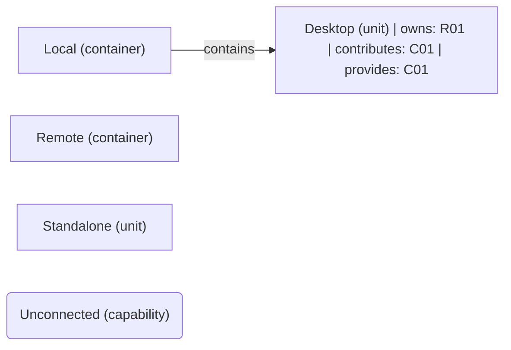

# VP03 — Responsibilities and capabilities across the architecture

Revision: `0d032e724dc923219596fc5a1cc304cef87aa7d6d0f91f52c5ce2b274bd742e8`.

owns, realizes and provides. Capability is not Feature.

## Responsibilities and capabilities across the architecture

Source facts: [f0023](sdl-source://s0/1380/1401), [f0024](sdl-source://s0/1402/1428), [f0031](sdl-source://s0/1735/1761), [f0036](sdl-source://s0/1917/1940).

Declarations: [Desktop](sdl-source://s0/282/295), [Local](sdl-source://s0/401/417), [Remote](sdl-source://s0/491/508), [Standalone](sdl-source://s0/530/546), [Unconnected](sdl-source://s0/547/570).

## Scope and notation

The complete logical architecture uses contains edges, including isolated components. R keys identify responsibilities on their immediate owners (owns). C keys identify capabilities: contributes summarizes an owns + realizes path; provides records an explicit offered capability. These annotations are not new SDL relations. Realizes is a contribution, not proof of complete or verified realization. Ownership does not imply provision, and provision does not imply realization. Rounded standalone capabilities have neither a represented contributor nor provider. Keys are sorted within this snapshot. Features and runtime allocation belong to other viewpoints.

## Responsibility register

| Key | Functionality | Immediate owner | Capability contributions | Source facts |
| --- | --- | --- | --- | --- |
| R01 | [Display](sdl-source://s0/296/318) | [Desktop](sdl-source://s0/282/295) | [Delivery](sdl-source://s0/261/281) | [f0023](sdl-source://s0/1380/1401), [f0031](sdl-source://s0/1735/1761) |

## Capability register

| Key | Capability | Explicit providers | Contributing responsibilities | Source facts |
| --- | --- | --- | --- | --- |
| C01 | [Delivery](sdl-source://s0/261/281) | [Desktop](sdl-source://s0/282/295) | [Display](sdl-source://s0/296/318) | [f0024](sdl-source://s0/1402/1428), [f0031](sdl-source://s0/1735/1761) |
| C02 | [Unconnected](sdl-source://s0/547/570) | Not specified | Not specified | — |

Not specified means no such fact is declared; it does not assert impossibility.

