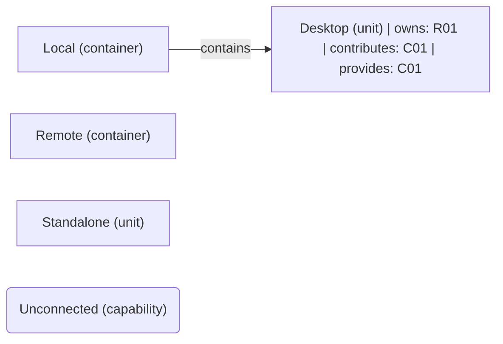

# VP03 — Responsibilities and capabilities across the architecture

Revision: `9fb5d8d1fc95f22386d89e6ebcd0c283be4fb59d7a6782f56a9f0ae735759f79`.

owns, realizes and provides. Capability is not Feature.

## Responsibilities and capabilities across the architecture

Source facts: [f0028](sdl-source://s0/1771/1792), [f0029](sdl-source://s0/1793/1822), [f0030](sdl-source://s0/1823/1848), [f0031](sdl-source://s0/1849/1875), [f0039](sdl-source://s0/2227/2253), [f0044](sdl-source://s0/2409/2432).

Declarations: [Desktop](sdl-source://s0/320/333), [Local](sdl-source://s0/439/455), [Remote](sdl-source://s0/575/592), [Standalone](sdl-source://s0/614/630), [Unconnected](sdl-source://s0/651/674).

## Scope and notation

The complete logical architecture uses contains edges, including isolated components. R keys identify responsibilities on their immediate owners (owns). C keys identify capabilities: contributes summarizes an owns + realizes path; provides records an explicit offered capability. These annotations are not new SDL relations. Realizes is a contribution, not proof of complete or verified realization. Ownership does not imply provision, and provision does not imply realization. Rounded standalone capabilities have neither a represented contributor nor provider. Keys are sorted within this snapshot. Features and runtime allocation belong to other viewpoints.

## Responsibility register

| Key | Functionality | Immediate owner | Capability contributions | Source facts |
| --- | --- | --- | --- | --- |
| R01 | [Display](sdl-source://s0/334/356) | [Desktop](sdl-source://s0/320/333) | [Delivery](sdl-source://s0/299/319) | [f0028](sdl-source://s0/1771/1792), [f0039](sdl-source://s0/2227/2253) |

## Capability register

| Key | Capability | Explicit providers | Contributing responsibilities | Source facts |
| --- | --- | --- | --- | --- |
| C01 | [Delivery](sdl-source://s0/299/319) | [Desktop](sdl-source://s0/320/333) | [Display](sdl-source://s0/334/356) | [f0031](sdl-source://s0/1849/1875), [f0039](sdl-source://s0/2227/2253) |
| C02 | [Unconnected](sdl-source://s0/651/674) | Not specified | Not specified | — |

Not specified means no such fact is declared; it does not assert impossibility.

