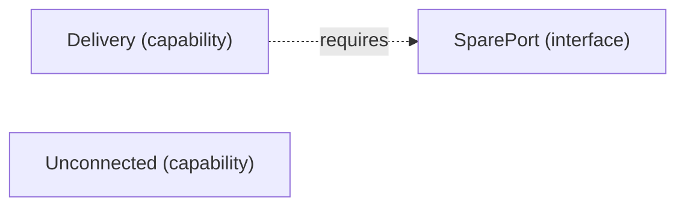

# VP05 — Dependencies by mode

Revision: `9fb5d8d1fc95f22386d89e6ebcd0c283be4fb59d7a6782f56a9f0ae735759f79`.

requires in mode; modes have no implicit inheritance.

## Required interfaces — mode Online

Source facts: [f0025](sdl-source://s0/1679/1722).

Declarations: [Delivery](sdl-source://s0/299/319), [SparePort](sdl-source://s0/593/613), [Unconnected](sdl-source://s0/651/674).

## Scope and notation

Requires states that an Interface is necessary for a Capability in the selected Mode. It does not establish sufficiency, a provider, consumption, transport or runtime execution. Modes have no implicit inheritance. Dashed requires arrows point from Capability to Interface.

Selected mode: **Online**. Mode source: [Online](sdl-source://s0/510/522).

## Capability requirements

| Capability | Required interface in selected mode | Source facts |
| --- | --- | --- |
| [Delivery](sdl-source://s0/299/319) | [SparePort](sdl-source://s0/593/613) | [f0025](sdl-source://s0/1679/1722) |
| [Unconnected](sdl-source://s0/651/674) | No declared requirement | — |

Capabilities without a declared requirement remain visible; no claim of completeness is inferred. Interfaces not required in this mode are outside this projection.

