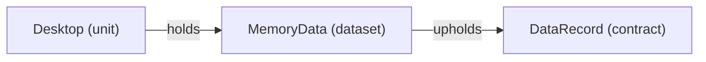
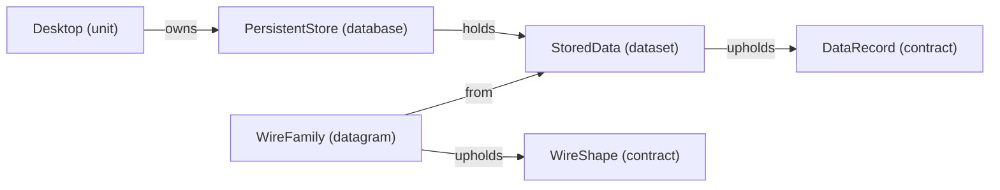

# VP09 — Dataset, Datagram and persistent Database

Revision: `9fb5d8d1fc95f22386d89e6ebcd0c283be4fb59d7a6782f56a9f0ae735759f79`.

Explicit holders, sources, contracts, variants, fields and projections.

## Data origin and holder: MemoryData

Source facts: [f0027](sdl-source://s0/1745/1770), [f0045](sdl-source://s0/2433/2463).

Declarations: [DataRecord](sdl-source://s0/261/281), [Desktop](sdl-source://s0/320/333), [MemoryData](sdl-source://s0/456/475).

## Data origin and holder: StoredData

Source facts: [f0029](sdl-source://s0/1793/1822), [f0047](sdl-source://s0/2492/2525), [f0054](sdl-source://s0/2775/2805), [f0056](sdl-source://s0/2843/2870), [f0057](sdl-source://s0/2871/2900).

Declarations: [DataRecord](sdl-source://s0/261/281), [Desktop](sdl-source://s0/320/333), [PersistentStore](sdl-source://s0/523/548), [StoredData](sdl-source://s0/631/650), [WireFamily](sdl-source://s0/719/739), [WireShape](sdl-source://s0/740/759).

## Scope and notation

Dataset neighborhoods retain explicit from, holds, owns and upholds relations. Database means a persistent data source, not SQL tables, keys, transactions, a storage engine or deployment. Unit-held data has no declared persistence. These are definitions, not runtime instances. Contract completeness is a source assertion, not execution evidence. Optional fields do not imply null, empty, false or zero. Projections do not specify executable transformations. Encoding and bit positions belong to VP10.

## Data definitions

- [MemoryData](sdl-source://s0/456/475) (Dataset): holder [Desktop](sdl-source://s0/320/333); contract [DataRecord](sdl-source://s0/261/281); Unit-held; persistence unspecified. Source facts: [f0027](sdl-source://s0/1745/1770), [f0045](sdl-source://s0/2433/2463).
- [StoredData](sdl-source://s0/631/650) (Dataset): holder [PersistentStore](sdl-source://s0/523/548); contract [DataRecord](sdl-source://s0/261/281); Database-backed persistence. Source facts: [f0047](sdl-source://s0/2492/2525), [f0054](sdl-source://s0/2775/2805).

- [WireFamily](sdl-source://s0/719/739) (Datagram): logical source Dataset [StoredData](sdl-source://s0/631/650); contract [WireShape](sdl-source://s0/740/759). This does not inherit the source's holder or persistence. Source facts: [f0056](sdl-source://s0/2843/2870), [f0057](sdl-source://s0/2871/2900).

## Database register

| Database | Responsible owner | Held Datasets | Source facts |
| --- | --- | --- | --- |
| [PersistentStore](sdl-source://s0/523/548) | [Desktop](sdl-source://s0/320/333) | [StoredData](sdl-source://s0/631/650) | [f0029](sdl-source://s0/1793/1822), [f0047](sdl-source://s0/2492/2525) |
| [UnusedStore](sdl-source://s0/697/718) | [Desktop](sdl-source://s0/320/333) | No Datasets declared | [f0030](sdl-source://s0/1823/1848) |

## Contract register

All Contracts are included, even unused/open definitions. Open a Contract in the navigation tree for its structure diagram. Counts describe explicit shape membership (fields / variants / permitted messages), not runtime coverage.

| Contract | Completeness | Fields / variants / messages | Source fact |
| --- | --- | --- | --- |
| [ChannelBody](sdl-source://s0/149/170) | closed | 1 / 0 / 0 | [f0009](sdl-source://s0/1088/1126) |
| [ChannelEvents](sdl-source://s0/171/194) | closed | 0 / 0 / 2 | [f0011](sdl-source://s0/1163/1203) |
| [DataRecord](sdl-source://s0/261/281) | closed | 1 / 0 / 0 | [f0020](sdl-source://s0/1502/1539) |
| [UnusedShape](sdl-source://s0/675/696) | open | 0 / 0 / 0 | [f0055](sdl-source://s0/2806/2842) |
| [WireShape](sdl-source://s0/740/759) | closed | 0 / 1 / 0 | [f0059](sdl-source://s0/2932/2968) |

## Variant register

| Variant | Contract | Source fact |
| --- | --- | --- |
| [WireVariant](sdl-source://s0/777/797) | [WireShape](sdl-source://s0/740/759) | [f0058](sdl-source://s0/2901/2931) |

## Field register

| Field | Shape owner | Value type | Presence | Source facts |
| --- | --- | --- | --- | --- |
| [ChannelValue](sdl-source://s0/241/260) | [ChannelBody](sdl-source://s0/149/170) | text | required | [f0010](sdl-source://s0/1127/1162), [f0018](sdl-source://s0/1428/1465), [f0019](sdl-source://s0/1466/1501) |
| [DataValue](sdl-source://s0/282/298) | [DataRecord](sdl-source://s0/261/281) | text | required | [f0021](sdl-source://s0/1540/1571), [f0022](sdl-source://s0/1572/1606), [f0023](sdl-source://s0/1607/1639) |
| [WireValue](sdl-source://s0/760/776) | [WireVariant](sdl-source://s0/777/797) | bytes | optional | [f0060](sdl-source://s0/2969/3003), [f0061](sdl-source://s0/3004/3037), [f0062](sdl-source://s0/3038/3070) |

## Shape membership

| Shape | Relation | Member | Source fact |
| --- | --- | --- | --- |
| [ChannelBody](sdl-source://s0/149/170) | has-field | [ChannelValue](sdl-source://s0/241/260) | [f0010](sdl-source://s0/1127/1162) |
| [ChannelEvents](sdl-source://s0/171/194) | permits | [ChannelNotice](sdl-source://s0/195/217) | [f0012](sdl-source://s0/1204/1240) |
| [ChannelEvents](sdl-source://s0/171/194) | permits | [ChannelUpdate](sdl-source://s0/218/240) | [f0013](sdl-source://s0/1241/1277) |
| [DataRecord](sdl-source://s0/261/281) | has-field | [DataValue](sdl-source://s0/282/298) | [f0021](sdl-source://s0/1540/1571) |
| [WireShape](sdl-source://s0/740/759) | defines | [WireVariant](sdl-source://s0/777/797) | [f0058](sdl-source://s0/2901/2931) |
| [WireVariant](sdl-source://s0/777/797) | has-field | [WireValue](sdl-source://s0/760/776) | [f0062](sdl-source://s0/3038/3070) |

## Projection responsibilities

Projects relates Functionality, Dataset and Datagram together; it does not imply a lossless conversion or a runtime call.

| Functionality | Dataset | Datagram | Responsible owner | Source facts |
| --- | --- | --- | --- | --- |
| [Display](sdl-source://s0/334/356) | [StoredData](sdl-source://s0/631/650) | [WireFamily](sdl-source://s0/719/739) | [Desktop](sdl-source://s0/320/333) | [f0028](sdl-source://s0/1771/1792), [f0038](sdl-source://s0/2182/2226) |

