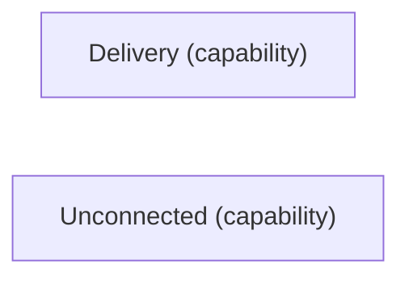

# VP05 — Dependencies by mode

Revision: `799b274252245be2ac5258510067da66a08bb45276538bcbb6482b3189e898c3`.

requires in mode; modes have no implicit inheritance.

## Required interfaces — mode Quiet

Source facts: .

Declarations only.

Declarations: [Delivery](sdl-source://s0/299/319), [Unconnected](sdl-source://s0/773/796).

## Scope and notation

Requires states that an Interface is necessary for a Capability in the selected Mode. It does not establish sufficiency, a provider, consumption, transport or runtime execution. Modes have no implicit inheritance. Dashed requires arrows point from Capability to Interface.

Selected mode: **Quiet**. Mode source: [Quiet](sdl-source://s0/671/682).

No required interfaces are declared for this mode. This does not prove independence or sufficiency.

## Capability requirements

| Capability | Required interface in selected mode | Source facts |
| --- | --- | --- |
| [Delivery](sdl-source://s0/299/319) | No declared requirement | — |
| [Unconnected](sdl-source://s0/773/796) | No declared requirement | — |

Capabilities without a declared requirement remain visible; no claim of completeness is inferred. Interfaces not required in this mode are outside this projection.

