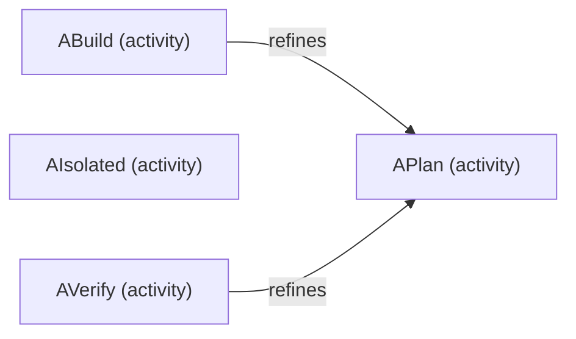
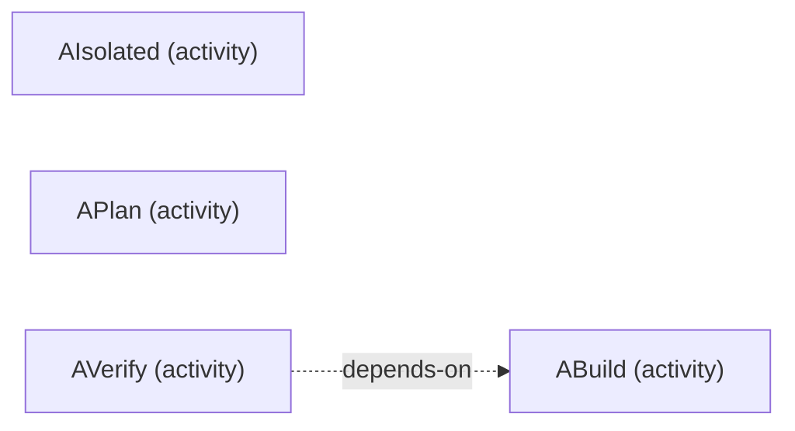

# VP06 — Activities and delivery plan

Revision: `799b274252245be2ac5258510067da66a08bb45276538bcbb6482b3189e898c3`.

refines, addresses, delivers and depends-on; status is an explicit source claim.

## All activities and explicit refinement

Source facts: [f0003](sdl-source://s0/1022/1043), [f0007](sdl-source://s0/1160/1182).

Declarations: [ABuild](sdl-source://s0/34/50), [AIsolated](sdl-source://s0/51/70), [APlan](sdl-source://s0/71/86), [AVerify](sdl-source://s0/87/104).

## Explicit activity prerequisites

Source facts: [f0005](sdl-source://s0/1087/1113).

Declarations: [ABuild](sdl-source://s0/34/50), [AIsolated](sdl-source://s0/51/70), [APlan](sdl-source://s0/71/86), [AVerify](sdl-source://s0/87/104).

## Scope and notation

All declared Activities are retained, including isolated activities. Refines points from detailed to abstract activity; depends-on points from dependent activity to its explicit prerequisite. Decomposition and prerequisites are separate diagrams. Neither relation inherits status or dependencies. No dates, durations, execution order or calendar schedule are inferred.

Implementation status is a source claim, not test evidence or owner acceptance. Addresses models Functionality coverage; delivers models a Feature contribution, not complete delivery; illustrates links an example Scenario, not an executed test.

## Activity register

| Activity | Source-claimed status | Refines | Source facts |
| --- | --- | --- | --- |
| [ABuild](sdl-source://s0/34/50) | implemented | [APlan](sdl-source://s0/71/86) | [f0002](sdl-source://s0/974/1021), [f0003](sdl-source://s0/1022/1043) |
| [AIsolated](sdl-source://s0/51/70) | Unspecified | No declared parent | — |
| [APlan](sdl-source://s0/71/86) | planned | No declared parent | [f0004](sdl-source://s0/1044/1086) |
| [AVerify](sdl-source://s0/87/104) | verified | [APlan](sdl-source://s0/71/86) | [f0006](sdl-source://s0/1114/1159), [f0007](sdl-source://s0/1160/1182) |

## Addressed responsibilities

| Activity | Functionality | Explicit owner | Source facts |
| --- | --- | --- | --- |
| [ABuild](sdl-source://s0/34/50) | [Display](sdl-source://s0/334/356) | [Desktop](sdl-source://s0/320/333) | [f0000](sdl-source://s0/920/945), [f0028](sdl-source://s0/1893/1914) |

## Planned Feature contributions

| Activity | Feature | Source fact |
| --- | --- | --- |
| [ABuild](sdl-source://s0/34/50) | [Navigation](sdl-source://s0/476/495) | [f0001](sdl-source://s0/946/973) |

No illustrative Scenarios are linked to activities.

## Functionality without activity coverage

This lists missing addresses relations in the model, not unimplemented native code.

No unaddressed Functionality declarations in this snapshot. This is not proof of completed implementation.

