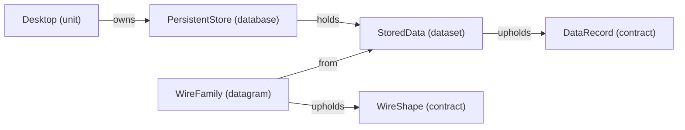

# VP09 — Dataset, Datagram and persistent Database

Revision: `799b274252245be2ac5258510067da66a08bb45276538bcbb6482b3189e898c3`.

Explicit holders, sources, contracts, variants, fields and projections.

## Data origin and holder: MemoryData

Source facts: [f0027](sdl-source://s0/1867/1892), [f0045](sdl-source://s0/2555/2585).

Declarations: [DataRecord](sdl-source://s0/261/281), [Desktop](sdl-source://s0/320/333), [MemoryData](sdl-source://s0/456/475).

## Data origin and holder: StoredData

Source facts: [f0029](sdl-source://s0/1915/1944), [f0067](sdl-source://s0/3433/3466), [f0074](sdl-source://s0/3716/3746), [f0076](sdl-source://s0/3784/3811), [f0077](sdl-source://s0/3812/3841).

Declarations: [DataRecord](sdl-source://s0/261/281), [Desktop](sdl-source://s0/320/333), [PersistentStore](sdl-source://s0/645/670), [StoredData](sdl-source://s0/753/772), [WireFamily](sdl-source://s0/841/861), [WireShape](sdl-source://s0/862/881).

## Scope and notation

Dataset neighborhoods retain explicit from, holds, owns and upholds relations. Database means a persistent data source, not SQL tables, keys, transactions, a storage engine or deployment. Unit-held data has no declared persistence. These are definitions, not runtime instances. Contract completeness is a source assertion, not execution evidence. Optional fields do not imply null, empty, false or zero. Projections do not specify executable transformations. Encoding and bit positions belong to VP10.

## Data definitions

- [MemoryData](sdl-source://s0/456/475) (Dataset): holder [Desktop](sdl-source://s0/320/333); contract [DataRecord](sdl-source://s0/261/281); Unit-held; persistence unspecified. Source facts: [f0027](sdl-source://s0/1867/1892), [f0045](sdl-source://s0/2555/2585).
- [StoredData](sdl-source://s0/753/772) (Dataset): holder [PersistentStore](sdl-source://s0/645/670); contract [DataRecord](sdl-source://s0/261/281); Database-backed persistence. Source facts: [f0067](sdl-source://s0/3433/3466), [f0074](sdl-source://s0/3716/3746).

- [WireFamily](sdl-source://s0/841/861) (Datagram): logical source Dataset [StoredData](sdl-source://s0/753/772); contract [WireShape](sdl-source://s0/862/881). This does not inherit the source's holder or persistence. Source facts: [f0076](sdl-source://s0/3784/3811), [f0077](sdl-source://s0/3812/3841).

## Database register

| Database | Responsible owner | Held Datasets | Source facts |
| --- | --- | --- | --- |
| [PersistentStore](sdl-source://s0/645/670) | [Desktop](sdl-source://s0/320/333) | [StoredData](sdl-source://s0/753/772) | [f0029](sdl-source://s0/1915/1944), [f0067](sdl-source://s0/3433/3466) |
| [UnusedStore](sdl-source://s0/819/840) | [Desktop](sdl-source://s0/320/333) | No Datasets declared | [f0030](sdl-source://s0/1945/1970) |

## Contract register

All Contracts are included, even unused/open definitions. Open a Contract in the navigation tree for its structure diagram. Counts describe explicit shape membership (fields / variants / permitted messages), not runtime coverage.

| Contract | Completeness | Fields / variants / messages | Source fact |
| --- | --- | --- | --- |
| [ChannelBody](sdl-source://s0/149/170) | closed | 1 / 0 / 0 | [f0009](sdl-source://s0/1210/1248) |
| [ChannelEvents](sdl-source://s0/171/194) | closed | 0 / 0 / 2 | [f0011](sdl-source://s0/1285/1325) |
| [DataRecord](sdl-source://s0/261/281) | closed | 1 / 0 / 0 | [f0020](sdl-source://s0/1624/1661) |
| [UnusedShape](sdl-source://s0/797/818) | open | 0 / 0 / 0 | [f0075](sdl-source://s0/3747/3783) |
| [WireShape](sdl-source://s0/862/881) | closed | 1 / 2 / 0 | [f0080](sdl-source://s0/3903/3939) |

## Variant register

| Variant | Contract | Source fact |
| --- | --- | --- |
| [PacketBody](sdl-source://s0/543/562) | [WireShape](sdl-source://s0/862/881) | [f0078](sdl-source://s0/3842/3871) |
| [WireVariant](sdl-source://s0/899/919) | [WireShape](sdl-source://s0/862/881) | [f0079](sdl-source://s0/3872/3902) |

## Field register

| Field | Shape owner | Value type | Presence | Source facts |
| --- | --- | --- | --- | --- |
| [ChannelValue](sdl-source://s0/241/260) | [ChannelBody](sdl-source://s0/149/170) | text | required | [f0010](sdl-source://s0/1249/1284), [f0018](sdl-source://s0/1550/1587), [f0019](sdl-source://s0/1588/1623) |
| [DataValue](sdl-source://s0/282/298) | [DataRecord](sdl-source://s0/261/281) | text | required | [f0021](sdl-source://s0/1662/1693), [f0022](sdl-source://s0/1694/1728), [f0023](sdl-source://s0/1729/1761) |
| [PacketFlag](sdl-source://s0/563/580) | [WireShape](sdl-source://s0/862/881) | boolean | required | [f0055](sdl-source://s0/2935/2970), [f0056](sdl-source://s0/2971/3007), [f0081](sdl-source://s0/3940/3971) |
| [PacketNumber](sdl-source://s0/604/623) | [PacketBody](sdl-source://s0/543/562) | signed | required | [f0053](sdl-source://s0/2864/2898), [f0063](sdl-source://s0/3280/3317), [f0064](sdl-source://s0/3318/3355) |
| [PacketPayload](sdl-source://s0/624/644) | [PacketBody](sdl-source://s0/543/562) | bytes | required | [f0054](sdl-source://s0/2899/2934), [f0065](sdl-source://s0/3356/3394), [f0066](sdl-source://s0/3395/3432) |
| [WireValue](sdl-source://s0/882/898) | [WireVariant](sdl-source://s0/899/919) | bytes | optional | [f0082](sdl-source://s0/3972/4006), [f0083](sdl-source://s0/4007/4040), [f0084](sdl-source://s0/4041/4073) |

## Shape membership

| Shape | Relation | Member | Source fact |
| --- | --- | --- | --- |
| [ChannelBody](sdl-source://s0/149/170) | has-field | [ChannelValue](sdl-source://s0/241/260) | [f0010](sdl-source://s0/1249/1284) |
| [ChannelEvents](sdl-source://s0/171/194) | permits | [ChannelNotice](sdl-source://s0/195/217) | [f0012](sdl-source://s0/1326/1362) |
| [ChannelEvents](sdl-source://s0/171/194) | permits | [ChannelUpdate](sdl-source://s0/218/240) | [f0013](sdl-source://s0/1363/1399) |
| [DataRecord](sdl-source://s0/261/281) | has-field | [DataValue](sdl-source://s0/282/298) | [f0021](sdl-source://s0/1662/1693) |
| [PacketBody](sdl-source://s0/543/562) | has-field | [PacketNumber](sdl-source://s0/604/623) | [f0053](sdl-source://s0/2864/2898) |
| [PacketBody](sdl-source://s0/543/562) | has-field | [PacketPayload](sdl-source://s0/624/644) | [f0054](sdl-source://s0/2899/2934) |
| [WireShape](sdl-source://s0/862/881) | defines | [PacketBody](sdl-source://s0/543/562) | [f0078](sdl-source://s0/3842/3871) |
| [WireShape](sdl-source://s0/862/881) | defines | [WireVariant](sdl-source://s0/899/919) | [f0079](sdl-source://s0/3872/3902) |
| [WireShape](sdl-source://s0/862/881) | has-field | [PacketFlag](sdl-source://s0/563/580) | [f0081](sdl-source://s0/3940/3971) |
| [WireVariant](sdl-source://s0/899/919) | has-field | [WireValue](sdl-source://s0/882/898) | [f0084](sdl-source://s0/4041/4073) |

## Projection responsibilities

Projects relates Functionality, Dataset and Datagram together; it does not imply a lossless conversion or a runtime call.

| Functionality | Dataset | Datagram | Responsible owner | Source facts |
| --- | --- | --- | --- | --- |
| [Display](sdl-source://s0/334/356) | [StoredData](sdl-source://s0/753/772) | [WireFamily](sdl-source://s0/841/861) | [Desktop](sdl-source://s0/320/333) | [f0028](sdl-source://s0/1893/1914), [f0038](sdl-source://s0/2304/2348) |

