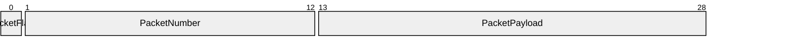

# VP10 — Datagram encoding and packets

Revision: `799b274252245be2ac5258510067da66a08bb45276538bcbb6482b3189e898c3`.

Only closed contracts with validated Encoding and explicit bit positions.

Selection: `{"viewpoint":"VP10","direction":"both","depth":2,"diagram":"VP10-PacketBig"}`.

## Packet: PacketBig / PacketBody — big-endian, most-significant-first

Source facts: [f0047](sdl-source://s0/2614/2643), [f0048](sdl-source://s0/2644/2693), [f0049](sdl-source://s0/2694/2732), [f0050](sdl-source://s0/2733/2773), [f0051](sdl-source://s0/2774/2817), [f0052](sdl-source://s0/2818/2863), [f0053](sdl-source://s0/2864/2898), [f0054](sdl-source://s0/2899/2934), [f0055](sdl-source://s0/2935/2970), [f0056](sdl-source://s0/2971/3007), [f0063](sdl-source://s0/3280/3317), [f0064](sdl-source://s0/3318/3355), [f0065](sdl-source://s0/3356/3394), [f0066](sdl-source://s0/3395/3432), [f0078](sdl-source://s0/3842/3871), [f0079](sdl-source://s0/3872/3902), [f0080](sdl-source://s0/3903/3939), [f0081](sdl-source://s0/3940/3971).

Declarations: [PacketFlag](sdl-source://s0/563/580), [PacketNumber](sdl-source://s0/604/623), [PacketPayload](sdl-source://s0/624/644).

Model gap NO_ENCODING: No fixed wire layout; a logical variant does not define a packet. (WireVariant; mode=).

