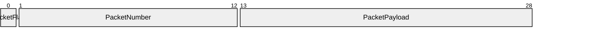

# VP10 — Datagram encoding and packets

Revision: `799b274252245be2ac5258510067da66a08bb45276538bcbb6482b3189e898c3`.

Only closed contracts with validated Encoding and explicit bit positions.

## Packet: PacketBig / PacketBody — big-endian, most-significant-first

Source facts: [f0047](sdl-source://s0/2614/2643), [f0048](sdl-source://s0/2644/2693), [f0049](sdl-source://s0/2694/2732), [f0050](sdl-source://s0/2733/2773), [f0051](sdl-source://s0/2774/2817), [f0052](sdl-source://s0/2818/2863), [f0053](sdl-source://s0/2864/2898), [f0054](sdl-source://s0/2899/2934), [f0055](sdl-source://s0/2935/2970), [f0056](sdl-source://s0/2971/3007), [f0063](sdl-source://s0/3280/3317), [f0064](sdl-source://s0/3318/3355), [f0065](sdl-source://s0/3356/3394), [f0066](sdl-source://s0/3395/3432), [f0078](sdl-source://s0/3842/3871), [f0079](sdl-source://s0/3872/3902), [f0080](sdl-source://s0/3903/3939), [f0081](sdl-source://s0/3940/3971).

Declarations: [PacketFlag](sdl-source://s0/563/580), [PacketNumber](sdl-source://s0/604/623), [PacketPayload](sdl-source://s0/624/644).

## Packet: PacketLittle / PacketBody — little-endian, least-significant-first

Source facts: [f0053](sdl-source://s0/2864/2898), [f0054](sdl-source://s0/2899/2934), [f0055](sdl-source://s0/2935/2970), [f0056](sdl-source://s0/2971/3007), [f0057](sdl-source://s0/3008/3040), [f0058](sdl-source://s0/3041/3094), [f0059](sdl-source://s0/3095/3139), [f0060](sdl-source://s0/3140/3183), [f0061](sdl-source://s0/3184/3230), [f0062](sdl-source://s0/3231/3279), [f0063](sdl-source://s0/3280/3317), [f0064](sdl-source://s0/3318/3355), [f0065](sdl-source://s0/3356/3394), [f0066](sdl-source://s0/3395/3432), [f0078](sdl-source://s0/3842/3871), [f0079](sdl-source://s0/3872/3902), [f0080](sdl-source://s0/3903/3939), [f0081](sdl-source://s0/3940/3971).

Declarations: [PacketFlag](sdl-source://s0/563/580), [PacketNumber](sdl-source://s0/604/623), [PacketPayload](sdl-source://s0/624/644).

## Scope and notation

Each packet is one validated fixed Encoding of a Variant in a closed Contract. Bit offsets are logical contract positions; byte-order and bit-order are explicit source declarations. The view does not implement serialization or infer padding, variable lengths, optional-field layout or an executable codec. Header fields belong to the Contract; variant fields belong to the Variant. Independent Encodings are never concatenated.

## Encoding register

### Encoding [PacketBig](sdl-source://s0/523/542)

Variant [PacketBody](sdl-source://s0/543/562); Contract [WireShape](sdl-source://s0/862/881) (closed); big-endian, most-significant-first; 29 bits. Source facts: [f0047](sdl-source://s0/2614/2643), [f0048](sdl-source://s0/2644/2693), [f0049](sdl-source://s0/2694/2732), [f0078](sdl-source://s0/3842/3871), [f0080](sdl-source://s0/3903/3939).

Datagram family: [WireFamily](sdl-source://s0/841/861). Source facts: [f0077](sdl-source://s0/3812/3841).

| Field | Shape owner | Bit range / width | Value type / presence | Source facts |
| --- | --- | --- | --- | --- |
| [PacketFlag](sdl-source://s0/563/580) | Header: [WireShape](sdl-source://s0/862/881) | 0–0 / 1 | boolean / required | [f0050](sdl-source://s0/2733/2773), [f0055](sdl-source://s0/2935/2970), [f0056](sdl-source://s0/2971/3007), [f0081](sdl-source://s0/3940/3971) |
| [PacketNumber](sdl-source://s0/604/623) | Variant: [PacketBody](sdl-source://s0/543/562) | 1–12 / 12 | signed / required | [f0051](sdl-source://s0/2774/2817), [f0053](sdl-source://s0/2864/2898), [f0063](sdl-source://s0/3280/3317), [f0064](sdl-source://s0/3318/3355) |
| [PacketPayload](sdl-source://s0/624/644) | Variant: [PacketBody](sdl-source://s0/543/562) | 13–28 / 16 | bytes / required | [f0052](sdl-source://s0/2818/2863), [f0054](sdl-source://s0/2899/2934), [f0065](sdl-source://s0/3356/3394), [f0066](sdl-source://s0/3395/3432) |

### Encoding [PacketLittle](sdl-source://s0/581/603)

Variant [PacketBody](sdl-source://s0/543/562); Contract [WireShape](sdl-source://s0/862/881) (closed); little-endian, least-significant-first; 29 bits. Source facts: [f0057](sdl-source://s0/3008/3040), [f0058](sdl-source://s0/3041/3094), [f0059](sdl-source://s0/3095/3139), [f0078](sdl-source://s0/3842/3871), [f0080](sdl-source://s0/3903/3939).

Datagram family: [WireFamily](sdl-source://s0/841/861). Source facts: [f0077](sdl-source://s0/3812/3841).

| Field | Shape owner | Bit range / width | Value type / presence | Source facts |
| --- | --- | --- | --- | --- |
| [PacketFlag](sdl-source://s0/563/580) | Header: [WireShape](sdl-source://s0/862/881) | 0–0 / 1 | boolean / required | [f0055](sdl-source://s0/2935/2970), [f0056](sdl-source://s0/2971/3007), [f0060](sdl-source://s0/3140/3183), [f0081](sdl-source://s0/3940/3971) |
| [PacketNumber](sdl-source://s0/604/623) | Variant: [PacketBody](sdl-source://s0/543/562) | 1–12 / 12 | signed / required | [f0053](sdl-source://s0/2864/2898), [f0061](sdl-source://s0/3184/3230), [f0063](sdl-source://s0/3280/3317), [f0064](sdl-source://s0/3318/3355) |
| [PacketPayload](sdl-source://s0/624/644) | Variant: [PacketBody](sdl-source://s0/543/562) | 13–28 / 16 | bytes / required | [f0054](sdl-source://s0/2899/2934), [f0062](sdl-source://s0/3231/3279), [f0065](sdl-source://s0/3356/3394), [f0066](sdl-source://s0/3395/3432) |

## Variant coverage

A logical Variant does not define a wire layout. Missing Encoding is a modeling gap, not evidence about native codec implementation.

| Variant | Contract | Encodings | Source facts |
| --- | --- | --- | --- |
| [PacketBody](sdl-source://s0/543/562) | [WireShape](sdl-source://s0/862/881) | [PacketBig](sdl-source://s0/523/542), [PacketLittle](sdl-source://s0/581/603) | [f0047](sdl-source://s0/2614/2643), [f0057](sdl-source://s0/3008/3040), [f0078](sdl-source://s0/3842/3871) |
| [WireVariant](sdl-source://s0/899/919) | [WireShape](sdl-source://s0/862/881) | No Encoding declared; no fixed wire layout | [f0079](sdl-source://s0/3872/3902) |

