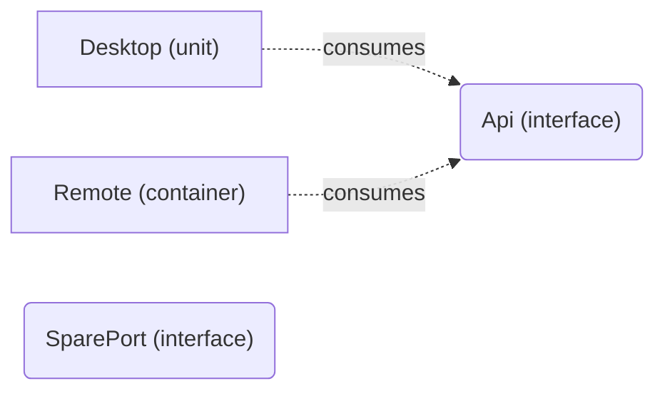

# VP04 — Interfaces and collaboration

Revision: `b3011e73ee1eece4b0df6861ea14435f312f5e54fcccec544f2b0ceebfe7012e`.

consumes records use; no provider, Channel or executable message flow is inferred.

## All declared interfaces and explicit consumers

Source facts: [f0026](sdl-source://s0/1845/1866), [f0072](sdl-source://s0/3596/3616).

Declarations: [Api](sdl-source://s0/105/119), [Desktop](sdl-source://s0/320/333), [Remote](sdl-source://s0/697/714), [SparePort](sdl-source://s0/715/735).

## Scope and notation

Every declared Interface is included, even without a consumer. Rectangles are explicit Unit/Container consumers; rounded nodes are interfaces. Dashed consumes arrows point from consumer to interface and mean designed use, not an observed call or mandatory availability. No provider, Channel, transport, call order or mode necessity is inferred. Units without consumes facts are outside this projection; VP02 shows the complete logical structure.

## Interface register

| Interface | Explicit consumers | Source facts |
| --- | --- | --- |
| [Api](sdl-source://s0/105/119) | [Desktop](sdl-source://s0/320/333), [Remote](sdl-source://s0/697/714) | [f0026](sdl-source://s0/1845/1866), [f0072](sdl-source://s0/3596/3616) |
| [SparePort](sdl-source://s0/715/735) | No declared consumer | — |

No declared consumer means no consumes fact is present; it does not prove an unused or unnecessary interface. Provider information is not expressed by consumes.

## Interface use

No Channel or provider is inferred.

| Consumer | Interface | Fact | Line |
| --- | --- | --- | --- |
| Desktop | Api | [f0026](sdl-source://s0/1845/1866) | 75 |
| Remote | Api | [f0072](sdl-source://s0/3596/3616) | 121 |

