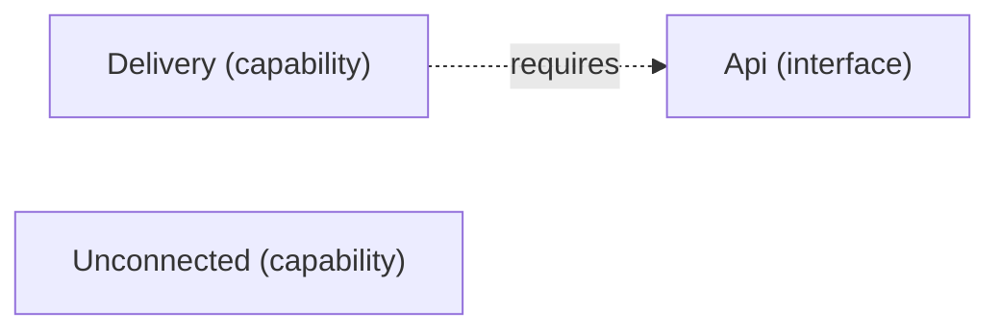

# VP05 — Dependencies by mode

Revision: `b3011e73ee1eece4b0df6861ea14435f312f5e54fcccec544f2b0ceebfe7012e`.

requires in mode; modes have no implicit inheritance.

## Required interfaces — mode Offline

Source facts: [f0024](sdl-source://s0/1762/1800).

Declarations: [Api](sdl-source://s0/105/119), [Delivery](sdl-source://s0/299/319), [Unconnected](sdl-source://s0/773/796).

## Scope and notation

Requires states that an Interface is necessary for a Capability in the selected Mode. It does not establish sufficiency, a provider, consumption, transport or runtime execution. Modes have no implicit inheritance. Dashed requires arrows point from Capability to Interface.

Selected mode: **Offline**. Mode source: [Offline](sdl-source://s0/496/509).

## Capability requirements

| Capability | Required interface in selected mode | Source facts |
| --- | --- | --- |
| [Delivery](sdl-source://s0/299/319) | [Api](sdl-source://s0/105/119) | [f0024](sdl-source://s0/1762/1800) |
| [Unconnected](sdl-source://s0/773/796) | No declared requirement | — |

Capabilities without a declared requirement remain visible; no claim of completeness is inferred. Interfaces not required in this mode are outside this projection.

