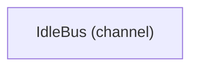

# VP08 — Channel contracts and sequences

Revision: `b3011e73ee1eece4b0df6861ea14435f312f5e54fcccec544f2b0ceebfe7012e`.

Explicit scenario steps validated against permits, participation, mode and request/result correlation.

## Channel Bus — mode Online

Source facts: [f0033](sdl-source://s0/2061/2120), [f0034](sdl-source://s0/2121/2180), [f0073](sdl-source://s0/3617/3677), [f0074](sdl-source://s0/3678/3738).

Declarations: [Bus](sdl-source://s0/136/148), [Desktop](sdl-source://s0/320/333), [Remote](sdl-source://s0/697/714).

## Channel IdleBus — mode Online

Source facts: .

Declarations only.

Declarations: [IdleBus](sdl-source://s0/404/420).

## Scope and notation

Channel topology is partitioned into one diagram per declared Channel, retaining every participant and binding. Repeated participants refer to the same source declarations. The diagrams show explicit participation in one Mode, not runtime delivery, transport or execution order. Sender arrows point from participant to Channel; receiver arrows point from Channel to participant. Each arrow groups all messages for that participant/channel/role; the register retains every binding and source proof. Modes have no implicit inheritance.

Selected mode: **Online**. Mode source: [Online](sdl-source://s0/510/522).

## Participation register

| Participant | Channel | Role | Message | Source fact |
| --- | --- | --- | --- | --- |
| [Desktop](sdl-source://s0/320/333) | [Bus](sdl-source://s0/136/148) | sender | [ChannelNotice](sdl-source://s0/195/217) | [f0033](sdl-source://s0/2061/2120) |
| [Desktop](sdl-source://s0/320/333) | [Bus](sdl-source://s0/136/148) | sender | [ChannelUpdate](sdl-source://s0/218/240) | [f0034](sdl-source://s0/2121/2180) |
| [Remote](sdl-source://s0/697/714) | [Bus](sdl-source://s0/136/148) | receiver | [ChannelNotice](sdl-source://s0/195/217) | [f0073](sdl-source://s0/3617/3677) |
| [Remote](sdl-source://s0/697/714) | [Bus](sdl-source://s0/136/148) | receiver | [ChannelUpdate](sdl-source://s0/218/240) | [f0074](sdl-source://s0/3678/3738) |

## Channel register

All declared Channels are retained, including those without participants in the selected mode. Contracts and permitted messages are global model declarations, not evidence of delivery in any mode.

| Channel | Contract | Permitted messages | Source facts |
| --- | --- | --- | --- |
| [Bus](sdl-source://s0/136/148) | [ChannelEvents](sdl-source://s0/171/194) | [ChannelNotice](sdl-source://s0/195/217), [ChannelUpdate](sdl-source://s0/218/240) | [f0008](sdl-source://s0/1183/1209), [f0012](sdl-source://s0/1326/1362), [f0013](sdl-source://s0/1363/1399) |
| [IdleBus](sdl-source://s0/404/420) | [ChannelEvents](sdl-source://s0/171/194) | [ChannelNotice](sdl-source://s0/195/217), [ChannelUpdate](sdl-source://s0/218/240) | [f0045](sdl-source://s0/2583/2613), [f0012](sdl-source://s0/1326/1362), [f0013](sdl-source://s0/1363/1399) |

## Scenario index

Open an individual Scenario in the navigation tree for its validated sequence. Source links below open declarations; steps are not concatenated across Scenarios. Completeness is a source assertion, not evidence of execution or test coverage. Preconditions and postconditions are not inferred.

| Scenario | Mode | Completeness | Steps | Source facts |
| --- | --- | --- | --- | --- |
| [Example](sdl-source://s0/357/374) | [Online](sdl-source://s0/510/522) | open | 1 | [f0042](sdl-source://s0/2459/2491), [f0043](sdl-source://s0/2492/2515), [f0044](sdl-source://s0/2516/2582) |

## Derived MessageSet

| Channel | Mode | Datagram | Sender | Receiver | Source IDs |
| --- | --- | --- | --- | --- | --- |
| Bus | Online | ChannelNotice | Desktop | Remote | [f0008](sdl-source://s0/1183/1209), [f0012](sdl-source://s0/1326/1362), [f0015](sdl-source://s0/1440/1474), [f0033](sdl-source://s0/2061/2120), [f0073](sdl-source://s0/3617/3677) |
| Bus | Online | ChannelUpdate | Desktop | Remote | [f0008](sdl-source://s0/1183/1209), [f0013](sdl-source://s0/1363/1399), [f0017](sdl-source://s0/1515/1549), [f0034](sdl-source://s0/2121/2180), [f0074](sdl-source://s0/3678/3738) |

Model gap NO_PARTICIPANTS: No explicit participation. (IdleBus; mode=).

