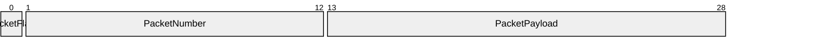

# VP10 — Datagram encoding and packets

Revision: `b3011e73ee1eece4b0df6861ea14435f312f5e54fcccec544f2b0ceebfe7012e`.

Only closed contracts with validated Encoding and explicit bit positions.

Selection: `{"viewpoint":"VP10","direction":"both","depth":2,"diagram":"VP10-PacketBig"}`.

## Packet: PacketBig / PacketBody — big-endian, most-significant-first

Source facts: [f0049](sdl-source://s0/2697/2726), [f0050](sdl-source://s0/2727/2776), [f0051](sdl-source://s0/2777/2815), [f0052](sdl-source://s0/2816/2856), [f0053](sdl-source://s0/2857/2900), [f0054](sdl-source://s0/2901/2946), [f0055](sdl-source://s0/2947/2981), [f0056](sdl-source://s0/2982/3017), [f0057](sdl-source://s0/3018/3053), [f0058](sdl-source://s0/3054/3090), [f0065](sdl-source://s0/3363/3400), [f0066](sdl-source://s0/3401/3438), [f0067](sdl-source://s0/3439/3477), [f0068](sdl-source://s0/3478/3515), [f0080](sdl-source://s0/3925/3954), [f0081](sdl-source://s0/3955/3985), [f0082](sdl-source://s0/3986/4022), [f0083](sdl-source://s0/4023/4054).

Declarations: [PacketFlag](sdl-source://s0/563/580), [PacketNumber](sdl-source://s0/604/623), [PacketPayload](sdl-source://s0/624/644).

Model gap NO_ENCODING: No fixed wire layout; a logical variant does not define a packet. (WireVariant; mode=).

