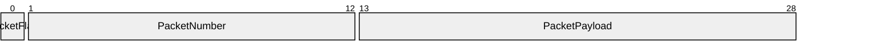

# VP10 — Datagram encoding and packets

Revision: `b3011e73ee1eece4b0df6861ea14435f312f5e54fcccec544f2b0ceebfe7012e`.

Only closed contracts with validated Encoding and explicit bit positions.

## Packet: PacketBig / PacketBody — big-endian, most-significant-first

Source facts: [f0049](sdl-source://s0/2697/2726), [f0050](sdl-source://s0/2727/2776), [f0051](sdl-source://s0/2777/2815), [f0052](sdl-source://s0/2816/2856), [f0053](sdl-source://s0/2857/2900), [f0054](sdl-source://s0/2901/2946), [f0055](sdl-source://s0/2947/2981), [f0056](sdl-source://s0/2982/3017), [f0057](sdl-source://s0/3018/3053), [f0058](sdl-source://s0/3054/3090), [f0065](sdl-source://s0/3363/3400), [f0066](sdl-source://s0/3401/3438), [f0067](sdl-source://s0/3439/3477), [f0068](sdl-source://s0/3478/3515), [f0080](sdl-source://s0/3925/3954), [f0081](sdl-source://s0/3955/3985), [f0082](sdl-source://s0/3986/4022), [f0083](sdl-source://s0/4023/4054).

Declarations: [PacketFlag](sdl-source://s0/563/580), [PacketNumber](sdl-source://s0/604/623), [PacketPayload](sdl-source://s0/624/644).

## Packet: PacketLittle / PacketBody — little-endian, least-significant-first

Source facts: [f0055](sdl-source://s0/2947/2981), [f0056](sdl-source://s0/2982/3017), [f0057](sdl-source://s0/3018/3053), [f0058](sdl-source://s0/3054/3090), [f0059](sdl-source://s0/3091/3123), [f0060](sdl-source://s0/3124/3177), [f0061](sdl-source://s0/3178/3222), [f0062](sdl-source://s0/3223/3266), [f0063](sdl-source://s0/3267/3313), [f0064](sdl-source://s0/3314/3362), [f0065](sdl-source://s0/3363/3400), [f0066](sdl-source://s0/3401/3438), [f0067](sdl-source://s0/3439/3477), [f0068](sdl-source://s0/3478/3515), [f0080](sdl-source://s0/3925/3954), [f0081](sdl-source://s0/3955/3985), [f0082](sdl-source://s0/3986/4022), [f0083](sdl-source://s0/4023/4054).

Declarations: [PacketFlag](sdl-source://s0/563/580), [PacketNumber](sdl-source://s0/604/623), [PacketPayload](sdl-source://s0/624/644).

## Scope and notation

Each packet is one validated fixed Encoding of a Variant in a closed Contract. Bit offsets are logical contract positions; byte-order and bit-order are explicit source declarations. The view does not implement serialization or infer padding, variable lengths, optional-field layout or an executable codec. Header fields belong to the Contract; variant fields belong to the Variant. Independent Encodings are never concatenated.

## Encoding register

### Encoding [PacketBig](sdl-source://s0/523/542)

Variant [PacketBody](sdl-source://s0/543/562); Contract [WireShape](sdl-source://s0/862/881) (closed); big-endian, most-significant-first; 29 bits. Source facts: [f0049](sdl-source://s0/2697/2726), [f0050](sdl-source://s0/2727/2776), [f0051](sdl-source://s0/2777/2815), [f0080](sdl-source://s0/3925/3954), [f0082](sdl-source://s0/3986/4022).

Datagram family: [WireFamily](sdl-source://s0/841/861). Source facts: [f0079](sdl-source://s0/3895/3924).

| Field | Shape owner | Bit range / width | Value type / presence | Source facts |
| --- | --- | --- | --- | --- |
| [PacketFlag](sdl-source://s0/563/580) | Header: [WireShape](sdl-source://s0/862/881) | 0–0 / 1 | boolean / required | [f0052](sdl-source://s0/2816/2856), [f0057](sdl-source://s0/3018/3053), [f0058](sdl-source://s0/3054/3090), [f0083](sdl-source://s0/4023/4054) |
| [PacketNumber](sdl-source://s0/604/623) | Variant: [PacketBody](sdl-source://s0/543/562) | 1–12 / 12 | signed / required | [f0053](sdl-source://s0/2857/2900), [f0055](sdl-source://s0/2947/2981), [f0065](sdl-source://s0/3363/3400), [f0066](sdl-source://s0/3401/3438) |
| [PacketPayload](sdl-source://s0/624/644) | Variant: [PacketBody](sdl-source://s0/543/562) | 13–28 / 16 | bytes / required | [f0054](sdl-source://s0/2901/2946), [f0056](sdl-source://s0/2982/3017), [f0067](sdl-source://s0/3439/3477), [f0068](sdl-source://s0/3478/3515) |

### Encoding [PacketLittle](sdl-source://s0/581/603)

Variant [PacketBody](sdl-source://s0/543/562); Contract [WireShape](sdl-source://s0/862/881) (closed); little-endian, least-significant-first; 29 bits. Source facts: [f0059](sdl-source://s0/3091/3123), [f0060](sdl-source://s0/3124/3177), [f0061](sdl-source://s0/3178/3222), [f0080](sdl-source://s0/3925/3954), [f0082](sdl-source://s0/3986/4022).

Datagram family: [WireFamily](sdl-source://s0/841/861). Source facts: [f0079](sdl-source://s0/3895/3924).

| Field | Shape owner | Bit range / width | Value type / presence | Source facts |
| --- | --- | --- | --- | --- |
| [PacketFlag](sdl-source://s0/563/580) | Header: [WireShape](sdl-source://s0/862/881) | 0–0 / 1 | boolean / required | [f0057](sdl-source://s0/3018/3053), [f0058](sdl-source://s0/3054/3090), [f0062](sdl-source://s0/3223/3266), [f0083](sdl-source://s0/4023/4054) |
| [PacketNumber](sdl-source://s0/604/623) | Variant: [PacketBody](sdl-source://s0/543/562) | 1–12 / 12 | signed / required | [f0055](sdl-source://s0/2947/2981), [f0063](sdl-source://s0/3267/3313), [f0065](sdl-source://s0/3363/3400), [f0066](sdl-source://s0/3401/3438) |
| [PacketPayload](sdl-source://s0/624/644) | Variant: [PacketBody](sdl-source://s0/543/562) | 13–28 / 16 | bytes / required | [f0056](sdl-source://s0/2982/3017), [f0064](sdl-source://s0/3314/3362), [f0067](sdl-source://s0/3439/3477), [f0068](sdl-source://s0/3478/3515) |

## Variant coverage

A logical Variant does not define a wire layout. Missing Encoding is a modeling gap, not evidence about native codec implementation.

| Variant | Contract | Encodings | Source facts |
| --- | --- | --- | --- |
| [PacketBody](sdl-source://s0/543/562) | [WireShape](sdl-source://s0/862/881) | [PacketBig](sdl-source://s0/523/542), [PacketLittle](sdl-source://s0/581/603) | [f0049](sdl-source://s0/2697/2726), [f0059](sdl-source://s0/3091/3123), [f0080](sdl-source://s0/3925/3954) |
| [WireVariant](sdl-source://s0/899/919) | [WireShape](sdl-source://s0/862/881) | No Encoding declared; no fixed wire layout | [f0081](sdl-source://s0/3955/3985) |

