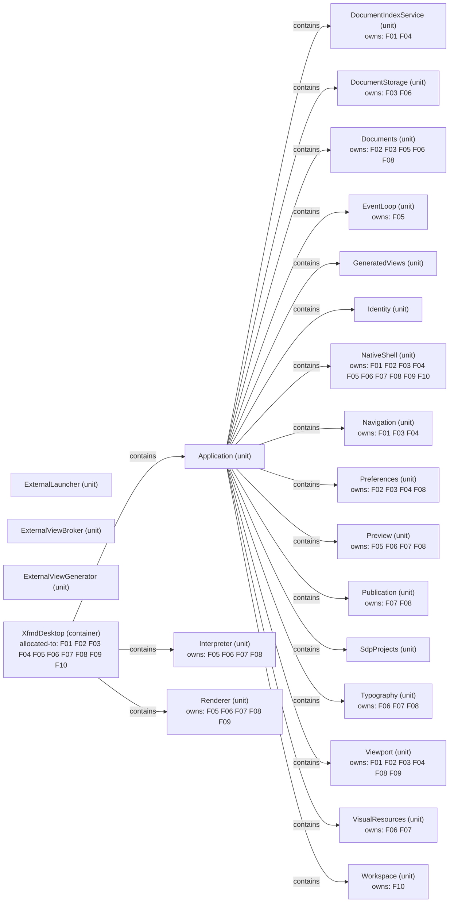

# VP07 — Features across the architecture

Revision: `e2a2f39e5c78476bb1bba08e406114367eb59953f02a63e952e435c880d24007`.

contributes-to, owns and explicit allocated-to per mode. Unspecified allocation is reported as a gap.

## Complete logical architecture and feature realization — mode NormalDesktop

Source facts: f0019, f0020, f0021, f0022, f0023, f0024, f0025, f0026, f0027, f0028, f0029, f0030, f0031, f0032, f0033, f0034, f0046, f0047, f0049, f0050, f0051, f0129, f0130, f0135, f0136, f0176, f0177, f0178, f0181, f0207, f0208, f0209, f0210, f0211, f0222, f0232, f0233, f0274, f0275, f0276, f0280, f0281, f0349, f0350, f0351, f0352, f0353, f0354, f0355, f0356, f0357, f0358, f0484, f0485, f0523, f0524, f0525, f0531, f0532, f0533, f0534, f0535, f0539, f0540, f0544, f0545, f0576, f0587, f0588, f0589, f0590, f0600, f0601, f0602, f0603, f0625, f0626, f0627, f0652, f0687, f0688, f0717, f0718, f0719, f0720, f0721, f0740, f0741, f0742, f0747, f0837, f0838, f0839, f0840, f0841, f0842, f0844, f0845, f0846, f0889, f0890, f0891, f0907, f0908, f0909, f0910, f0911, f0912, f0913, f0936, f0937, f0938, f0944, f0946, f0947, f0948, f0949, f0965, f0966, f0983, f0984, f0996, f0997, f0999, f1000, f1013, f1014, f1015, f1016, f1017, f1018, f1019, f1020, f1022, f1031, f1032, f1033.

## Scope and notation

All declared Systems, containers and units form the logical architecture base, including isolated declarations. Rectangles show the complete structural base with contains edges. Feature keys annotate logical owners (owns) and selected-mode containers (allocated-to), derived only through explicit Functionality contribution paths. Rounded standalone Features have no represented placement. These annotations are not new direct SDL relations. This is decomposition and responsibility, not an inferred deployment or call graph.

Selected mode: **NormalDesktop**. Only this mode's explicit allocated-to edges are included. Ownership does not imply allocation; missing placement is reported below.

## Feature legend

| Key | Feature |
| --- | --- |
| F01 | ChapterNavigation |
| F02 | ConfigurableScrolling |
| F03 | DocumentNavigation |
| F04 | DocumentReferences |
| F05 | LivePreview |
| F06 | MarkdownPresentation |
| F07 | MermaidDiagrams |
| F08 | PagedPublication |
| F09 | SynchronizedScrolling |
| F10 | WorkPathNavigation |

## Feature contributions

| Feature | Functionality | Logical owner | Allocation in selected scope | Source facts |
| --- | --- | --- | --- | --- |
| ChapterNavigation | DocumentIndex | DocumentIndexService | XfmdDesktop | f0177, f0181, f0176 |
| ChapterNavigation | NavigationHistory | Navigation | XfmdDesktop | f0588, f0576, f0587 |
| ChapterNavigation | SourceAnchorMapping | Viewport | XfmdDesktop | f0908, f0966, f0907 |
| ChapterNavigation | WorkspaceControls | NativeShell | XfmdDesktop | f1014, f0545, f1013 |
| ConfigurableScrolling | ApplicationPreferences | Preferences | XfmdDesktop | f0047, f0652, f0046 |
| ConfigurableScrolling | FoxPresentation | NativeShell | XfmdDesktop | f0352, f0544, f0351 |
| ConfigurableScrolling | ScrollMotion | Viewport | XfmdDesktop | f0890, f0965, f0889 |
| ConfigurableScrolling | SourceAnchorMapping | Viewport | XfmdDesktop | f0909, f0966, f0907 |
| ConfigurableScrolling | TextEditing | Documents | XfmdDesktop | f0937, f0233, f0936 |
| ConfigurableScrolling | WorkspaceControls | NativeShell | XfmdDesktop | f1015, f0545, f1013 |
| DocumentNavigation | ApplicationPreferences | Preferences | XfmdDesktop | f0049, f0652, f0046 |
| DocumentNavigation | DocumentSession | Documents | XfmdDesktop | f0208, f0232, f0207 |
| DocumentNavigation | FoxPresentation | NativeShell | XfmdDesktop | f0353, f0544, f0351 |
| DocumentNavigation | LocalFileStorage | DocumentStorage | XfmdDesktop | f0524, f0222, f0523 |
| DocumentNavigation | NavigationHistory | Navigation | XfmdDesktop | f0589, f0576, f0587 |
| DocumentNavigation | SourceAnchorMapping | Viewport | XfmdDesktop | f0910, f0966, f0907 |
| DocumentNavigation | WorkspaceControls | NativeShell | XfmdDesktop | f1016, f0545, f1013 |
| DocumentReferences | ApplicationPreferences | Preferences | XfmdDesktop | f0050, f0652, f0046 |
| DocumentReferences | DocumentIndex | DocumentIndexService | XfmdDesktop | f0178, f0181, f0176 |
| DocumentReferences | NavigationHistory | Navigation | XfmdDesktop | f0590, f0576, f0587 |
| DocumentReferences | SourceAnchorMapping | Viewport | XfmdDesktop | f0911, f0966, f0907 |
| DocumentReferences | WorkspaceControls | NativeShell | XfmdDesktop | f1017, f0545, f1013 |
| LivePreview | DocumentSession | Documents | XfmdDesktop | f0209, f0232, f0207 |
| LivePreview | EventScheduling | EventLoop | XfmdDesktop | f0281, f0276, f0280 |
| LivePreview | FoxPresentation | NativeShell | XfmdDesktop | f0354, f0544, f0351 |
| LivePreview | MarkdownInterpretation | Interpreter | XfmdDesktop | f0532, f0484, f0531 |
| LivePreview | PreviewPipeline | Preview | XfmdDesktop | f0718, f0687, f0717 |
| LivePreview | RenderLayout | Renderer | XfmdDesktop | f0838, f0846, f0837 |
| LivePreview | TextEditing | Documents | XfmdDesktop | f0938, f0233, f0936 |
| MarkdownPresentation | DocumentSession | Documents | XfmdDesktop | f0210, f0232, f0207 |
| MarkdownPresentation | EmbeddedVisuals | VisualResources | XfmdDesktop | f0275, f0984, f0274 |
| MarkdownPresentation | FoxPresentation | NativeShell | XfmdDesktop | f0355, f0544, f0351 |
| MarkdownPresentation | LocalFileStorage | DocumentStorage | XfmdDesktop | f0525, f0222, f0523 |
| MarkdownPresentation | MarkdownInterpretation | Interpreter | XfmdDesktop | f0533, f0484, f0531 |
| MarkdownPresentation | PageComposition | Renderer | XfmdDesktop | f0601, f0845, f0600 |
| MarkdownPresentation | PreviewPipeline | Preview | XfmdDesktop | f0719, f0687, f0717 |
| MarkdownPresentation | PreviewTextSelection | Preview | XfmdDesktop | f0741, f0688, f0740 |
| MarkdownPresentation | RenderLayout | Renderer | XfmdDesktop | f0839, f0846, f0837 |
| MarkdownPresentation | TypographyAndDrawing | Typography | XfmdDesktop | f0947, f0944, f0946 |
| MarkdownPresentation | WorkspaceControls | NativeShell | XfmdDesktop | f1018, f0545, f1013 |
| MermaidDiagrams | DiagramLayout | Renderer | XfmdDesktop | f0130, f0844, f0129 |
| MermaidDiagrams | DiagramPreparation | VisualResources | XfmdDesktop | f0136, f0983, f0135 |
| MermaidDiagrams | FoxPresentation | NativeShell | XfmdDesktop | f0356, f0544, f0351 |
| MermaidDiagrams | MarkdownInterpretation | Interpreter | XfmdDesktop | f0534, f0484, f0531 |
| MermaidDiagrams | MermaidInterpretation | Interpreter | XfmdDesktop | f0540, f0485, f0539 |
| MermaidDiagrams | PageComposition | Renderer | XfmdDesktop | f0602, f0845, f0600 |
| MermaidDiagrams | PdfExport | Publication | XfmdDesktop | f0626, f0747, f0625 |
| MermaidDiagrams | PreviewPipeline | Preview | XfmdDesktop | f0720, f0687, f0717 |
| MermaidDiagrams | PreviewTextSelection | Preview | XfmdDesktop | f0742, f0688, f0740 |
| MermaidDiagrams | RenderLayout | Renderer | XfmdDesktop | f0840, f0846, f0837 |
| MermaidDiagrams | TypographyAndDrawing | Typography | XfmdDesktop | f0948, f0944, f0946 |
| PagedPublication | ApplicationPreferences | Preferences | XfmdDesktop | f0051, f0652, f0046 |
| PagedPublication | DocumentSession | Documents | XfmdDesktop | f0211, f0232, f0207 |
| PagedPublication | FoxPresentation | NativeShell | XfmdDesktop | f0357, f0544, f0351 |
| PagedPublication | MarkdownInterpretation | Interpreter | XfmdDesktop | f0535, f0484, f0531 |
| PagedPublication | PageComposition | Renderer | XfmdDesktop | f0603, f0845, f0600 |
| PagedPublication | PdfExport | Publication | XfmdDesktop | f0627, f0747, f0625 |
| PagedPublication | PreviewPipeline | Preview | XfmdDesktop | f0721, f0687, f0717 |
| PagedPublication | RenderLayout | Renderer | XfmdDesktop | f0841, f0846, f0837 |
| PagedPublication | SourceAnchorMapping | Viewport | XfmdDesktop | f0912, f0966, f0907 |
| PagedPublication | TypographyAndDrawing | Typography | XfmdDesktop | f0949, f0944, f0946 |
| PagedPublication | WorkspaceControls | NativeShell | XfmdDesktop | f1019, f0545, f1013 |
| SynchronizedScrolling | FoxPresentation | NativeShell | XfmdDesktop | f0358, f0544, f0351 |
| SynchronizedScrolling | RenderLayout | Renderer | XfmdDesktop | f0842, f0846, f0837 |
| SynchronizedScrolling | ScrollMotion | Viewport | XfmdDesktop | f0891, f0965, f0889 |
| SynchronizedScrolling | SourceAnchorMapping | Viewport | XfmdDesktop | f0913, f0966, f0907 |
| SynchronizedScrolling | WorkspaceControls | NativeShell | XfmdDesktop | f1020, f0545, f1013 |
| WorkPathNavigation | FilteredFileTree | Workspace | XfmdDesktop | f0350, f0999, f0349 |
| WorkPathNavigation | WorkPathHistory | Workspace | XfmdDesktop | f0997, f1000, f0996 |
| WorkPathNavigation | WorkspaceControls | NativeShell | XfmdDesktop | f1022, f0545, f1013 |

