# VP07 — Features across the architecture

Revision: `e2a2f39e5c78476bb1bba08e406114367eb59953f02a63e952e435c880d24007`.

contributes-to, owns and explicit allocated-to per mode. Unspecified allocation is reported as a gap.

## Complete logical architecture and feature realization — mode NormalDesktop

```mermaid
flowchart LR
    n_Application["Application (unit)"]
    n_ApplicationPreferences(["ApplicationPreferences (functionality)"])
    n_ChapterNavigation{{"ChapterNavigation (feature)"}}
    n_ConfigurableScrolling{{"ConfigurableScrolling (feature)"}}
    n_DiagramLayout(["DiagramLayout (functionality)"])
    n_DiagramPreparation(["DiagramPreparation (functionality)"])
    n_DocumentIndex(["DocumentIndex (functionality)"])
    n_DocumentIndexService["DocumentIndexService (unit)"]
    n_DocumentNavigation{{"DocumentNavigation (feature)"}}
    n_DocumentReferences{{"DocumentReferences (feature)"}}
    n_DocumentSession(["DocumentSession (functionality)"])
    n_DocumentStorage["DocumentStorage (unit)"]
    n_Documents["Documents (unit)"]
    n_EmbeddedVisuals(["EmbeddedVisuals (functionality)"])
    n_EventLoop["EventLoop (unit)"]
    n_EventScheduling(["EventScheduling (functionality)"])
    n_ExternalLauncher["ExternalLauncher (unit)"]
    n_ExternalViewBroker["ExternalViewBroker (unit)"]
    n_ExternalViewGenerator["ExternalViewGenerator (unit)"]
    n_FilteredFileTree(["FilteredFileTree (functionality)"])
    n_FoxPresentation(["FoxPresentation (functionality)"])
    n_GeneratedViews["GeneratedViews (unit)"]
    n_Identity["Identity (unit)"]
    n_Interpreter["Interpreter (unit)"]
    n_LivePreview{{"LivePreview (feature)"}}
    n_LocalFileStorage(["LocalFileStorage (functionality)"])
    n_MarkdownInterpretation(["MarkdownInterpretation (functionality)"])
    n_MarkdownPresentation{{"MarkdownPresentation (feature)"}}
    n_MermaidDiagrams{{"MermaidDiagrams (feature)"}}
    n_MermaidInterpretation(["MermaidInterpretation (functionality)"])
    n_NativeShell["NativeShell (unit)"]
    n_Navigation["Navigation (unit)"]
    n_NavigationHistory(["NavigationHistory (functionality)"])
    n_PageComposition(["PageComposition (functionality)"])
    n_PagedPublication{{"PagedPublication (feature)"}}
    n_PdfExport(["PdfExport (functionality)"])
    n_Preferences["Preferences (unit)"]
    n_Preview["Preview (unit)"]
    n_PreviewPipeline(["PreviewPipeline (functionality)"])
    n_PreviewTextSelection(["PreviewTextSelection (functionality)"])
    n_Publication["Publication (unit)"]
    n_RenderLayout(["RenderLayout (functionality)"])
    n_Renderer["Renderer (unit)"]
    n_ScrollMotion(["ScrollMotion (functionality)"])
    n_SdpProjects["SdpProjects (unit)"]
    n_SourceAnchorMapping(["SourceAnchorMapping (functionality)"])
    n_SynchronizedScrolling{{"SynchronizedScrolling (feature)"}}
    n_TextEditing(["TextEditing (functionality)"])
    n_Typography["Typography (unit)"]
    n_TypographyAndDrawing(["TypographyAndDrawing (functionality)"])
    n_Viewport["Viewport (unit)"]
    n_VisualResources["VisualResources (unit)"]
    n_WorkPathHistory(["WorkPathHistory (functionality)"])
    n_WorkPathNavigation{{"WorkPathNavigation (feature)"}}
    n_Workspace["Workspace (unit)"]
    n_WorkspaceControls(["WorkspaceControls (functionality)"])
    n_XfmdDesktop["XfmdDesktop (container)"]
    n_Application -->|contains| n_DocumentIndexService
    n_Application -->|contains| n_DocumentStorage
    n_Application -->|contains| n_Documents
    n_Application -->|contains| n_EventLoop
    n_Application -->|contains| n_GeneratedViews
    n_Application -->|contains| n_Identity
    n_Application -->|contains| n_NativeShell
    n_Application -->|contains| n_Navigation
    n_Application -->|contains| n_Preferences
    n_Application -->|contains| n_Preview
    n_Application -->|contains| n_Publication
    n_Application -->|contains| n_SdpProjects
    n_Application -->|contains| n_Typography
    n_Application -->|contains| n_Viewport
    n_Application -->|contains| n_VisualResources
    n_Application -->|contains| n_Workspace
    n_ApplicationPreferences -->|allocated-to| n_XfmdDesktop
    n_ApplicationPreferences -.->|contributes-to| n_ConfigurableScrolling
    n_ApplicationPreferences -.->|contributes-to| n_DocumentNavigation
    n_ApplicationPreferences -.->|contributes-to| n_DocumentReferences
    n_ApplicationPreferences -.->|contributes-to| n_PagedPublication
    n_DiagramLayout -->|allocated-to| n_XfmdDesktop
    n_DiagramLayout -.->|contributes-to| n_MermaidDiagrams
    n_DiagramPreparation -->|allocated-to| n_XfmdDesktop
    n_DiagramPreparation -.->|contributes-to| n_MermaidDiagrams
    n_DocumentIndex -->|allocated-to| n_XfmdDesktop
    n_DocumentIndex -.->|contributes-to| n_ChapterNavigation
    n_DocumentIndex -.->|contributes-to| n_DocumentReferences
    n_DocumentIndexService -->|owns| n_DocumentIndex
    n_DocumentSession -->|allocated-to| n_XfmdDesktop
    n_DocumentSession -.->|contributes-to| n_DocumentNavigation
    n_DocumentSession -.->|contributes-to| n_LivePreview
    n_DocumentSession -.->|contributes-to| n_MarkdownPresentation
    n_DocumentSession -.->|contributes-to| n_PagedPublication
    n_DocumentStorage -->|owns| n_LocalFileStorage
    n_Documents -->|owns| n_DocumentSession
    n_Documents -->|owns| n_TextEditing
    n_EmbeddedVisuals -->|allocated-to| n_XfmdDesktop
    n_EmbeddedVisuals -.->|contributes-to| n_MarkdownPresentation
    n_EventLoop -->|owns| n_EventScheduling
    n_EventScheduling -->|allocated-to| n_XfmdDesktop
    n_EventScheduling -.->|contributes-to| n_LivePreview
    n_FilteredFileTree -->|allocated-to| n_XfmdDesktop
    n_FilteredFileTree -.->|contributes-to| n_WorkPathNavigation
    n_FoxPresentation -->|allocated-to| n_XfmdDesktop
    n_FoxPresentation -.->|contributes-to| n_ConfigurableScrolling
    n_FoxPresentation -.->|contributes-to| n_DocumentNavigation
    n_FoxPresentation -.->|contributes-to| n_LivePreview
    n_FoxPresentation -.->|contributes-to| n_MarkdownPresentation
    n_FoxPresentation -.->|contributes-to| n_MermaidDiagrams
    n_FoxPresentation -.->|contributes-to| n_PagedPublication
    n_FoxPresentation -.->|contributes-to| n_SynchronizedScrolling
    n_Interpreter -->|owns| n_MarkdownInterpretation
    n_Interpreter -->|owns| n_MermaidInterpretation
    n_LocalFileStorage -->|allocated-to| n_XfmdDesktop
    n_LocalFileStorage -.->|contributes-to| n_DocumentNavigation
    n_LocalFileStorage -.->|contributes-to| n_MarkdownPresentation
    n_MarkdownInterpretation -->|allocated-to| n_XfmdDesktop
    n_MarkdownInterpretation -.->|contributes-to| n_LivePreview
    n_MarkdownInterpretation -.->|contributes-to| n_MarkdownPresentation
    n_MarkdownInterpretation -.->|contributes-to| n_MermaidDiagrams
    n_MarkdownInterpretation -.->|contributes-to| n_PagedPublication
    n_MermaidInterpretation -->|allocated-to| n_XfmdDesktop
    n_MermaidInterpretation -.->|contributes-to| n_MermaidDiagrams
    n_NativeShell -->|owns| n_FoxPresentation
    n_NativeShell -->|owns| n_WorkspaceControls
    n_Navigation -->|owns| n_NavigationHistory
    n_NavigationHistory -->|allocated-to| n_XfmdDesktop
    n_NavigationHistory -.->|contributes-to| n_ChapterNavigation
    n_NavigationHistory -.->|contributes-to| n_DocumentNavigation
    n_NavigationHistory -.->|contributes-to| n_DocumentReferences
    n_PageComposition -->|allocated-to| n_XfmdDesktop
    n_PageComposition -.->|contributes-to| n_MarkdownPresentation
    n_PageComposition -.->|contributes-to| n_MermaidDiagrams
    n_PageComposition -.->|contributes-to| n_PagedPublication
    n_PdfExport -->|allocated-to| n_XfmdDesktop
    n_PdfExport -.->|contributes-to| n_MermaidDiagrams
    n_PdfExport -.->|contributes-to| n_PagedPublication
    n_Preferences -->|owns| n_ApplicationPreferences
    n_Preview -->|owns| n_PreviewPipeline
    n_Preview -->|owns| n_PreviewTextSelection
    n_PreviewPipeline -->|allocated-to| n_XfmdDesktop
    n_PreviewPipeline -.->|contributes-to| n_LivePreview
    n_PreviewPipeline -.->|contributes-to| n_MarkdownPresentation
    n_PreviewPipeline -.->|contributes-to| n_MermaidDiagrams
    n_PreviewPipeline -.->|contributes-to| n_PagedPublication
    n_PreviewTextSelection -->|allocated-to| n_XfmdDesktop
    n_PreviewTextSelection -.->|contributes-to| n_MarkdownPresentation
    n_PreviewTextSelection -.->|contributes-to| n_MermaidDiagrams
    n_Publication -->|owns| n_PdfExport
    n_RenderLayout -->|allocated-to| n_XfmdDesktop
    n_RenderLayout -.->|contributes-to| n_LivePreview
    n_RenderLayout -.->|contributes-to| n_MarkdownPresentation
    n_RenderLayout -.->|contributes-to| n_MermaidDiagrams
    n_RenderLayout -.->|contributes-to| n_PagedPublication
    n_RenderLayout -.->|contributes-to| n_SynchronizedScrolling
    n_Renderer -->|owns| n_DiagramLayout
    n_Renderer -->|owns| n_PageComposition
    n_Renderer -->|owns| n_RenderLayout
    n_ScrollMotion -->|allocated-to| n_XfmdDesktop
    n_ScrollMotion -.->|contributes-to| n_ConfigurableScrolling
    n_ScrollMotion -.->|contributes-to| n_SynchronizedScrolling
    n_SourceAnchorMapping -->|allocated-to| n_XfmdDesktop
    n_SourceAnchorMapping -.->|contributes-to| n_ChapterNavigation
    n_SourceAnchorMapping -.->|contributes-to| n_ConfigurableScrolling
    n_SourceAnchorMapping -.->|contributes-to| n_DocumentNavigation
    n_SourceAnchorMapping -.->|contributes-to| n_DocumentReferences
    n_SourceAnchorMapping -.->|contributes-to| n_PagedPublication
    n_SourceAnchorMapping -.->|contributes-to| n_SynchronizedScrolling
    n_TextEditing -->|allocated-to| n_XfmdDesktop
    n_TextEditing -.->|contributes-to| n_ConfigurableScrolling
    n_TextEditing -.->|contributes-to| n_LivePreview
    n_Typography -->|owns| n_TypographyAndDrawing
    n_TypographyAndDrawing -->|allocated-to| n_XfmdDesktop
    n_TypographyAndDrawing -.->|contributes-to| n_MarkdownPresentation
    n_TypographyAndDrawing -.->|contributes-to| n_MermaidDiagrams
    n_TypographyAndDrawing -.->|contributes-to| n_PagedPublication
    n_Viewport -->|owns| n_ScrollMotion
    n_Viewport -->|owns| n_SourceAnchorMapping
    n_VisualResources -->|owns| n_DiagramPreparation
    n_VisualResources -->|owns| n_EmbeddedVisuals
    n_WorkPathHistory -->|allocated-to| n_XfmdDesktop
    n_WorkPathHistory -.->|contributes-to| n_WorkPathNavigation
    n_Workspace -->|owns| n_FilteredFileTree
    n_Workspace -->|owns| n_WorkPathHistory
    n_WorkspaceControls -->|allocated-to| n_XfmdDesktop
    n_WorkspaceControls -.->|contributes-to| n_ChapterNavigation
    n_WorkspaceControls -.->|contributes-to| n_ConfigurableScrolling
    n_WorkspaceControls -.->|contributes-to| n_DocumentNavigation
    n_WorkspaceControls -.->|contributes-to| n_DocumentReferences
    n_WorkspaceControls -.->|contributes-to| n_MarkdownPresentation
    n_WorkspaceControls -.->|contributes-to| n_PagedPublication
    n_WorkspaceControls -.->|contributes-to| n_SynchronizedScrolling
    n_WorkspaceControls -.->|contributes-to| n_WorkPathNavigation
    n_XfmdDesktop -->|contains| n_Application
    n_XfmdDesktop -->|contains| n_Interpreter
    n_XfmdDesktop -->|contains| n_Renderer
```

Source facts: f0019, f0020, f0021, f0022, f0023, f0024, f0025, f0026, f0027, f0028, f0029, f0030, f0031, f0032, f0033, f0034, f0046, f0047, f0049, f0050, f0051, f0129, f0130, f0135, f0136, f0176, f0177, f0178, f0181, f0207, f0208, f0209, f0210, f0211, f0222, f0232, f0233, f0274, f0275, f0276, f0280, f0281, f0349, f0350, f0351, f0352, f0353, f0354, f0355, f0356, f0357, f0358, f0484, f0485, f0523, f0524, f0525, f0531, f0532, f0533, f0534, f0535, f0539, f0540, f0544, f0545, f0576, f0587, f0588, f0589, f0590, f0600, f0601, f0602, f0603, f0625, f0626, f0627, f0652, f0687, f0688, f0717, f0718, f0719, f0720, f0721, f0740, f0741, f0742, f0747, f0837, f0838, f0839, f0840, f0841, f0842, f0844, f0845, f0846, f0889, f0890, f0891, f0907, f0908, f0909, f0910, f0911, f0912, f0913, f0936, f0937, f0938, f0944, f0946, f0947, f0948, f0949, f0965, f0966, f0983, f0984, f0996, f0997, f0999, f1000, f1013, f1014, f1015, f1016, f1017, f1018, f1019, f1020, f1022, f1031, f1032, f1033.

## Scope and notation

All declared Systems, containers and units form the logical architecture base, including isolated declarations. Hexagons are Features; rounded nodes are contributing Functionality. Dotted contributes-to edges overlay feature realization on explicit contains and owns relationships. This is decomposition and responsibility, not an inferred deployment or call graph.

Selected mode: **NormalDesktop**. Only this mode's explicit allocated-to edges are included. Ownership does not imply allocation; missing placement is reported below.

## Feature contributions

| Feature | Functionality | Logical owner | Allocation in selected scope | Contribution fact |
| --- | --- | --- | --- | --- |
| ChapterNavigation | DocumentIndex | DocumentIndexService | XfmdDesktop | f0177 |
| ChapterNavigation | NavigationHistory | Navigation | XfmdDesktop | f0588 |
| ChapterNavigation | SourceAnchorMapping | Viewport | XfmdDesktop | f0908 |
| ChapterNavigation | WorkspaceControls | NativeShell | XfmdDesktop | f1014 |
| ConfigurableScrolling | ApplicationPreferences | Preferences | XfmdDesktop | f0047 |
| ConfigurableScrolling | FoxPresentation | NativeShell | XfmdDesktop | f0352 |
| ConfigurableScrolling | ScrollMotion | Viewport | XfmdDesktop | f0890 |
| ConfigurableScrolling | SourceAnchorMapping | Viewport | XfmdDesktop | f0909 |
| ConfigurableScrolling | TextEditing | Documents | XfmdDesktop | f0937 |
| ConfigurableScrolling | WorkspaceControls | NativeShell | XfmdDesktop | f1015 |
| DocumentNavigation | ApplicationPreferences | Preferences | XfmdDesktop | f0049 |
| DocumentNavigation | DocumentSession | Documents | XfmdDesktop | f0208 |
| DocumentNavigation | FoxPresentation | NativeShell | XfmdDesktop | f0353 |
| DocumentNavigation | LocalFileStorage | DocumentStorage | XfmdDesktop | f0524 |
| DocumentNavigation | NavigationHistory | Navigation | XfmdDesktop | f0589 |
| DocumentNavigation | SourceAnchorMapping | Viewport | XfmdDesktop | f0910 |
| DocumentNavigation | WorkspaceControls | NativeShell | XfmdDesktop | f1016 |
| DocumentReferences | ApplicationPreferences | Preferences | XfmdDesktop | f0050 |
| DocumentReferences | DocumentIndex | DocumentIndexService | XfmdDesktop | f0178 |
| DocumentReferences | NavigationHistory | Navigation | XfmdDesktop | f0590 |
| DocumentReferences | SourceAnchorMapping | Viewport | XfmdDesktop | f0911 |
| DocumentReferences | WorkspaceControls | NativeShell | XfmdDesktop | f1017 |
| LivePreview | DocumentSession | Documents | XfmdDesktop | f0209 |
| LivePreview | EventScheduling | EventLoop | XfmdDesktop | f0281 |
| LivePreview | FoxPresentation | NativeShell | XfmdDesktop | f0354 |
| LivePreview | MarkdownInterpretation | Interpreter | XfmdDesktop | f0532 |
| LivePreview | PreviewPipeline | Preview | XfmdDesktop | f0718 |
| LivePreview | RenderLayout | Renderer | XfmdDesktop | f0838 |
| LivePreview | TextEditing | Documents | XfmdDesktop | f0938 |
| MarkdownPresentation | DocumentSession | Documents | XfmdDesktop | f0210 |
| MarkdownPresentation | EmbeddedVisuals | VisualResources | XfmdDesktop | f0275 |
| MarkdownPresentation | FoxPresentation | NativeShell | XfmdDesktop | f0355 |
| MarkdownPresentation | LocalFileStorage | DocumentStorage | XfmdDesktop | f0525 |
| MarkdownPresentation | MarkdownInterpretation | Interpreter | XfmdDesktop | f0533 |
| MarkdownPresentation | PageComposition | Renderer | XfmdDesktop | f0601 |
| MarkdownPresentation | PreviewPipeline | Preview | XfmdDesktop | f0719 |
| MarkdownPresentation | PreviewTextSelection | Preview | XfmdDesktop | f0741 |
| MarkdownPresentation | RenderLayout | Renderer | XfmdDesktop | f0839 |
| MarkdownPresentation | TypographyAndDrawing | Typography | XfmdDesktop | f0947 |
| MarkdownPresentation | WorkspaceControls | NativeShell | XfmdDesktop | f1018 |
| MermaidDiagrams | DiagramLayout | Renderer | XfmdDesktop | f0130 |
| MermaidDiagrams | DiagramPreparation | VisualResources | XfmdDesktop | f0136 |
| MermaidDiagrams | FoxPresentation | NativeShell | XfmdDesktop | f0356 |
| MermaidDiagrams | MarkdownInterpretation | Interpreter | XfmdDesktop | f0534 |
| MermaidDiagrams | MermaidInterpretation | Interpreter | XfmdDesktop | f0540 |
| MermaidDiagrams | PageComposition | Renderer | XfmdDesktop | f0602 |
| MermaidDiagrams | PdfExport | Publication | XfmdDesktop | f0626 |
| MermaidDiagrams | PreviewPipeline | Preview | XfmdDesktop | f0720 |
| MermaidDiagrams | PreviewTextSelection | Preview | XfmdDesktop | f0742 |
| MermaidDiagrams | RenderLayout | Renderer | XfmdDesktop | f0840 |
| MermaidDiagrams | TypographyAndDrawing | Typography | XfmdDesktop | f0948 |
| PagedPublication | ApplicationPreferences | Preferences | XfmdDesktop | f0051 |
| PagedPublication | DocumentSession | Documents | XfmdDesktop | f0211 |
| PagedPublication | FoxPresentation | NativeShell | XfmdDesktop | f0357 |
| PagedPublication | MarkdownInterpretation | Interpreter | XfmdDesktop | f0535 |
| PagedPublication | PageComposition | Renderer | XfmdDesktop | f0603 |
| PagedPublication | PdfExport | Publication | XfmdDesktop | f0627 |
| PagedPublication | PreviewPipeline | Preview | XfmdDesktop | f0721 |
| PagedPublication | RenderLayout | Renderer | XfmdDesktop | f0841 |
| PagedPublication | SourceAnchorMapping | Viewport | XfmdDesktop | f0912 |
| PagedPublication | TypographyAndDrawing | Typography | XfmdDesktop | f0949 |
| PagedPublication | WorkspaceControls | NativeShell | XfmdDesktop | f1019 |
| SynchronizedScrolling | FoxPresentation | NativeShell | XfmdDesktop | f0358 |
| SynchronizedScrolling | RenderLayout | Renderer | XfmdDesktop | f0842 |
| SynchronizedScrolling | ScrollMotion | Viewport | XfmdDesktop | f0891 |
| SynchronizedScrolling | SourceAnchorMapping | Viewport | XfmdDesktop | f0913 |
| SynchronizedScrolling | WorkspaceControls | NativeShell | XfmdDesktop | f1020 |
| WorkPathNavigation | FilteredFileTree | Workspace | XfmdDesktop | f0350 |
| WorkPathNavigation | WorkPathHistory | Workspace | XfmdDesktop | f0997 |
| WorkPathNavigation | WorkspaceControls | NativeShell | XfmdDesktop | f1022 |

