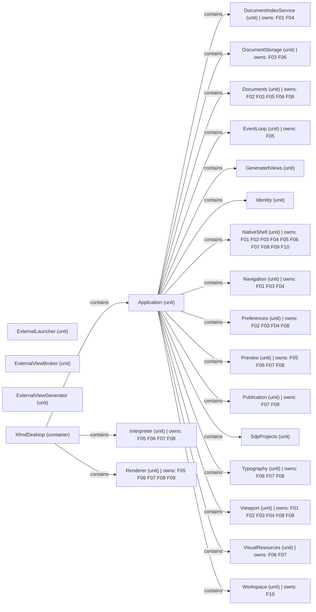

# VP07 — Features across the architecture

Revision: `e2a2f39e5c78476bb1bba08e406114367eb59953f02a63e952e435c880d24007`.

contributes-to, owns and explicit allocated-to per mode. Unspecified allocation is reported as a gap.

## Complete logical architecture and feature realization

Source facts: f0019, f0020, f0021, f0022, f0023, f0024, f0025, f0026, f0027, f0028, f0029, f0030, f0031, f0032, f0033, f0034, f0047, f0049, f0050, f0051, f0130, f0136, f0177, f0178, f0181, f0208, f0209, f0210, f0211, f0222, f0232, f0233, f0275, f0276, f0281, f0350, f0352, f0353, f0354, f0355, f0356, f0357, f0358, f0484, f0485, f0524, f0525, f0532, f0533, f0534, f0535, f0540, f0544, f0545, f0576, f0588, f0589, f0590, f0601, f0602, f0603, f0626, f0627, f0652, f0687, f0688, f0718, f0719, f0720, f0721, f0741, f0742, f0747, f0838, f0839, f0840, f0841, f0842, f0844, f0845, f0846, f0890, f0891, f0908, f0909, f0910, f0911, f0912, f0913, f0937, f0938, f0944, f0947, f0948, f0949, f0965, f0966, f0983, f0984, f0997, f0999, f1000, f1014, f1015, f1016, f1017, f1018, f1019, f1020, f1022, f1031, f1032, f1033.

## Scope and notation

All declared Systems, containers and units form the logical architecture base, including isolated declarations. Rectangles show the complete structural base with contains edges. Feature keys annotate logical owners (owns) and selected-mode containers (allocated-to), derived only through explicit Functionality contribution paths. Rounded standalone Features have no represented placement. These annotations are not new direct SDL relations. This is decomposition and responsibility, not an inferred deployment or call graph.

Logical scope: allocation annotations are intentionally absent. Select a named mode under VP07 in the navigation tree to inspect its explicit placement. No allocations from different modes are combined.

## Feature legend

| Key | Feature |
| --- | --- |
| F01 | ChapterNavigation |
| F02 | ConfigurableScrolling |
| F03 | DocumentNavigation |
| F04 | DocumentReferences |
| F05 | LivePreview |
| F06 | MarkdownPresentation |
| F07 | MermaidDiagrams |
| F08 | PagedPublication |
| F09 | SynchronizedScrolling |
| F10 | WorkPathNavigation |

## Feature contributions

| Feature | Functionality | Logical owner | Allocation in selected scope | Source facts |
| --- | --- | --- | --- | --- |
| ChapterNavigation | DocumentIndex | DocumentIndexService | Not selected (logical scope) | f0177, f0181 |
| ChapterNavigation | NavigationHistory | Navigation | Not selected (logical scope) | f0588, f0576 |
| ChapterNavigation | SourceAnchorMapping | Viewport | Not selected (logical scope) | f0908, f0966 |
| ChapterNavigation | WorkspaceControls | NativeShell | Not selected (logical scope) | f1014, f0545 |
| ConfigurableScrolling | ApplicationPreferences | Preferences | Not selected (logical scope) | f0047, f0652 |
| ConfigurableScrolling | FoxPresentation | NativeShell | Not selected (logical scope) | f0352, f0544 |
| ConfigurableScrolling | ScrollMotion | Viewport | Not selected (logical scope) | f0890, f0965 |
| ConfigurableScrolling | SourceAnchorMapping | Viewport | Not selected (logical scope) | f0909, f0966 |
| ConfigurableScrolling | TextEditing | Documents | Not selected (logical scope) | f0937, f0233 |
| ConfigurableScrolling | WorkspaceControls | NativeShell | Not selected (logical scope) | f1015, f0545 |
| DocumentNavigation | ApplicationPreferences | Preferences | Not selected (logical scope) | f0049, f0652 |
| DocumentNavigation | DocumentSession | Documents | Not selected (logical scope) | f0208, f0232 |
| DocumentNavigation | FoxPresentation | NativeShell | Not selected (logical scope) | f0353, f0544 |
| DocumentNavigation | LocalFileStorage | DocumentStorage | Not selected (logical scope) | f0524, f0222 |
| DocumentNavigation | NavigationHistory | Navigation | Not selected (logical scope) | f0589, f0576 |
| DocumentNavigation | SourceAnchorMapping | Viewport | Not selected (logical scope) | f0910, f0966 |
| DocumentNavigation | WorkspaceControls | NativeShell | Not selected (logical scope) | f1016, f0545 |
| DocumentReferences | ApplicationPreferences | Preferences | Not selected (logical scope) | f0050, f0652 |
| DocumentReferences | DocumentIndex | DocumentIndexService | Not selected (logical scope) | f0178, f0181 |
| DocumentReferences | NavigationHistory | Navigation | Not selected (logical scope) | f0590, f0576 |
| DocumentReferences | SourceAnchorMapping | Viewport | Not selected (logical scope) | f0911, f0966 |
| DocumentReferences | WorkspaceControls | NativeShell | Not selected (logical scope) | f1017, f0545 |
| LivePreview | DocumentSession | Documents | Not selected (logical scope) | f0209, f0232 |
| LivePreview | EventScheduling | EventLoop | Not selected (logical scope) | f0281, f0276 |
| LivePreview | FoxPresentation | NativeShell | Not selected (logical scope) | f0354, f0544 |
| LivePreview | MarkdownInterpretation | Interpreter | Not selected (logical scope) | f0532, f0484 |
| LivePreview | PreviewPipeline | Preview | Not selected (logical scope) | f0718, f0687 |
| LivePreview | RenderLayout | Renderer | Not selected (logical scope) | f0838, f0846 |
| LivePreview | TextEditing | Documents | Not selected (logical scope) | f0938, f0233 |
| MarkdownPresentation | DocumentSession | Documents | Not selected (logical scope) | f0210, f0232 |
| MarkdownPresentation | EmbeddedVisuals | VisualResources | Not selected (logical scope) | f0275, f0984 |
| MarkdownPresentation | FoxPresentation | NativeShell | Not selected (logical scope) | f0355, f0544 |
| MarkdownPresentation | LocalFileStorage | DocumentStorage | Not selected (logical scope) | f0525, f0222 |
| MarkdownPresentation | MarkdownInterpretation | Interpreter | Not selected (logical scope) | f0533, f0484 |
| MarkdownPresentation | PageComposition | Renderer | Not selected (logical scope) | f0601, f0845 |
| MarkdownPresentation | PreviewPipeline | Preview | Not selected (logical scope) | f0719, f0687 |
| MarkdownPresentation | PreviewTextSelection | Preview | Not selected (logical scope) | f0741, f0688 |
| MarkdownPresentation | RenderLayout | Renderer | Not selected (logical scope) | f0839, f0846 |
| MarkdownPresentation | TypographyAndDrawing | Typography | Not selected (logical scope) | f0947, f0944 |
| MarkdownPresentation | WorkspaceControls | NativeShell | Not selected (logical scope) | f1018, f0545 |
| MermaidDiagrams | DiagramLayout | Renderer | Not selected (logical scope) | f0130, f0844 |
| MermaidDiagrams | DiagramPreparation | VisualResources | Not selected (logical scope) | f0136, f0983 |
| MermaidDiagrams | FoxPresentation | NativeShell | Not selected (logical scope) | f0356, f0544 |
| MermaidDiagrams | MarkdownInterpretation | Interpreter | Not selected (logical scope) | f0534, f0484 |
| MermaidDiagrams | MermaidInterpretation | Interpreter | Not selected (logical scope) | f0540, f0485 |
| MermaidDiagrams | PageComposition | Renderer | Not selected (logical scope) | f0602, f0845 |
| MermaidDiagrams | PdfExport | Publication | Not selected (logical scope) | f0626, f0747 |
| MermaidDiagrams | PreviewPipeline | Preview | Not selected (logical scope) | f0720, f0687 |
| MermaidDiagrams | PreviewTextSelection | Preview | Not selected (logical scope) | f0742, f0688 |
| MermaidDiagrams | RenderLayout | Renderer | Not selected (logical scope) | f0840, f0846 |
| MermaidDiagrams | TypographyAndDrawing | Typography | Not selected (logical scope) | f0948, f0944 |
| PagedPublication | ApplicationPreferences | Preferences | Not selected (logical scope) | f0051, f0652 |
| PagedPublication | DocumentSession | Documents | Not selected (logical scope) | f0211, f0232 |
| PagedPublication | FoxPresentation | NativeShell | Not selected (logical scope) | f0357, f0544 |
| PagedPublication | MarkdownInterpretation | Interpreter | Not selected (logical scope) | f0535, f0484 |
| PagedPublication | PageComposition | Renderer | Not selected (logical scope) | f0603, f0845 |
| PagedPublication | PdfExport | Publication | Not selected (logical scope) | f0627, f0747 |
| PagedPublication | PreviewPipeline | Preview | Not selected (logical scope) | f0721, f0687 |
| PagedPublication | RenderLayout | Renderer | Not selected (logical scope) | f0841, f0846 |
| PagedPublication | SourceAnchorMapping | Viewport | Not selected (logical scope) | f0912, f0966 |
| PagedPublication | TypographyAndDrawing | Typography | Not selected (logical scope) | f0949, f0944 |
| PagedPublication | WorkspaceControls | NativeShell | Not selected (logical scope) | f1019, f0545 |
| SynchronizedScrolling | FoxPresentation | NativeShell | Not selected (logical scope) | f0358, f0544 |
| SynchronizedScrolling | RenderLayout | Renderer | Not selected (logical scope) | f0842, f0846 |
| SynchronizedScrolling | ScrollMotion | Viewport | Not selected (logical scope) | f0891, f0965 |
| SynchronizedScrolling | SourceAnchorMapping | Viewport | Not selected (logical scope) | f0913, f0966 |
| SynchronizedScrolling | WorkspaceControls | NativeShell | Not selected (logical scope) | f1020, f0545 |
| WorkPathNavigation | FilteredFileTree | Workspace | Not selected (logical scope) | f0350, f0999 |
| WorkPathNavigation | WorkPathHistory | Workspace | Not selected (logical scope) | f0997, f1000 |
| WorkPathNavigation | WorkspaceControls | NativeShell | Not selected (logical scope) | f1022, f0545 |

