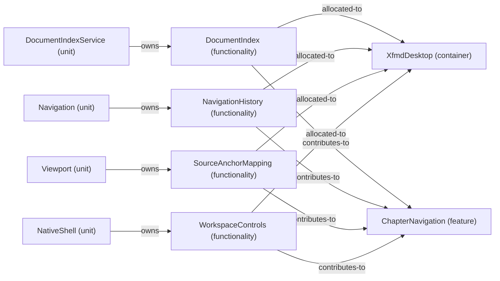

# VP07 — Features across the architecture

Revision: `e2a2f39e5c78476bb1bba08e406114367eb59953f02a63e952e435c880d24007`.

contributes-to, owns and explicit allocated-to per mode. Unspecified allocation is reported as a gap.

Selection: `{"viewpoint":"VP07","direction":"both","depth":2,"diagram":"VP07-ChapterNavigation-NormalDesktop"}`.

## Feature: ChapterNavigation — mode NormalDesktop

Source facts: f0176, f0177, f0181, f0545, f0576, f0587, f0588, f0907, f0908, f0966, f1013, f1014.

