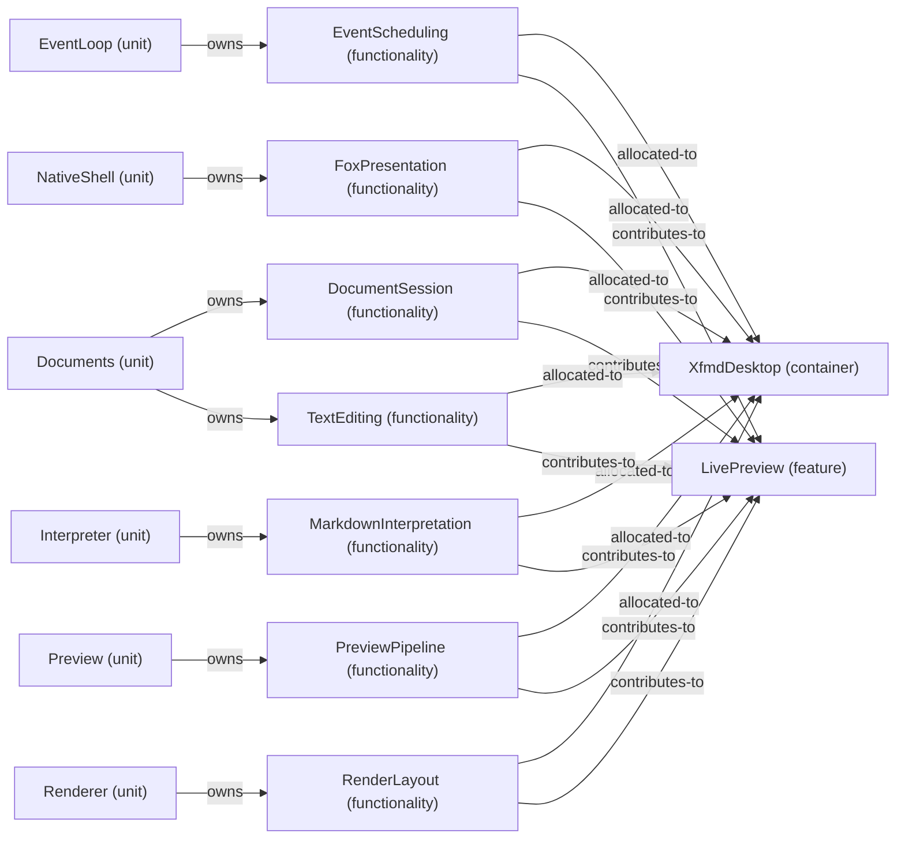

# VP07 — Features across the architecture

Revision: `e2a2f39e5c78476bb1bba08e406114367eb59953f02a63e952e435c880d24007`.

contributes-to, owns and explicit allocated-to per mode. Unspecified allocation is reported as a gap.

Selection: `{"viewpoint":"VP07","direction":"both","depth":2,"diagram":"VP07-LivePreview-NormalDesktop"}`.

## Feature: LivePreview — mode NormalDesktop

Source facts: f0207, f0209, f0232, f0233, f0276, f0280, f0281, f0351, f0354, f0484, f0531, f0532, f0544, f0687, f0717, f0718, f0837, f0838, f0846, f0936, f0938.

