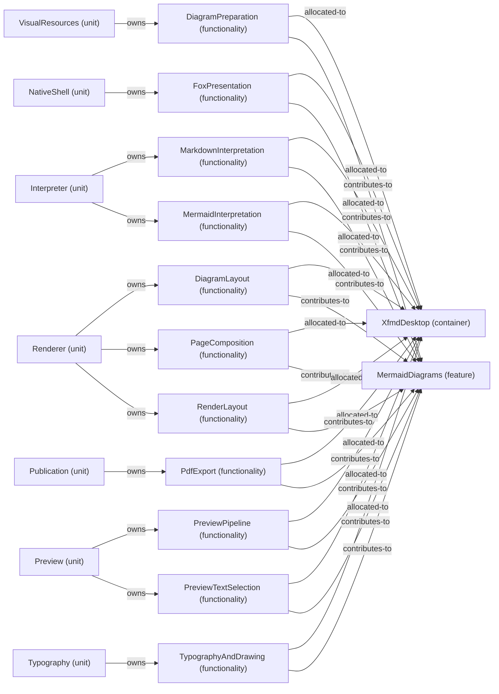

# VP07 — Features across the architecture

Revision: `e2a2f39e5c78476bb1bba08e406114367eb59953f02a63e952e435c880d24007`.

contributes-to, owns and explicit allocated-to per mode. Unspecified allocation is reported as a gap.

Selection: `{"viewpoint":"VP07","direction":"both","depth":2,"diagram":"VP07-MermaidDiagrams-NormalDesktop"}`.

## Feature: MermaidDiagrams — mode NormalDesktop

Source facts: f0129, f0130, f0135, f0136, f0351, f0356, f0484, f0485, f0531, f0534, f0539, f0540, f0544, f0600, f0602, f0625, f0626, f0687, f0688, f0717, f0720, f0740, f0742, f0747, f0837, f0840, f0844, f0845, f0846, f0944, f0946, f0948, f0983.

