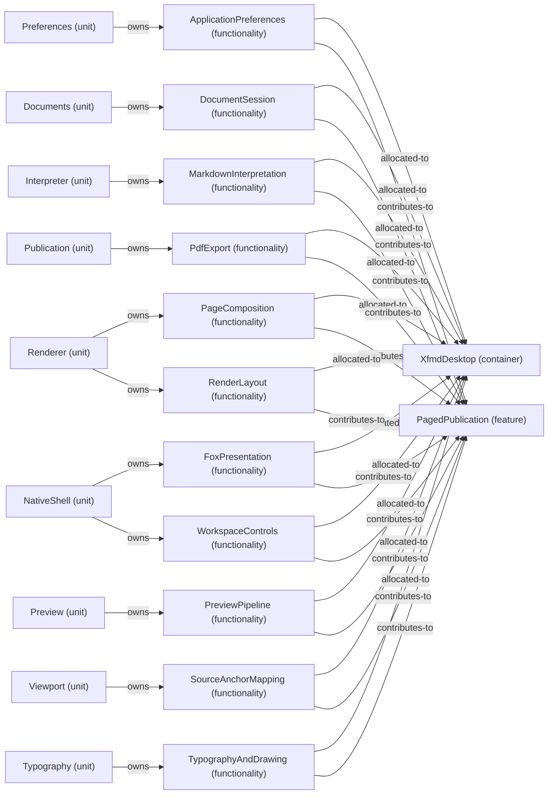

# VP07 — Features across the architecture

Revision: `e2a2f39e5c78476bb1bba08e406114367eb59953f02a63e952e435c880d24007`.

contributes-to, owns and explicit allocated-to per mode. Unspecified allocation is reported as a gap.

Selection: `{"viewpoint":"VP07","direction":"both","depth":2,"diagram":"VP07-PagedPublication-NormalDesktop"}`.

## Feature: PagedPublication — mode NormalDesktop

Source facts: f0046, f0051, f0207, f0211, f0232, f0351, f0357, f0484, f0531, f0535, f0544, f0545, f0600, f0603, f0625, f0627, f0652, f0687, f0717, f0721, f0747, f0837, f0841, f0845, f0846, f0907, f0912, f0944, f0946, f0949, f0966, f1013, f1019.

