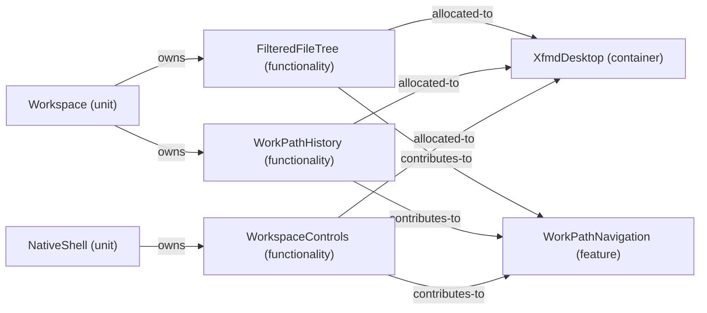

# VP07 — Features across the architecture

Revision: `e2a2f39e5c78476bb1bba08e406114367eb59953f02a63e952e435c880d24007`.

contributes-to, owns and explicit allocated-to per mode. Unspecified allocation is reported as a gap.

Selection: `{"viewpoint":"VP07","direction":"both","depth":2,"diagram":"VP07-WorkPathNavigation-NormalDesktop"}`.

## Feature: WorkPathNavigation — mode NormalDesktop

Source facts: f0349, f0350, f0545, f0996, f0997, f0999, f1000, f1013, f1022.

