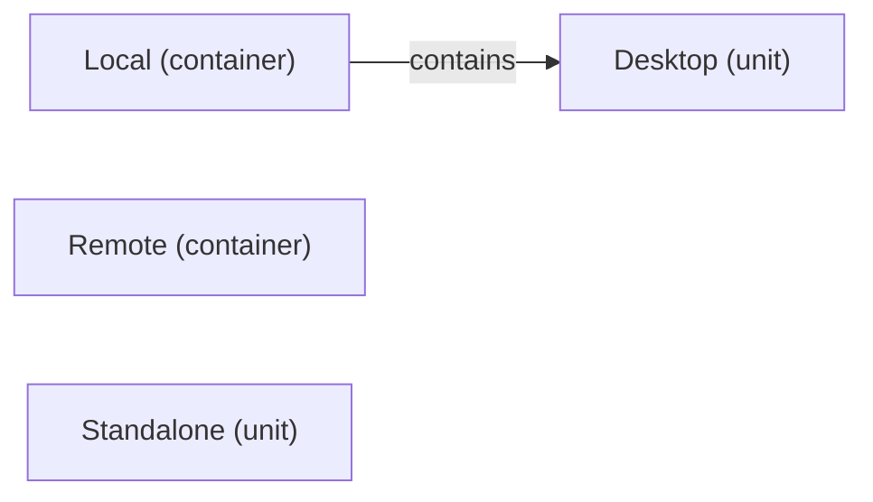

# VP02 — Architecture and logical decomposition

Revision: `e23b851194407692dbd7b263f7ee95d0a529ed793d380383100451e8ae04ddf9`.

Container/Unit and contains; library structure is not deployment allocation.

## Complete logical architecture

Source facts: [f0004](sdl-source://s0/392/415).

Declarations: [Desktop](sdl-source://s0/50/63), [Local](sdl-source://s0/134/150), [Remote](sdl-source://s0/212/229), [Standalone](sdl-source://s0/230/246).

## Scope and notation

All declared Systems, Containers and Units in the checked model are shown, including isolated roots. Arrows mean explicit contains. This is logical decomposition, not deployment, Functionality ownership or runtime communication. No parent or connection is inferred.

## Structural register

| Component | Kind | Explicit parent | Contains facts |
| --- | --- | --- | --- |
| [Local](sdl-source://s0/134/150) | container | Root (no declared parent) | — |
| [Remote](sdl-source://s0/212/229) | container | Root (no declared parent) | — |
| [Desktop](sdl-source://s0/50/63) | unit | Local | [f0004](sdl-source://s0/392/415) |
| [Standalone](sdl-source://s0/230/246) | unit | Root (no declared parent) | — |

