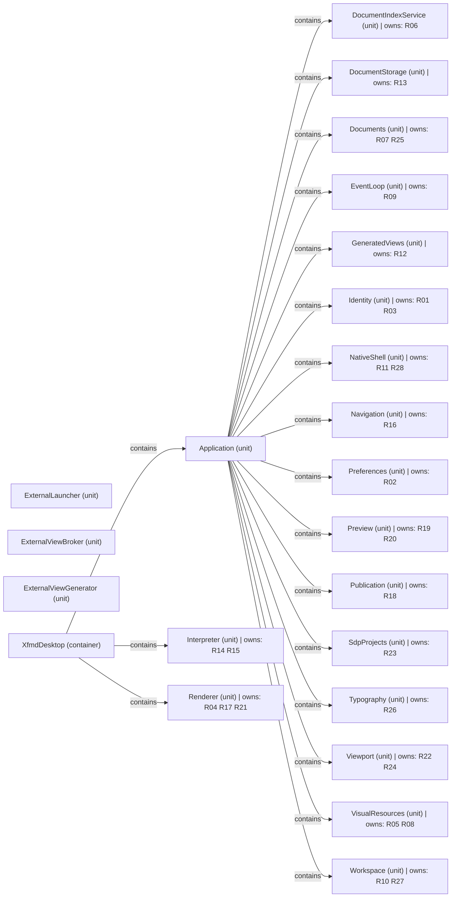

# VP03 — Responsibilities and capabilities across the architecture

Revision: `e2a2f39e5c78476bb1bba08e406114367eb59953f02a63e952e435c880d24007`.

owns, realizes and provides. Capability is not Feature.

## Responsibilities and capabilities across the architecture

Source facts: [f0019](sdl-source://s0/9962/10004), [f0020](sdl-source://s0/10005/10042), [f0021](sdl-source://s0/10043/10074), [f0022](sdl-source://s0/10075/10106), [f0023](sdl-source://s0/10107/10143), [f0024](sdl-source://s0/10144/10174), [f0025](sdl-source://s0/10175/10208), [f0026](sdl-source://s0/10209/10241), [f0027](sdl-source://s0/10242/10275), [f0028](sdl-source://s0/10276/10305), [f0029](sdl-source://s0/10306/10339), [f0030](sdl-source://s0/10340/10373), [f0031](sdl-source://s0/10374/10406), [f0032](sdl-source://s0/10407/10437), [f0033](sdl-source://s0/10438/10475), [f0034](sdl-source://s0/10476/10507), [f0181](sdl-source://s0/19637/19677), [f0222](sdl-source://s0/22045/22083), [f0232](sdl-source://s0/22761/22792), [f0233](sdl-source://s0/22793/22820), [f0276](sdl-source://s0/26300/26331), [f0424](sdl-source://s0/36412/36460), [f0464](sdl-source://s0/39661/39695), [f0465](sdl-source://s0/39696/39724), [f0484](sdl-source://s0/40628/40668), [f0485](sdl-source://s0/40669/40708), [f0544](sdl-source://s0/44107/44140), [f0545](sdl-source://s0/44141/44176), [f0576](sdl-source://s0/46865/46899), [f0652](sdl-source://s0/51599/51639), [f0687](sdl-source://s0/54067/54096), [f0688](sdl-source://s0/54097/54131), [f0747](sdl-source://s0/58530/58557), [f0844](sdl-source://s0/64760/64788), [f0845](sdl-source://s0/64789/64819), [f0846](sdl-source://s0/64820/64847), [f0896](sdl-source://s0/67985/68023), [f0944](sdl-source://s0/70412/70449), [f0965](sdl-source://s0/71501/71528), [f0966](sdl-source://s0/71529/71563), [f0983](sdl-source://s0/72609/72649), [f0984](sdl-source://s0/72650/72687), [f0999](sdl-source://s0/73806/73838), [f1000](sdl-source://s0/73839/73870), [f1031](sdl-source://s0/75691/75724), [f1032](sdl-source://s0/75725/75758), [f1033](sdl-source://s0/75759/75789).

Declarations: [Application](sdl-source://s0/303/320), [DocumentIndexService](sdl-source://s0/1928/1954), [DocumentStorage](sdl-source://s0/2305/2326), [Documents](sdl-source://s0/2327/2342), [EventLoop](sdl-source://s0/2481/2496), [ExternalLauncher](sdl-source://s0/2844/2866), [ExternalViewBroker](sdl-source://s0/2992/3016), [ExternalViewGenerator](sdl-source://s0/3017/3044), [GeneratedViews](sdl-source://s0/3908/3928), [Identity](sdl-source://s0/4053/4067), [Interpreter](sdl-source://s0/4330/4347), [NativeShell](sdl-source://s0/5038/5055), [Navigation](sdl-source://s0/5083/5099), [Preferences](sdl-source://s0/5774/5791), [Preview](sdl-source://s0/6079/6092), [Publication](sdl-source://s0/6298/6315), [Renderer](sdl-source://s0/7189/7203), [SdpProjects](sdl-source://s0/7655/7672), [Typography](sdl-source://s0/8213/8229), [Viewport](sdl-source://s0/8502/8516), [VisualResources](sdl-source://s0/8576/8597), [Workspace](sdl-source://s0/8756/8771), [XfmdDesktop](sdl-source://s0/8949/8971).

## Scope and notation

The complete logical architecture uses contains edges, including isolated components. R keys identify responsibilities on their immediate owners (owns). C keys identify capabilities: contributes summarizes an owns + realizes path; provides records an explicit offered capability. These annotations are not new SDL relations. Realizes is a contribution, not proof of complete or verified realization. Ownership does not imply provision, and provision does not imply realization. Rounded standalone capabilities have neither a represented contributor nor provider. Keys are sorted within this snapshot. Features and runtime allocation belong to other viewpoints.

## Responsibility register

| Key | Functionality | Immediate owner | Capability contributions | Source facts |
| --- | --- | --- | --- | --- |
| R01 | [ApplicationIdentity](sdl-source://s0/321/355) | [Identity](sdl-source://s0/4053/4067) | Not specified | [f0464](sdl-source://s0/39661/39695) |
| R02 | [ApplicationPreferences](sdl-source://s0/356/393) | [Preferences](sdl-source://s0/5774/5791) | Not specified | [f0652](sdl-source://s0/51599/51639) |
| R03 | [BuildIdentity](sdl-source://s0/523/551) | [Identity](sdl-source://s0/4053/4067) | Not specified | [f0465](sdl-source://s0/39696/39724) |
| R04 | [DiagramLayout](sdl-source://s0/1424/1452) | [Renderer](sdl-source://s0/7189/7203) | Not specified | [f0844](sdl-source://s0/64760/64788) |
| R05 | [DiagramPreparation](sdl-source://s0/1547/1580) | [VisualResources](sdl-source://s0/8576/8597) | Not specified | [f0983](sdl-source://s0/72609/72649) |
| R06 | [DocumentIndex](sdl-source://s0/1899/1927) | [DocumentIndexService](sdl-source://s0/1928/1954) | Not specified | [f0181](sdl-source://s0/19637/19677) |
| R07 | [DocumentSession](sdl-source://s0/2176/2206) | [Documents](sdl-source://s0/2327/2342) | Not specified | [f0232](sdl-source://s0/22761/22792) |
| R08 | [EmbeddedVisuals](sdl-source://s0/2450/2480) | [VisualResources](sdl-source://s0/8576/8597) | Not specified | [f0984](sdl-source://s0/72650/72687) |
| R09 | [EventScheduling](sdl-source://s0/2497/2527) | [EventLoop](sdl-source://s0/2481/2496) | Not specified | [f0276](sdl-source://s0/26300/26331) |
| R10 | [FilteredFileTree](sdl-source://s0/3192/3223) | [Workspace](sdl-source://s0/8756/8771) | Not specified | [f0999](sdl-source://s0/73806/73838) |
| R11 | [FoxPresentation](sdl-source://s0/3224/3254) | [NativeShell](sdl-source://s0/5038/5055) | Not specified | [f0544](sdl-source://s0/44107/44140) |
| R12 | [GeneratedDocumentNavigation](sdl-source://s0/3590/3632) | [GeneratedViews](sdl-source://s0/3908/3928) | Not specified | [f0424](sdl-source://s0/36412/36460) |
| R13 | [LocalFileStorage](sdl-source://s0/4776/4807) | [DocumentStorage](sdl-source://s0/2305/2326) | Not specified | [f0222](sdl-source://s0/22045/22083) |
| R14 | [MarkdownInterpretation](sdl-source://s0/4886/4923) | [Interpreter](sdl-source://s0/4330/4347) | Not specified | [f0484](sdl-source://s0/40628/40668) |
| R15 | [MermaidInterpretation](sdl-source://s0/4979/5015) | [Interpreter](sdl-source://s0/4330/4347) | Not specified | [f0485](sdl-source://s0/40669/40708) |
| R16 | [NavigationHistory](sdl-source://s0/5159/5191) | [Navigation](sdl-source://s0/5083/5099) | Not specified | [f0576](sdl-source://s0/46865/46899) |
| R17 | [PageComposition](sdl-source://s0/5345/5375) | [Renderer](sdl-source://s0/7189/7203) | Not specified | [f0845](sdl-source://s0/64789/64819) |
| R18 | [PdfExport](sdl-source://s0/5596/5620) | [Publication](sdl-source://s0/6298/6315) | Not specified | [f0747](sdl-source://s0/58530/58557) |
| R19 | [PreviewPipeline](sdl-source://s0/6154/6184) | [Preview](sdl-source://s0/6079/6092) | Not specified | [f0687](sdl-source://s0/54067/54096) |
| R20 | [PreviewTextSelection](sdl-source://s0/6262/6297) | [Preview](sdl-source://s0/6079/6092) | Not specified | [f0688](sdl-source://s0/54097/54131) |
| R21 | [RenderLayout](sdl-source://s0/7161/7188) | [Renderer](sdl-source://s0/7189/7203) | Not specified | [f0846](sdl-source://s0/64820/64847) |
| R22 | [ScrollMotion](sdl-source://s0/7591/7618) | [Viewport](sdl-source://s0/8502/8516) | Not specified | [f0965](sdl-source://s0/71501/71528) |
| R23 | [SdpProjectNavigation](sdl-source://s0/7619/7654) | [SdpProjects](sdl-source://s0/7655/7672) | Not specified | [f0896](sdl-source://s0/67985/68023) |
| R24 | [SourceAnchorMapping](sdl-source://s0/7868/7902) | [Viewport](sdl-source://s0/8502/8516) | Not specified | [f0966](sdl-source://s0/71529/71563) |
| R25 | [TextEditing](sdl-source://s0/8104/8130) | [Documents](sdl-source://s0/2327/2342) | Not specified | [f0233](sdl-source://s0/22793/22820) |
| R26 | [TypographyAndDrawing](sdl-source://s0/8230/8265) | [Typography](sdl-source://s0/8213/8229) | Not specified | [f0944](sdl-source://s0/70412/70449) |
| R27 | [WorkPathHistory](sdl-source://s0/8697/8727) | [Workspace](sdl-source://s0/8756/8771) | Not specified | [f1000](sdl-source://s0/73839/73870) |
| R28 | [WorkspaceControls](sdl-source://s0/8833/8865) | [NativeShell](sdl-source://s0/5038/5055) | Not specified | [f0545](sdl-source://s0/44141/44176) |

No Capabilities are declared. No capability realization or provision is inferred.

