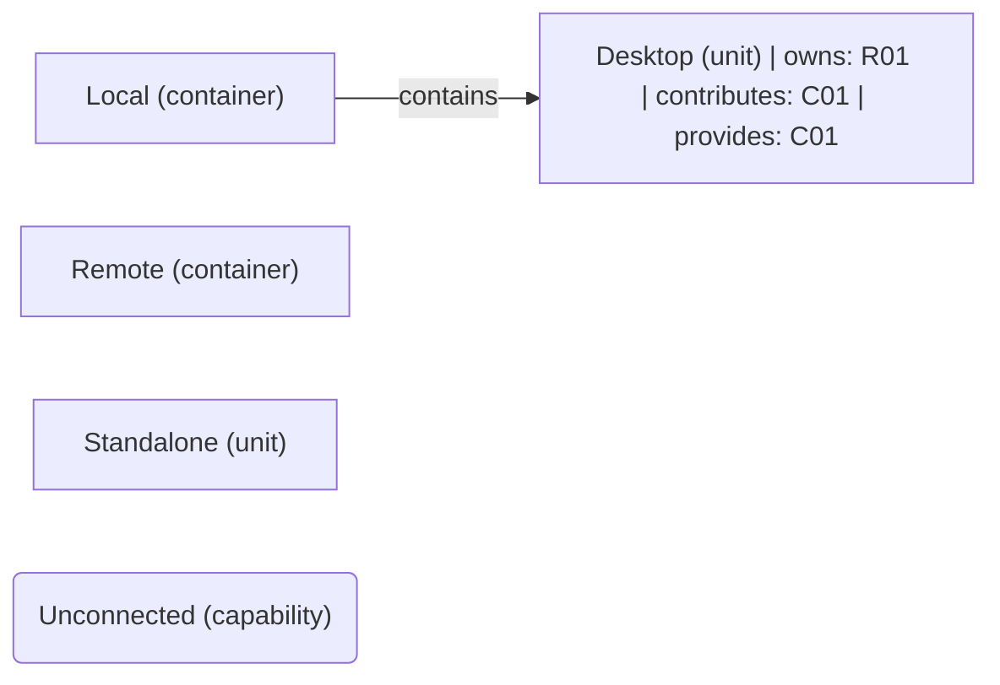

# VP03 — Responsibilities and capabilities across the architecture

Revision: `5220e973f4bb86e2ecba31e01441539e1b922579a39ba9679a8915020611bc6f`.

owns, realizes and provides. Capability is not Feature.

## Responsibilities and capabilities across the architecture

Source facts: [f0000](sdl-source://s0/292/313), [f0001](sdl-source://s0/314/340), [f0005](sdl-source://s0/464/490), [f0006](sdl-source://s0/491/514).

Declarations: [Desktop](sdl-source://s0/71/84), [Local](sdl-source://s0/155/171), [Remote](sdl-source://s0/233/250), [Standalone](sdl-source://s0/251/267), [Unconnected](sdl-source://s0/268/291).

## Scope and notation

The complete logical architecture uses contains edges, including isolated components. R keys identify responsibilities on their immediate owners (owns). C keys identify capabilities: contributes summarizes an owns + realizes path; provides records an explicit offered capability. These annotations are not new SDL relations. Realizes is a contribution, not proof of complete or verified realization. Ownership does not imply provision, and provision does not imply realization. Rounded standalone capabilities have neither a represented contributor nor provider. Keys are sorted within this snapshot. Features and runtime allocation belong to other viewpoints.

## Responsibility register

| Key | Functionality | Immediate owner | Capability contributions | Source facts |
| --- | --- | --- | --- | --- |
| R01 | [Display](sdl-source://s0/85/107) | [Desktop](sdl-source://s0/71/84) | [Delivery](sdl-source://s0/50/70) | [f0000](sdl-source://s0/292/313), [f0005](sdl-source://s0/464/490) |

## Capability register

| Key | Capability | Explicit providers | Contributing responsibilities | Source facts |
| --- | --- | --- | --- | --- |
| C01 | [Delivery](sdl-source://s0/50/70) | [Desktop](sdl-source://s0/71/84) | [Display](sdl-source://s0/85/107) | [f0001](sdl-source://s0/314/340), [f0005](sdl-source://s0/464/490) |
| C02 | [Unconnected](sdl-source://s0/268/291) | Not specified | Not specified | — |

Not specified means no such fact is declared; it does not assert impossibility.

