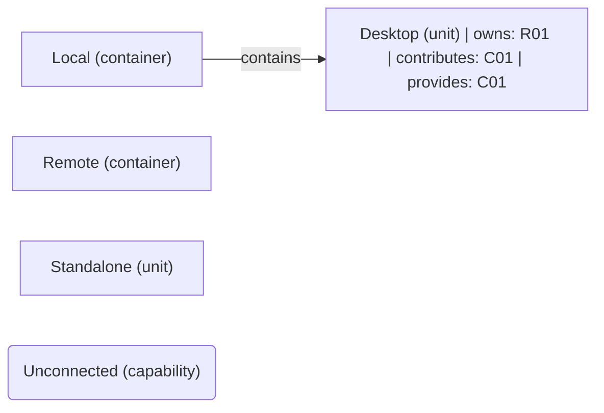

# VP03 — Responsibilities and capabilities across the architecture

Revision: `ec80ff038b0bcea3e58e88f4162e0b83ae754cc5b8539413cb615f948cd61699`.

owns, realizes and provides. Capability is not Feature.

## Responsibilities and capabilities across the architecture

Source facts: [f0001](sdl-source://s0/350/371), [f0002](sdl-source://s0/372/398), [f0006](sdl-source://s0/522/548), [f0007](sdl-source://s0/549/572).

Declarations: [Desktop](sdl-source://s0/86/99), [Local](sdl-source://s0/170/186), [Remote](sdl-source://s0/248/265), [Standalone](sdl-source://s0/287/303), [Unconnected](sdl-source://s0/304/327).

## Scope and notation

The complete logical architecture uses contains edges, including isolated components. R keys identify responsibilities on their immediate owners (owns). C keys identify capabilities: contributes summarizes an owns + realizes path; provides records an explicit offered capability. These annotations are not new SDL relations. Realizes is a contribution, not proof of complete or verified realization. Ownership does not imply provision, and provision does not imply realization. Rounded standalone capabilities have neither a represented contributor nor provider. Keys are sorted within this snapshot. Features and runtime allocation belong to other viewpoints.

## Responsibility register

| Key | Functionality | Immediate owner | Capability contributions | Source facts |
| --- | --- | --- | --- | --- |
| R01 | [Display](sdl-source://s0/100/122) | [Desktop](sdl-source://s0/86/99) | [Delivery](sdl-source://s0/65/85) | [f0001](sdl-source://s0/350/371), [f0006](sdl-source://s0/522/548) |

## Capability register

| Key | Capability | Explicit providers | Contributing responsibilities | Source facts |
| --- | --- | --- | --- | --- |
| C01 | [Delivery](sdl-source://s0/65/85) | [Desktop](sdl-source://s0/86/99) | [Display](sdl-source://s0/100/122) | [f0002](sdl-source://s0/372/398), [f0006](sdl-source://s0/522/548) |
| C02 | [Unconnected](sdl-source://s0/304/327) | Not specified | Not specified | — |

Not specified means no such fact is declared; it does not assert impossibility.

