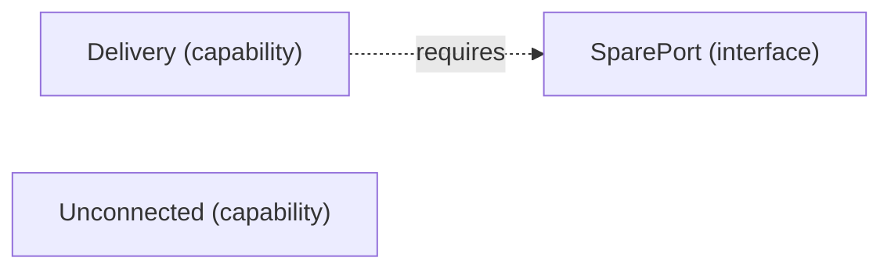

# VP05 — Dependencies by mode

Revision: `1da94717409fc03ce14a88a2de6245db0f15915310ae72e8fd720d276c97a730`.

requires in mode; modes have no implicit inheritance.

## Required interfaces — mode Online

Source facts: [f0001](sdl-source://s0/379/422).

Declarations: [Delivery](sdl-source://s0/65/85), [SparePort](sdl-source://s0/278/298), [Unconnected](sdl-source://s0/316/339).

## Scope and notation

Requires states that an Interface is necessary for a Capability in the selected Mode. It does not establish sufficiency, a provider, consumption, transport or runtime execution. Modes have no implicit inheritance. Dashed requires arrows point from Capability to Interface.

Selected mode: **Online**. Mode source: [Online](sdl-source://s0/221/233).

## Capability requirements

| Capability | Required interface in selected mode | Source facts |
| --- | --- | --- |
| [Delivery](sdl-source://s0/65/85) | [SparePort](sdl-source://s0/278/298) | [f0001](sdl-source://s0/379/422) |
| [Unconnected](sdl-source://s0/316/339) | No declared requirement | — |

Capabilities without a declared requirement remain visible; no claim of completeness is inferred. Interfaces not required in this mode are outside this projection.

