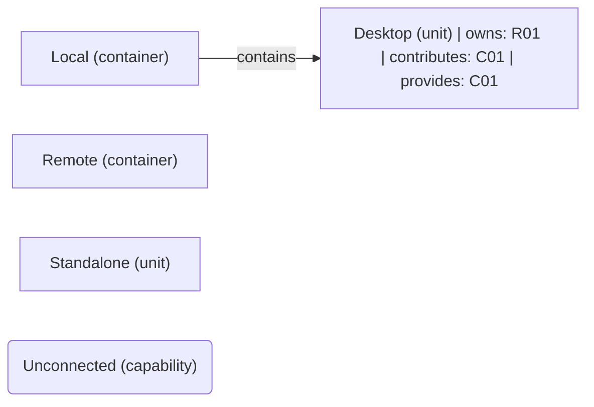

# VP03 — Responsibilities and capabilities across the architecture

Revision: `f08f981f22d579abe806b5da72052d23ea35c313d0d93ef1cb44b17782bb273c`.

owns, realizes and provides. Capability is not Feature.

## Responsibilities and capabilities across the architecture

Source facts: [f0011](sdl-source://s0/779/800), [f0012](sdl-source://s0/801/827), [f0016](sdl-source://s0/951/977), [f0017](sdl-source://s0/978/1001).

Declarations: [Desktop](sdl-source://s0/157/170), [Local](sdl-source://s0/241/257), [Remote](sdl-source://s0/331/348), [Standalone](sdl-source://s0/370/386), [Unconnected](sdl-source://s0/387/410).

## Scope and notation

The complete logical architecture uses contains edges, including isolated components. R keys identify responsibilities on their immediate owners (owns). C keys identify capabilities: contributes summarizes an owns + realizes path; provides records an explicit offered capability. These annotations are not new SDL relations. Realizes is a contribution, not proof of complete or verified realization. Ownership does not imply provision, and provision does not imply realization. Rounded standalone capabilities have neither a represented contributor nor provider. Keys are sorted within this snapshot. Features and runtime allocation belong to other viewpoints.

## Responsibility register

| Key | Functionality | Immediate owner | Capability contributions | Source facts |
| --- | --- | --- | --- | --- |
| R01 | [Display](sdl-source://s0/171/193) | [Desktop](sdl-source://s0/157/170) | [Delivery](sdl-source://s0/136/156) | [f0011](sdl-source://s0/779/800), [f0016](sdl-source://s0/951/977) |

## Capability register

| Key | Capability | Explicit providers | Contributing responsibilities | Source facts |
| --- | --- | --- | --- | --- |
| C01 | [Delivery](sdl-source://s0/136/156) | [Desktop](sdl-source://s0/157/170) | [Display](sdl-source://s0/171/193) | [f0012](sdl-source://s0/801/827), [f0016](sdl-source://s0/951/977) |
| C02 | [Unconnected](sdl-source://s0/387/410) | Not specified | Not specified | — |

Not specified means no such fact is declared; it does not assert impossibility.

