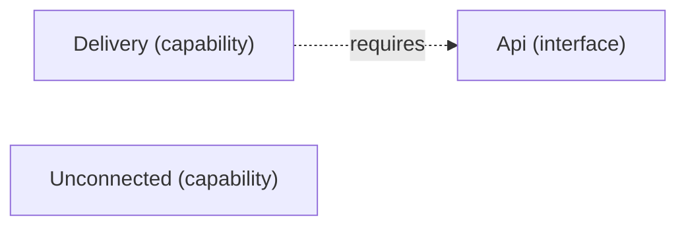

# VP05 — Dependencies by mode

Revision: `f08f981f22d579abe806b5da72052d23ea35c313d0d93ef1cb44b17782bb273c`.

requires in mode; modes have no implicit inheritance.

## Required interfaces — mode Offline

Source facts: [f0008](sdl-source://s0/674/712).

Declarations: [Api](sdl-source://s0/105/119), [Delivery](sdl-source://s0/136/156), [Unconnected](sdl-source://s0/387/410).

## Scope and notation

Requires states that an Interface is necessary for a Capability in the selected Mode. It does not establish sufficiency, a provider, consumption, transport or runtime execution. Modes have no implicit inheritance. Dashed requires arrows point from Capability to Interface.

Selected mode: **Offline**. Mode source: [Offline](sdl-source://s0/278/291).

## Capability requirements

| Capability | Required interface in selected mode | Source facts |
| --- | --- | --- |
| [Delivery](sdl-source://s0/136/156) | [Api](sdl-source://s0/105/119) | [f0008](sdl-source://s0/674/712) |
| [Unconnected](sdl-source://s0/387/410) | No declared requirement | — |

Capabilities without a declared requirement remain visible; no claim of completeness is inferred. Interfaces not required in this mode are outside this projection.

