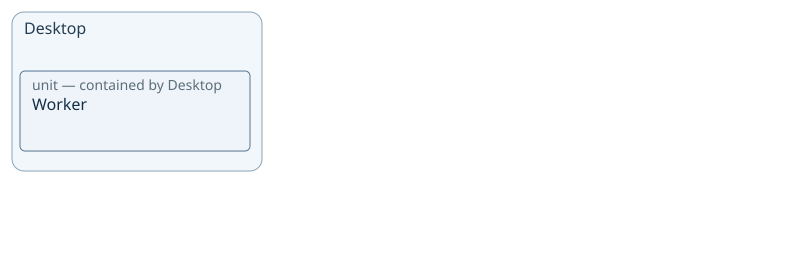

# VP02 — Architecture and logical decomposition

What parts exist and how are they organized?

Container/Unit and contains; library structure is not deployment allocation.

This page describes the checked model: 5 declarations and 4 source statements. Model claims do not establish implemented behavior or execution evidence.

## Structure and collaboration

### Declared structure and participation

Containment is logical structure. Named attachments mark existing Channels at participant boundaries; they are not declared ports. Arrows describe sender/receiver roles for the stated payload and mode, not execution order.

All explicitly declared modes are shown; no mode inheritance is inferred.

No channel participation is declared in this scope.

Inspect: [Desktop](sdl-view://reading-project/VP02?projection=reading&focus=Desktop)

## Desktop — participants and channels

### Declared structure and participation

Containment is logical structure. Named attachments mark existing Channels at participant boundaries; they are not declared ports. Arrows describe sender/receiver roles for the stated payload and mode, not execution order.

All explicitly declared modes are shown; no mode inheritance is inferred.

No channel participation is declared in this scope.

Inspect: [Worker](sdl-view://reading-project/VP02?projection=reading&focus=Worker)

## Reading chapters

- [Containers](sdl-view://reading-project/VP02?collection=containers&consumer=xfmd&projection=reading&target=main) — 1 objects.
  [Desktop](sdl-view://reading-project/VP02?consumer=xfmd&focus=Desktop&projection=reading&target=main).
- [Units](sdl-view://reading-project/VP02?collection=units&consumer=xfmd&projection=reading&target=main) — 1 objects.
  [Worker](sdl-view://reading-project/VP02?consumer=xfmd&focus=Worker&projection=reading&target=main).

## Interpretation and unspecified behavior

Contains describes logical structure. Deployment, scheduling, runtime calls, and unnamed internal units are not inferred. Channel endpoints refer to actual declared participants.

