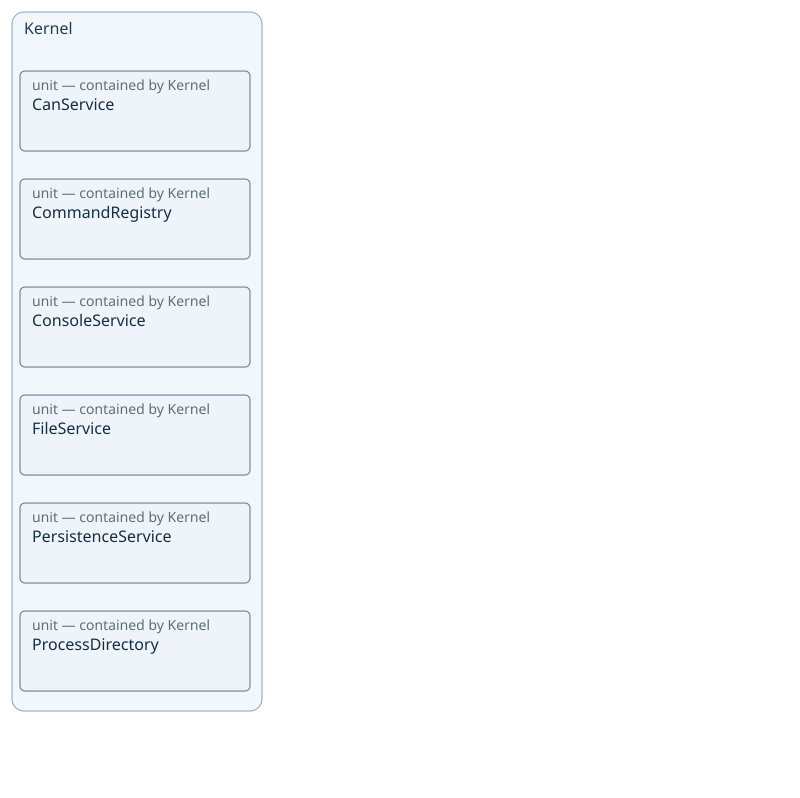
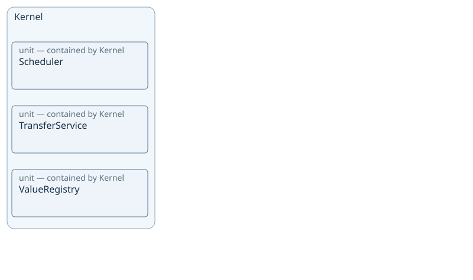
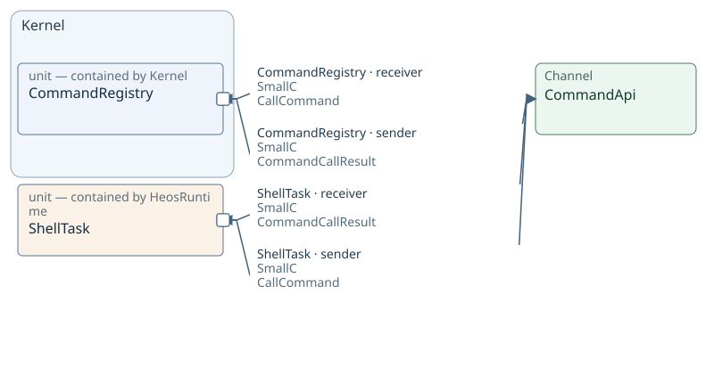
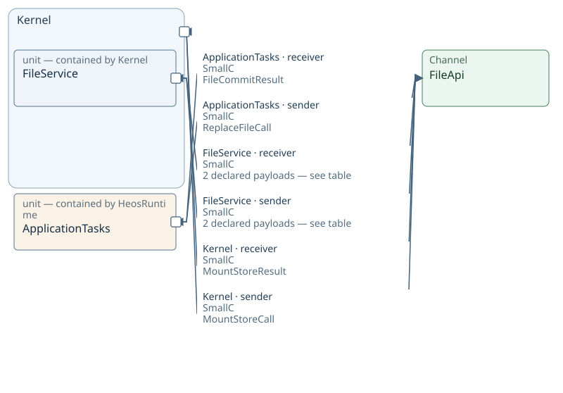
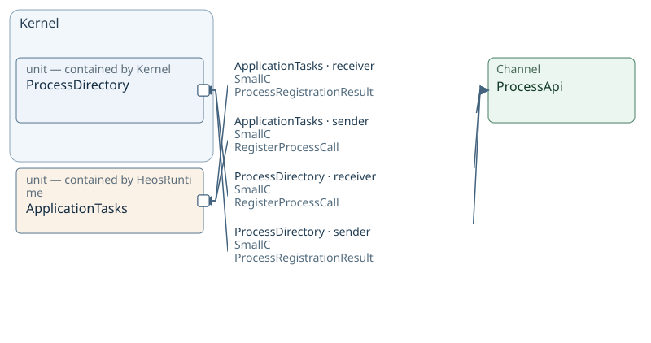
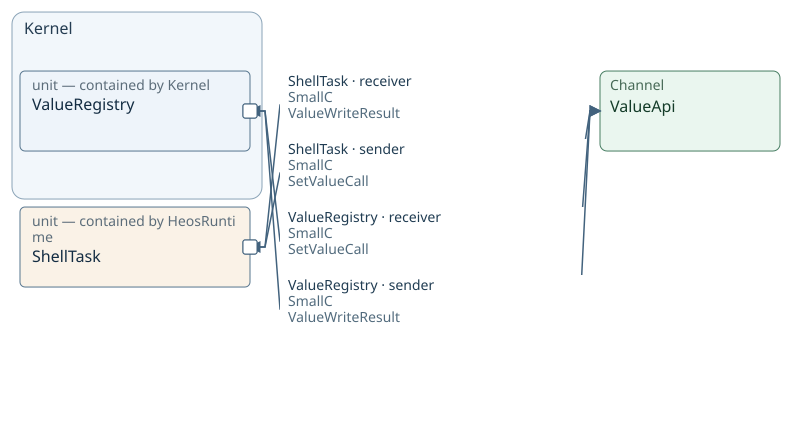

# VP02 — Architecture and logical decomposition

What parts exist and how are they organized?

Container/Unit and contains; library structure is not deployment allocation.

Operating mode: [All declared modes](sdl-view://heos/VP02?consumer=xfmd&focus=Kernel&projection=reading&target=main) · [NativeCpp](sdl-view://heos/VP02?consumer=xfmd&focus=Kernel&mode=NativeCpp&projection=reading&target=main) · [SmallC](sdl-view://heos/VP02?consumer=xfmd&focus=Kernel&mode=SmallC&projection=reading&target=main)

[Viewpoint overview](sdl-view://heos/VP02?consumer=xfmd&projection=reading&target=main)

## Kernel — participants and channels

### Containment — 1–6 of 9 objects

### Containment — 7–9 of 9 objects

### CommandApi — mode SmallC

### FileApi — mode SmallC

### MediaApi — mode SmallC

### ProcessApi — mode SmallC

### TaskAbi — mode NativeCpp

### ValueApi — mode NativeCpp

### ValueApi — mode SmallC

Containment is logical structure. Named attachments mark existing Channels at participant boundaries; they are not declared ports. Arrows describe sender/receiver roles for the stated payload and mode, not execution order.

All explicitly declared modes are shown; no mode inheritance is inferred.

Inspect: [CanService](sdl-view://heos/VP02?projection=reading&focus=CanService) · [CommandRegistry](sdl-view://heos/VP02?projection=reading&focus=CommandRegistry) · [ConsoleService](sdl-view://heos/VP02?projection=reading&focus=ConsoleService) · [FileService](sdl-view://heos/VP02?projection=reading&focus=FileService) · [PersistenceService](sdl-view://heos/VP02?projection=reading&focus=PersistenceService) · [ProcessDirectory](sdl-view://heos/VP02?projection=reading&focus=ProcessDirectory) · [Scheduler](sdl-view://heos/VP02?projection=reading&focus=Scheduler) · [TransferService](sdl-view://heos/VP02?projection=reading&focus=TransferService) · [ValueRegistry](sdl-view://heos/VP02?projection=reading&focus=ValueRegistry) · [ApplicationTasks](sdl-view://heos/VP02?projection=reading&focus=ApplicationTasks) · [BoardHal](sdl-view://heos/VP02?projection=reading&focus=BoardHal) · [CppTaskAdapter](sdl-view://heos/VP02?projection=reading&focus=CppTaskAdapter) · [HsxAdapter](sdl-view://heos/VP02?projection=reading&focus=HsxAdapter) · [ShellTask](sdl-view://heos/VP02?projection=reading&focus=ShellTask)

### CommandApi payloads

| Participant | Role | Message / Datagram | Dataset origin | Mode |
| --- | --- | --- | --- | --- |
| CommandRegistry | receiver | CallCommand | Not applicable | SmallC |
| CommandRegistry | sender | CommandCallResult | Not applicable | SmallC |
| ShellTask | receiver | CommandCallResult | Not applicable | SmallC |
| ShellTask | sender | CallCommand | Not applicable | SmallC |

### FileApi payloads

| Participant | Role | Message / Datagram | Dataset origin | Mode |
| --- | --- | --- | --- | --- |
| ApplicationTasks | receiver | FileCommitResult | Not applicable | SmallC |
| ApplicationTasks | sender | ReplaceFileCall | Not applicable | SmallC |
| FileService | receiver | MountStoreCall | Not applicable | SmallC |
| FileService | receiver | ReplaceFileCall | Not applicable | SmallC |
| FileService | sender | FileCommitResult | Not applicable | SmallC |
| FileService | sender | MountStoreResult | Not applicable | SmallC |
| Kernel | receiver | MountStoreResult | Not applicable | SmallC |
| Kernel | sender | MountStoreCall | Not applicable | SmallC |

### MediaApi payloads

| Participant | Role | Message / Datagram | Dataset origin | Mode |
| --- | --- | --- | --- | --- |
| BoardHal | receiver | WriteMediaCall | Not applicable | SmallC |
| BoardHal | sender | MediaWriteResult | Not applicable | SmallC |
| FileService | receiver | MediaWriteResult | Not applicable | SmallC |
| FileService | sender | WriteMediaCall | Not applicable | SmallC |

### ProcessApi payloads

| Participant | Role | Message / Datagram | Dataset origin | Mode |
| --- | --- | --- | --- | --- |
| ApplicationTasks | receiver | ProcessRegistrationResult | Not applicable | SmallC |
| ApplicationTasks | sender | RegisterProcessCall | Not applicable | SmallC |
| ProcessDirectory | receiver | RegisterProcessCall | Not applicable | SmallC |
| ProcessDirectory | sender | ProcessRegistrationResult | Not applicable | SmallC |

### TaskAbi payloads

| Participant | Role | Message / Datagram | Dataset origin | Mode |
| --- | --- | --- | --- | --- |
| CppTaskAdapter | receiver | RunTaskCall | Not applicable | NativeCpp |
| CppTaskAdapter | sender | TaskSliceResult | Not applicable | NativeCpp |
| Scheduler | receiver | TaskSliceResult | Not applicable | NativeCpp |
| Scheduler | sender | RunTaskCall | Not applicable | NativeCpp |

### ValueApi payloads

| Participant | Role | Message / Datagram | Dataset origin | Mode |
| --- | --- | --- | --- | --- |
| HsxAdapter | receiver | ValueWriteResult | Not applicable | NativeCpp |
| HsxAdapter | sender | SetValueCall | Not applicable | NativeCpp |
| ShellTask | receiver | ValueWriteResult | Not applicable | SmallC |
| ShellTask | sender | SetValueCall | Not applicable | SmallC |
| ValueRegistry | receiver | SetValueCall | Not applicable | NativeCpp |
| ValueRegistry | receiver | SetValueCall | Not applicable | SmallC |
| ValueRegistry | sender | ValueWriteResult | Not applicable | NativeCpp |
| ValueRegistry | sender | ValueWriteResult | Not applicable | SmallC |

## Kernel

unit declaration: [Kernel — Containers/Runtime/Runtime.design, line 31](sdl-source://s0/854/866).

### Declared relationships

- [ComposeKernel allocated-to HeosRuntime in mode NativeCpp. — Containers/Runtime/Runtime.design, line 107](sdl-source://s0/3894/3951)
- [ComposeKernel allocated-to HeosRuntime in mode SmallC. — Containers/Runtime/Runtime.design, line 108](sdl-source://s0/3952/4006)
- [FreezeRegistration allocated-to HeosRuntime in mode NativeCpp. — Containers/Runtime/Runtime.design, line 140](sdl-source://s0/5528/5590)
- [FreezeRegistration allocated-to HeosRuntime in mode SmallC. — Containers/Runtime/Runtime.design, line 141](sdl-source://s0/5591/5650)
- [HeosRuntime contains Kernel. — Containers/Runtime/Runtime.design, line 148](sdl-source://s0/5892/5920)
- [Kernel contains CanService. — Containers/Runtime/Runtime.design, line 162](sdl-source://s0/6505/6532)
- [Kernel contains CommandRegistry. — Containers/Runtime/Runtime.design, line 163](sdl-source://s0/6533/6565)
- [Kernel contains ConsoleService. — Containers/Runtime/Runtime.design, line 164](sdl-source://s0/6566/6597)
- [Kernel contains FileService. — Containers/Runtime/Runtime.design, line 165](sdl-source://s0/6598/6626)
- [Kernel contains PersistenceService. — Containers/Runtime/Runtime.design, line 166](sdl-source://s0/6627/6662)
- [Kernel contains ProcessDirectory. — Containers/Runtime/Runtime.design, line 167](sdl-source://s0/6663/6696)
- [Kernel contains Scheduler. — Containers/Runtime/Runtime.design, line 168](sdl-source://s0/6697/6723)
- [Kernel contains TransferService. — Containers/Runtime/Runtime.design, line 169](sdl-source://s0/6724/6756)
- [Kernel contains ValueRegistry. — Containers/Runtime/Runtime.design, line 170](sdl-source://s0/6757/6787)
- [Kernel owns ComposeKernel. — Containers/Runtime/Runtime.design, line 171](sdl-source://s0/6788/6814)
- [Kernel owns FreezeRegistration. — Containers/Runtime/Runtime.design, line 172](sdl-source://s0/6815/6846)
- [Kernel owns ManageLifecycle. — Containers/Runtime/Runtime.design, line 173](sdl-source://s0/6847/6875)
- [Kernel owns ReportHealth. — Containers/Runtime/Runtime.design, line 174](sdl-source://s0/6876/6901)
- [Kernel uses FileApi as receiver of MountStoreResult in mode SmallC. — Scenarios/Services.design, line 65](sdl-source://s5/4131/4198)
- [Kernel uses FileApi as sender of MountStoreCall in mode SmallC. — Scenarios/Services.design, line 66](sdl-source://s5/4199/4262)
- [ManageLifecycle allocated-to HeosRuntime in mode NativeCpp. — Containers/Runtime/Runtime.design, line 183](sdl-source://s0/7360/7419)
- [ManageLifecycle allocated-to HeosRuntime in mode SmallC. — Containers/Runtime/Runtime.design, line 184](sdl-source://s0/7420/7476)
- [ReportHealth allocated-to HeosRuntime in mode NativeCpp. — Containers/Runtime/Runtime.design, line 242](sdl-source://s0/10511/10567)
- [ReportHealth allocated-to HeosRuntime in mode SmallC. — Containers/Runtime/Runtime.design, line 243](sdl-source://s0/10568/10621)

### Related objects in this viewpoint

[CanService](sdl-view://heos/VP02?consumer=xfmd&focus=CanService&projection=reading&target=main), [CommandRegistry](sdl-view://heos/VP02?consumer=xfmd&focus=CommandRegistry&projection=reading&target=main), [ComposeKernel](sdl-view://heos/VP02?consumer=xfmd&focus=ComposeKernel&projection=reading&target=main), [ConsoleService](sdl-view://heos/VP02?consumer=xfmd&focus=ConsoleService&projection=reading&target=main), [FileApi](sdl-view://heos/VP02?consumer=xfmd&focus=FileApi&projection=reading&target=main), [FileService](sdl-view://heos/VP02?consumer=xfmd&focus=FileService&projection=reading&target=main), [FreezeRegistration](sdl-view://heos/VP02?consumer=xfmd&focus=FreezeRegistration&projection=reading&target=main), [HeosRuntime](sdl-view://heos/VP02?consumer=xfmd&focus=HeosRuntime&projection=reading&target=main), [ManageLifecycle](sdl-view://heos/VP02?consumer=xfmd&focus=ManageLifecycle&projection=reading&target=main), [MountStoreCall](sdl-view://heos/VP02?consumer=xfmd&focus=MountStoreCall&projection=reading&target=main), [MountStoreResult](sdl-view://heos/VP02?consumer=xfmd&focus=MountStoreResult&projection=reading&target=main), [NativeCpp](sdl-view://heos/VP02?consumer=xfmd&focus=NativeCpp&projection=reading&target=main), [PersistenceService](sdl-view://heos/VP02?consumer=xfmd&focus=PersistenceService&projection=reading&target=main), [ProcessDirectory](sdl-view://heos/VP02?consumer=xfmd&focus=ProcessDirectory&projection=reading&target=main), [ReportHealth](sdl-view://heos/VP02?consumer=xfmd&focus=ReportHealth&projection=reading&target=main), [Scheduler](sdl-view://heos/VP02?consumer=xfmd&focus=Scheduler&projection=reading&target=main), [SmallC](sdl-view://heos/VP02?consumer=xfmd&focus=SmallC&projection=reading&target=main), [TransferService](sdl-view://heos/VP02?consumer=xfmd&focus=TransferService&projection=reading&target=main), [ValueRegistry](sdl-view://heos/VP02?consumer=xfmd&focus=ValueRegistry&projection=reading&target=main)

## Interpretation and unspecified behavior

Contains describes logical structure. Deployment, scheduling, runtime calls, and unnamed internal units are not inferred. Channel endpoints refer to actual declared participants.

