# VP02 — Architecture and logical decomposition

What parts exist and how are they organized?

Container/Unit and contains; library structure is not deployment allocation.

Operating mode: [All declared modes](sdl-view://heos/VP02?consumer=xfmd&projection=reading&target=main) · [NativeCpp](sdl-view://heos/VP02?consumer=xfmd&mode=NativeCpp&projection=reading&target=main) · [SmallC](sdl-view://heos/VP02?consumer=xfmd&mode=SmallC&projection=reading&target=main)

This page describes the checked model: 208 declarations and 654 source statements. Model claims do not establish implemented behavior or execution evidence.

## Structure and collaboration

### System collaboration — aggregated endpoints; roles and modes in the following figures

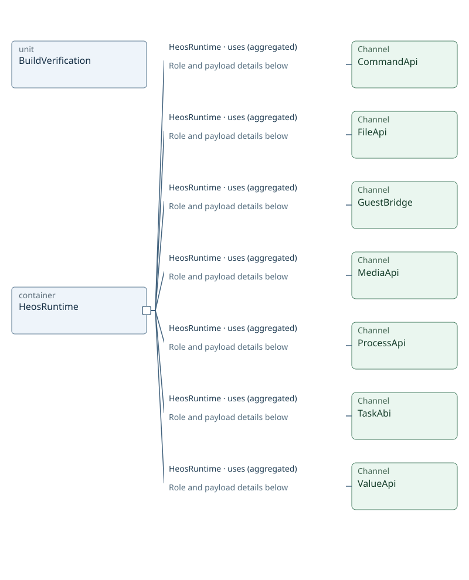

### Containment — 1–2 of 2 objects

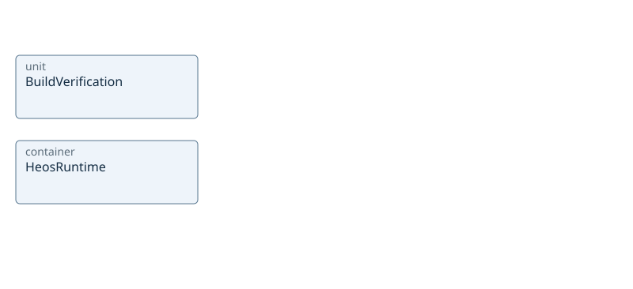

### CommandApi — mode SmallC

### FileApi — mode SmallC

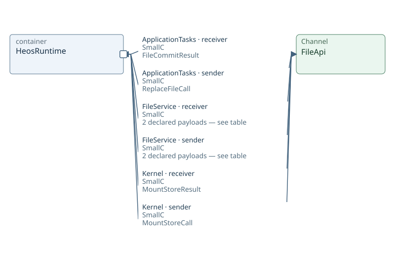

### GuestBridge — mode NativeCpp

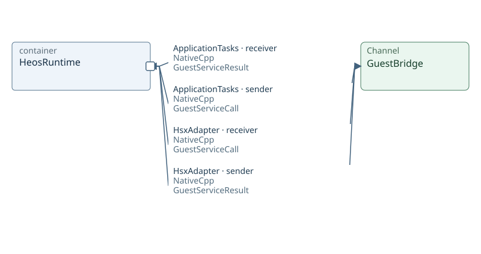

### MediaApi — mode SmallC

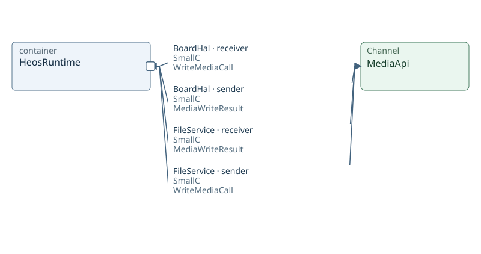

### ProcessApi — mode SmallC

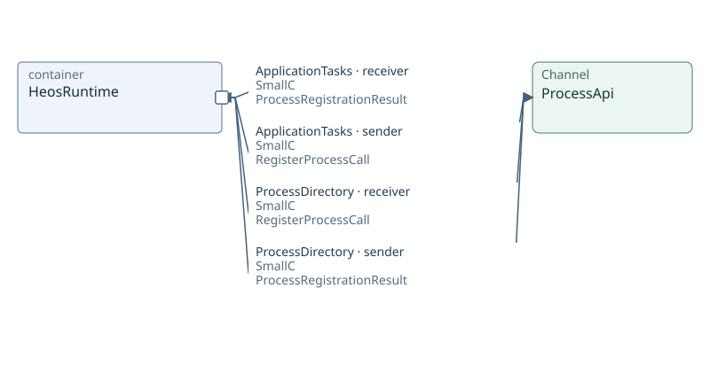

### TaskAbi — mode NativeCpp

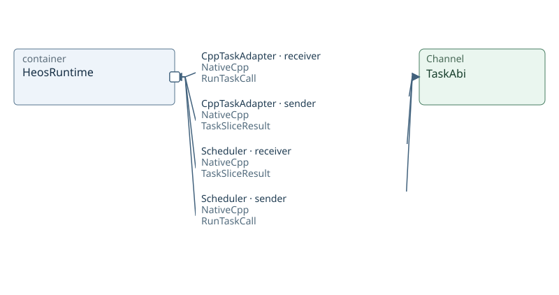

### ValueApi — mode NativeCpp

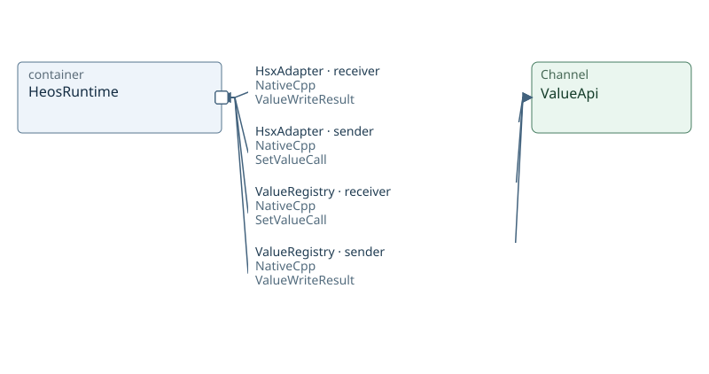

### ValueApi — mode SmallC

Containment is logical structure. Named attachments mark existing Channels at participant boundaries; they are not declared ports. Arrows describe sender/receiver roles for the stated payload and mode, not execution order.

All explicitly declared modes are shown; no mode inheritance is inferred.

Inspect: [BuildVerification](sdl-view://heos/VP02?projection=reading&focus=BuildVerification) · [HeosRuntime](sdl-view://heos/VP02?projection=reading&focus=HeosRuntime)

### CommandApi payloads

| Participant | Role | Message / Datagram | Dataset origin | Mode |
| --- | --- | --- | --- | --- |
| CommandRegistry | receiver | CallCommand | Not applicable | SmallC |
| CommandRegistry | sender | CommandCallResult | Not applicable | SmallC |
| ShellTask | receiver | CommandCallResult | Not applicable | SmallC |
| ShellTask | sender | CallCommand | Not applicable | SmallC |

### FileApi payloads

| Participant | Role | Message / Datagram | Dataset origin | Mode |
| --- | --- | --- | --- | --- |
| ApplicationTasks | receiver | FileCommitResult | Not applicable | SmallC |
| ApplicationTasks | sender | ReplaceFileCall | Not applicable | SmallC |
| FileService | receiver | MountStoreCall | Not applicable | SmallC |
| FileService | receiver | ReplaceFileCall | Not applicable | SmallC |
| FileService | sender | FileCommitResult | Not applicable | SmallC |
| FileService | sender | MountStoreResult | Not applicable | SmallC |
| Kernel | receiver | MountStoreResult | Not applicable | SmallC |
| Kernel | sender | MountStoreCall | Not applicable | SmallC |

### GuestBridge payloads

| Participant | Role | Message / Datagram | Dataset origin | Mode |
| --- | --- | --- | --- | --- |
| ApplicationTasks | receiver | GuestServiceResult | Not applicable | NativeCpp |
| ApplicationTasks | sender | GuestServiceCall | Not applicable | NativeCpp |
| HsxAdapter | receiver | GuestServiceCall | Not applicable | NativeCpp |
| HsxAdapter | sender | GuestServiceResult | Not applicable | NativeCpp |

### MediaApi payloads

| Participant | Role | Message / Datagram | Dataset origin | Mode |
| --- | --- | --- | --- | --- |
| BoardHal | receiver | WriteMediaCall | Not applicable | SmallC |
| BoardHal | sender | MediaWriteResult | Not applicable | SmallC |
| FileService | receiver | MediaWriteResult | Not applicable | SmallC |
| FileService | sender | WriteMediaCall | Not applicable | SmallC |

### ProcessApi payloads

| Participant | Role | Message / Datagram | Dataset origin | Mode |
| --- | --- | --- | --- | --- |
| ApplicationTasks | receiver | ProcessRegistrationResult | Not applicable | SmallC |
| ApplicationTasks | sender | RegisterProcessCall | Not applicable | SmallC |
| ProcessDirectory | receiver | RegisterProcessCall | Not applicable | SmallC |
| ProcessDirectory | sender | ProcessRegistrationResult | Not applicable | SmallC |

### TaskAbi payloads

| Participant | Role | Message / Datagram | Dataset origin | Mode |
| --- | --- | --- | --- | --- |
| CppTaskAdapter | receiver | RunTaskCall | Not applicable | NativeCpp |
| CppTaskAdapter | sender | TaskSliceResult | Not applicable | NativeCpp |
| Scheduler | receiver | TaskSliceResult | Not applicable | NativeCpp |
| Scheduler | sender | RunTaskCall | Not applicable | NativeCpp |

### ValueApi payloads

| Participant | Role | Message / Datagram | Dataset origin | Mode |
| --- | --- | --- | --- | --- |
| HsxAdapter | receiver | ValueWriteResult | Not applicable | NativeCpp |
| HsxAdapter | sender | SetValueCall | Not applicable | NativeCpp |
| ShellTask | receiver | ValueWriteResult | Not applicable | SmallC |
| ShellTask | sender | SetValueCall | Not applicable | SmallC |
| ValueRegistry | receiver | SetValueCall | Not applicable | NativeCpp |
| ValueRegistry | receiver | SetValueCall | Not applicable | SmallC |
| ValueRegistry | sender | ValueWriteResult | Not applicable | NativeCpp |
| ValueRegistry | sender | ValueWriteResult | Not applicable | SmallC |

## HeosRuntime — participants and channels

### Containment — 1–6 of 7 objects

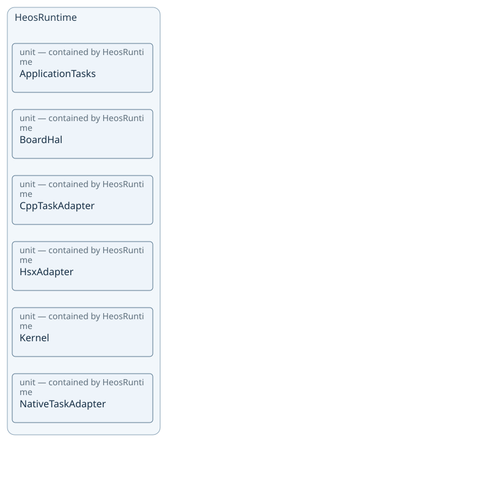

### Containment — 7–7 of 7 objects

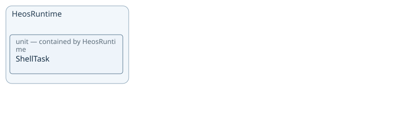

### CommandApi — mode SmallC

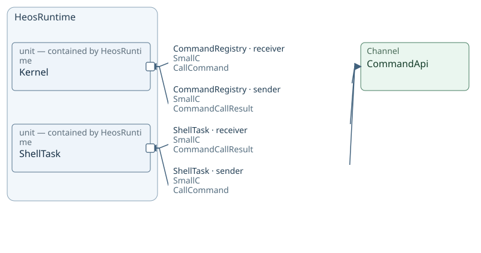

### FileApi — mode SmallC

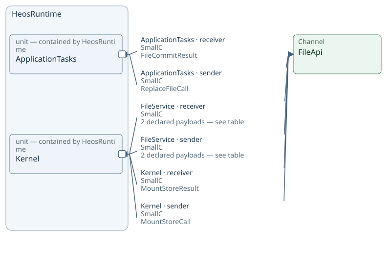

### GuestBridge — mode NativeCpp

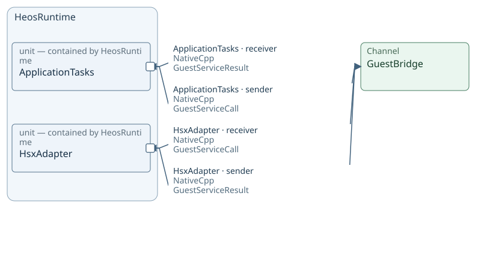

### MediaApi — mode SmallC

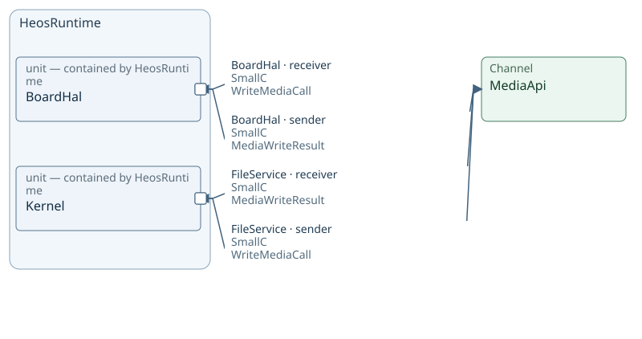

### ProcessApi — mode SmallC

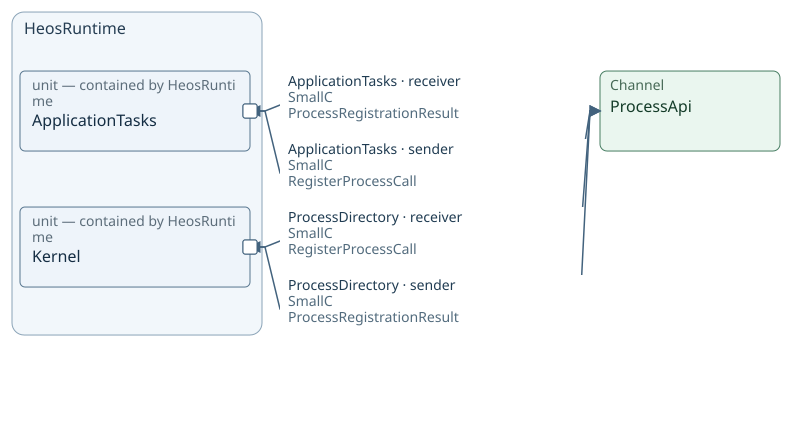

### TaskAbi — mode NativeCpp

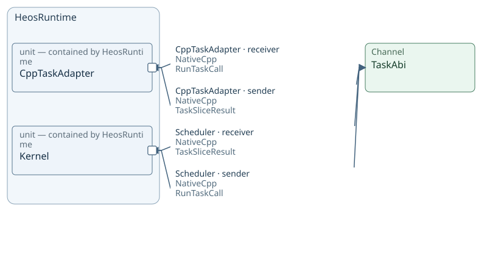

### ValueApi — mode NativeCpp

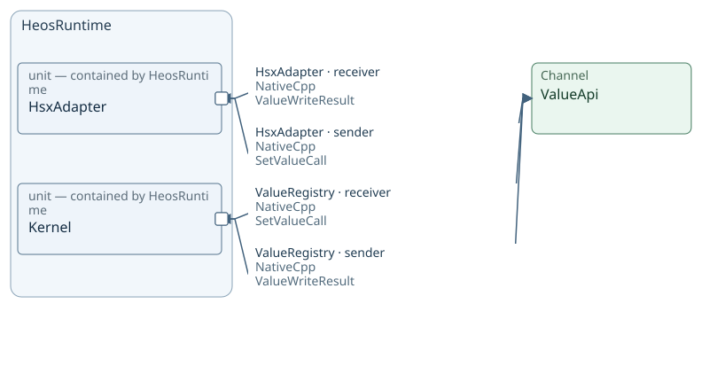

### ValueApi — mode SmallC

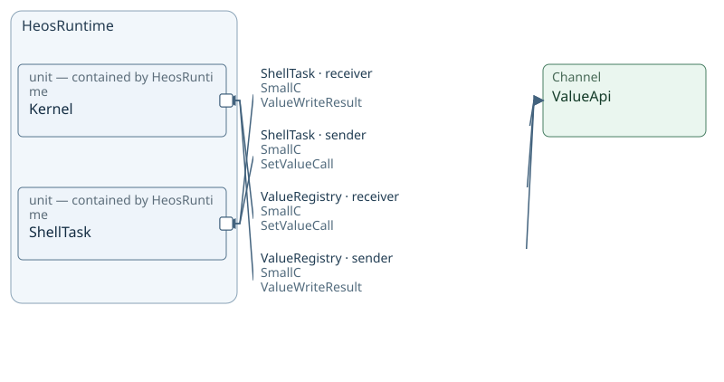

Containment is logical structure. Named attachments mark existing Channels at participant boundaries; they are not declared ports. Arrows describe sender/receiver roles for the stated payload and mode, not execution order.

All explicitly declared modes are shown; no mode inheritance is inferred.

Inspect: [ApplicationTasks](sdl-view://heos/VP02?projection=reading&focus=ApplicationTasks) · [BoardHal](sdl-view://heos/VP02?projection=reading&focus=BoardHal) · [CppTaskAdapter](sdl-view://heos/VP02?projection=reading&focus=CppTaskAdapter) · [HsxAdapter](sdl-view://heos/VP02?projection=reading&focus=HsxAdapter) · [Kernel](sdl-view://heos/VP02?projection=reading&focus=Kernel) · [NativeTaskAdapter](sdl-view://heos/VP02?projection=reading&focus=NativeTaskAdapter) · [ShellTask](sdl-view://heos/VP02?projection=reading&focus=ShellTask)

### CommandApi payloads

| Participant | Role | Message / Datagram | Dataset origin | Mode |
| --- | --- | --- | --- | --- |
| CommandRegistry | receiver | CallCommand | Not applicable | SmallC |
| CommandRegistry | sender | CommandCallResult | Not applicable | SmallC |
| ShellTask | receiver | CommandCallResult | Not applicable | SmallC |
| ShellTask | sender | CallCommand | Not applicable | SmallC |

### FileApi payloads

| Participant | Role | Message / Datagram | Dataset origin | Mode |
| --- | --- | --- | --- | --- |
| ApplicationTasks | receiver | FileCommitResult | Not applicable | SmallC |
| ApplicationTasks | sender | ReplaceFileCall | Not applicable | SmallC |
| FileService | receiver | MountStoreCall | Not applicable | SmallC |
| FileService | receiver | ReplaceFileCall | Not applicable | SmallC |
| FileService | sender | FileCommitResult | Not applicable | SmallC |
| FileService | sender | MountStoreResult | Not applicable | SmallC |
| Kernel | receiver | MountStoreResult | Not applicable | SmallC |
| Kernel | sender | MountStoreCall | Not applicable | SmallC |

### GuestBridge payloads

| Participant | Role | Message / Datagram | Dataset origin | Mode |
| --- | --- | --- | --- | --- |
| ApplicationTasks | receiver | GuestServiceResult | Not applicable | NativeCpp |
| ApplicationTasks | sender | GuestServiceCall | Not applicable | NativeCpp |
| HsxAdapter | receiver | GuestServiceCall | Not applicable | NativeCpp |
| HsxAdapter | sender | GuestServiceResult | Not applicable | NativeCpp |

### MediaApi payloads

| Participant | Role | Message / Datagram | Dataset origin | Mode |
| --- | --- | --- | --- | --- |
| BoardHal | receiver | WriteMediaCall | Not applicable | SmallC |
| BoardHal | sender | MediaWriteResult | Not applicable | SmallC |
| FileService | receiver | MediaWriteResult | Not applicable | SmallC |
| FileService | sender | WriteMediaCall | Not applicable | SmallC |

### ProcessApi payloads

| Participant | Role | Message / Datagram | Dataset origin | Mode |
| --- | --- | --- | --- | --- |
| ApplicationTasks | receiver | ProcessRegistrationResult | Not applicable | SmallC |
| ApplicationTasks | sender | RegisterProcessCall | Not applicable | SmallC |
| ProcessDirectory | receiver | RegisterProcessCall | Not applicable | SmallC |
| ProcessDirectory | sender | ProcessRegistrationResult | Not applicable | SmallC |

### TaskAbi payloads

| Participant | Role | Message / Datagram | Dataset origin | Mode |
| --- | --- | --- | --- | --- |
| CppTaskAdapter | receiver | RunTaskCall | Not applicable | NativeCpp |
| CppTaskAdapter | sender | TaskSliceResult | Not applicable | NativeCpp |
| Scheduler | receiver | TaskSliceResult | Not applicable | NativeCpp |
| Scheduler | sender | RunTaskCall | Not applicable | NativeCpp |

### ValueApi payloads

| Participant | Role | Message / Datagram | Dataset origin | Mode |
| --- | --- | --- | --- | --- |
| HsxAdapter | receiver | ValueWriteResult | Not applicable | NativeCpp |
| HsxAdapter | sender | SetValueCall | Not applicable | NativeCpp |
| ShellTask | receiver | ValueWriteResult | Not applicable | SmallC |
| ShellTask | sender | SetValueCall | Not applicable | SmallC |
| ValueRegistry | receiver | SetValueCall | Not applicable | NativeCpp |
| ValueRegistry | receiver | SetValueCall | Not applicable | SmallC |
| ValueRegistry | sender | ValueWriteResult | Not applicable | NativeCpp |
| ValueRegistry | sender | ValueWriteResult | Not applicable | SmallC |

## Kernel — participants and channels

### Containment — 1–6 of 9 objects

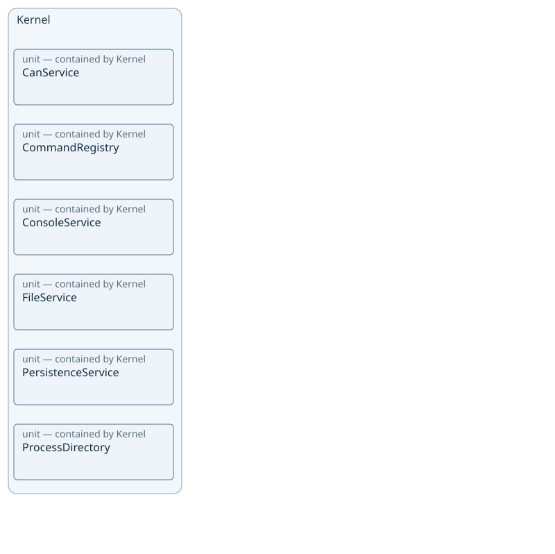

### Containment — 7–9 of 9 objects

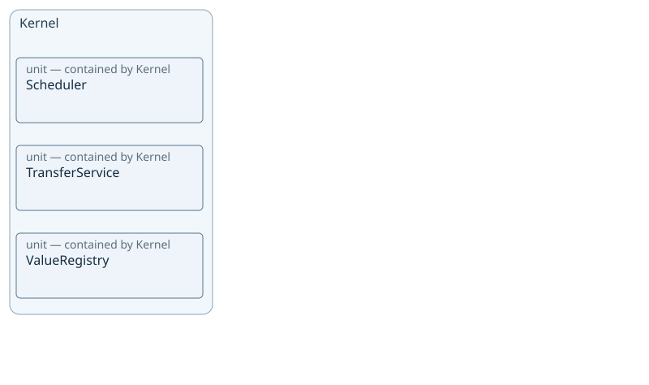

### CommandApi — mode SmallC

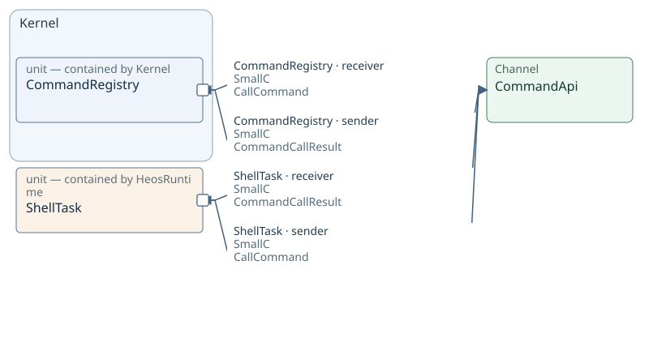

### FileApi — mode SmallC

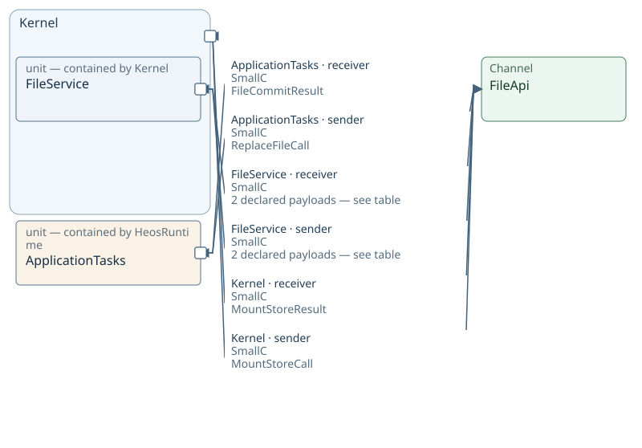

### MediaApi — mode SmallC

### ProcessApi — mode SmallC

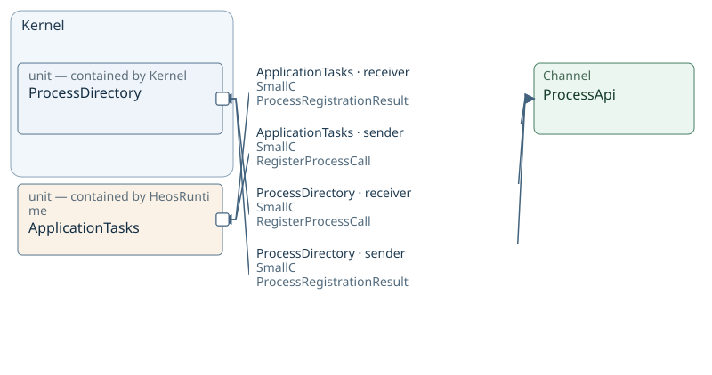

### TaskAbi — mode NativeCpp

### ValueApi — mode NativeCpp

### ValueApi — mode SmallC

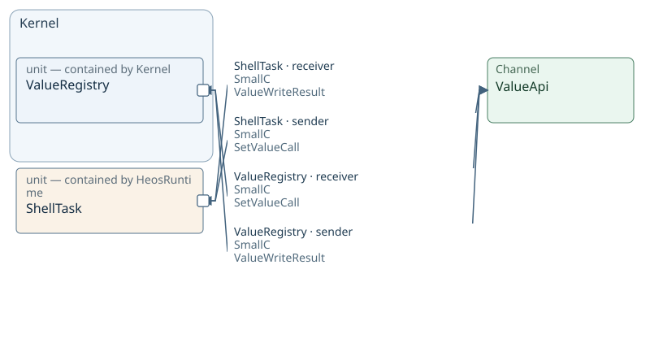

Containment is logical structure. Named attachments mark existing Channels at participant boundaries; they are not declared ports. Arrows describe sender/receiver roles for the stated payload and mode, not execution order.

All explicitly declared modes are shown; no mode inheritance is inferred.

Inspect: [CanService](sdl-view://heos/VP02?projection=reading&focus=CanService) · [CommandRegistry](sdl-view://heos/VP02?projection=reading&focus=CommandRegistry) · [ConsoleService](sdl-view://heos/VP02?projection=reading&focus=ConsoleService) · [FileService](sdl-view://heos/VP02?projection=reading&focus=FileService) · [PersistenceService](sdl-view://heos/VP02?projection=reading&focus=PersistenceService) · [ProcessDirectory](sdl-view://heos/VP02?projection=reading&focus=ProcessDirectory) · [Scheduler](sdl-view://heos/VP02?projection=reading&focus=Scheduler) · [TransferService](sdl-view://heos/VP02?projection=reading&focus=TransferService) · [ValueRegistry](sdl-view://heos/VP02?projection=reading&focus=ValueRegistry) · [ApplicationTasks](sdl-view://heos/VP02?projection=reading&focus=ApplicationTasks) · [BoardHal](sdl-view://heos/VP02?projection=reading&focus=BoardHal) · [CppTaskAdapter](sdl-view://heos/VP02?projection=reading&focus=CppTaskAdapter) · [HsxAdapter](sdl-view://heos/VP02?projection=reading&focus=HsxAdapter) · [ShellTask](sdl-view://heos/VP02?projection=reading&focus=ShellTask)

### CommandApi payloads

| Participant | Role | Message / Datagram | Dataset origin | Mode |
| --- | --- | --- | --- | --- |
| CommandRegistry | receiver | CallCommand | Not applicable | SmallC |
| CommandRegistry | sender | CommandCallResult | Not applicable | SmallC |
| ShellTask | receiver | CommandCallResult | Not applicable | SmallC |
| ShellTask | sender | CallCommand | Not applicable | SmallC |

### FileApi payloads

| Participant | Role | Message / Datagram | Dataset origin | Mode |
| --- | --- | --- | --- | --- |
| ApplicationTasks | receiver | FileCommitResult | Not applicable | SmallC |
| ApplicationTasks | sender | ReplaceFileCall | Not applicable | SmallC |
| FileService | receiver | MountStoreCall | Not applicable | SmallC |
| FileService | receiver | ReplaceFileCall | Not applicable | SmallC |
| FileService | sender | FileCommitResult | Not applicable | SmallC |
| FileService | sender | MountStoreResult | Not applicable | SmallC |
| Kernel | receiver | MountStoreResult | Not applicable | SmallC |
| Kernel | sender | MountStoreCall | Not applicable | SmallC |

### MediaApi payloads

| Participant | Role | Message / Datagram | Dataset origin | Mode |
| --- | --- | --- | --- | --- |
| BoardHal | receiver | WriteMediaCall | Not applicable | SmallC |
| BoardHal | sender | MediaWriteResult | Not applicable | SmallC |
| FileService | receiver | MediaWriteResult | Not applicable | SmallC |
| FileService | sender | WriteMediaCall | Not applicable | SmallC |

### ProcessApi payloads

| Participant | Role | Message / Datagram | Dataset origin | Mode |
| --- | --- | --- | --- | --- |
| ApplicationTasks | receiver | ProcessRegistrationResult | Not applicable | SmallC |
| ApplicationTasks | sender | RegisterProcessCall | Not applicable | SmallC |
| ProcessDirectory | receiver | RegisterProcessCall | Not applicable | SmallC |
| ProcessDirectory | sender | ProcessRegistrationResult | Not applicable | SmallC |

### TaskAbi payloads

| Participant | Role | Message / Datagram | Dataset origin | Mode |
| --- | --- | --- | --- | --- |
| CppTaskAdapter | receiver | RunTaskCall | Not applicable | NativeCpp |
| CppTaskAdapter | sender | TaskSliceResult | Not applicable | NativeCpp |
| Scheduler | receiver | TaskSliceResult | Not applicable | NativeCpp |
| Scheduler | sender | RunTaskCall | Not applicable | NativeCpp |

### ValueApi payloads

| Participant | Role | Message / Datagram | Dataset origin | Mode |
| --- | --- | --- | --- | --- |
| HsxAdapter | receiver | ValueWriteResult | Not applicable | NativeCpp |
| HsxAdapter | sender | SetValueCall | Not applicable | NativeCpp |
| ShellTask | receiver | ValueWriteResult | Not applicable | SmallC |
| ShellTask | sender | SetValueCall | Not applicable | SmallC |
| ValueRegistry | receiver | SetValueCall | Not applicable | NativeCpp |
| ValueRegistry | receiver | SetValueCall | Not applicable | SmallC |
| ValueRegistry | sender | ValueWriteResult | Not applicable | NativeCpp |
| ValueRegistry | sender | ValueWriteResult | Not applicable | SmallC |

## Reading chapters

- [Containers](sdl-view://heos/VP02?collection=containers&consumer=xfmd&projection=reading&target=main) — 1 objects.
  [HeosRuntime](sdl-view://heos/VP02?consumer=xfmd&focus=HeosRuntime&projection=reading&target=main).
- [Units](sdl-view://heos/VP02?collection=units&consumer=xfmd&projection=reading&target=main) — 17 objects.
  [ApplicationTasks](sdl-view://heos/VP02?consumer=xfmd&focus=ApplicationTasks&projection=reading&target=main).
  [BoardHal](sdl-view://heos/VP02?consumer=xfmd&focus=BoardHal&projection=reading&target=main).
  [BuildVerification](sdl-view://heos/VP02?consumer=xfmd&focus=BuildVerification&projection=reading&target=main).

## Interpretation and unspecified behavior

Contains describes logical structure. Deployment, scheduling, runtime calls, and unnamed internal units are not inferred. Channel endpoints refer to actual declared participants.

