# VP02 — Architecture and logical decomposition

What parts exist and how are they organized?

Container/Unit and contains; library structure is not deployment allocation.

Operating mode: [All declared modes](sdl-view://heos/VP02?consumer=xfmd&projection=reading&target=main) · [MicroConsole](sdl-view://heos/VP02?consumer=xfmd&mode=MicroConsole&projection=reading&target=main) · [MicroCore](sdl-view://heos/VP02?consumer=xfmd&mode=MicroCore&projection=reading&target=main) · [MicroRetained](sdl-view://heos/VP02?consumer=xfmd&mode=MicroRetained&projection=reading&target=main)

This page describes the checked model: 129 declarations and 384 source statements. Model claims do not establish implemented behavior or execution evidence.

## Structure and collaboration

### System collaboration — aggregated endpoints; roles and modes in the following figures

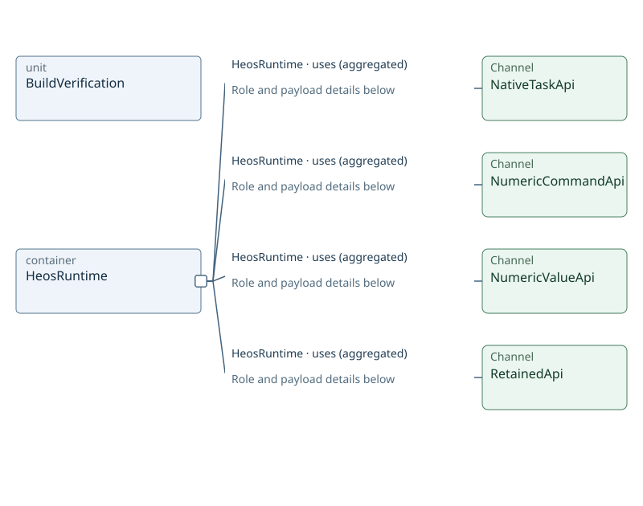

### Containment — 1–2 of 2 objects

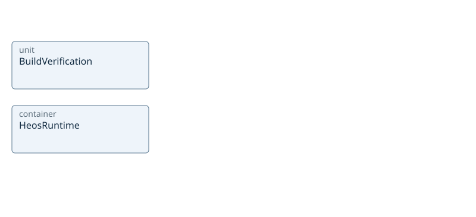

### NativeTaskApi — mode MicroCore

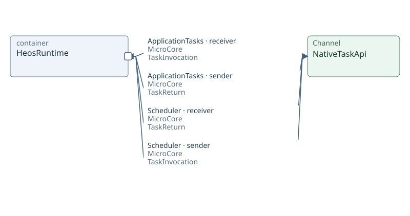

### NumericCommandApi — mode MicroConsole

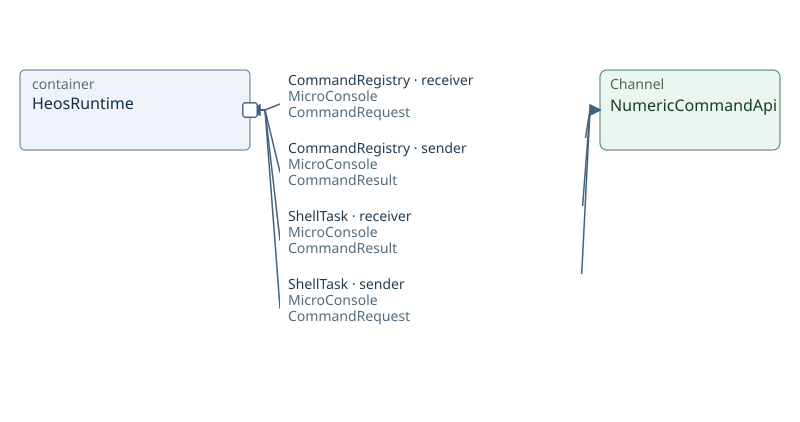

### NumericValueApi — mode MicroConsole

### RetainedApi — mode MicroRetained

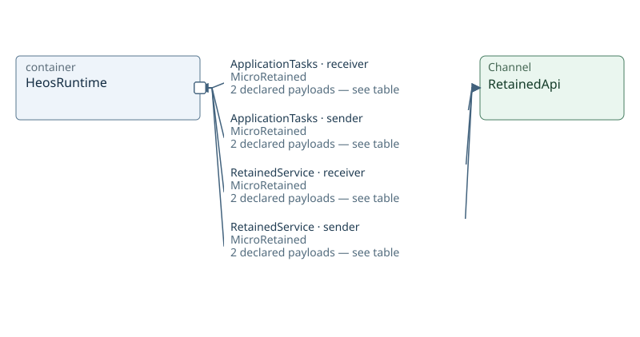

Containment is logical structure. Named attachments mark existing Channels at participant boundaries; they are not declared ports. Arrows describe sender/receiver roles for the stated payload and mode, not execution order.

All explicitly declared modes are shown; no mode inheritance is inferred.

Inspect: [BuildVerification](sdl-view://heos/VP02?projection=reading&focus=BuildVerification) · [HeosRuntime](sdl-view://heos/VP02?projection=reading&focus=HeosRuntime)

### NativeTaskApi payloads

| Participant | Role | Message / Datagram | Dataset origin | Mode |
| --- | --- | --- | --- | --- |
| ApplicationTasks | receiver | TaskInvocation | Not applicable | MicroCore |
| ApplicationTasks | sender | TaskReturn | Not applicable | MicroCore |
| Scheduler | receiver | TaskReturn | Not applicable | MicroCore |
| Scheduler | sender | TaskInvocation | Not applicable | MicroCore |

### NumericCommandApi payloads

| Participant | Role | Message / Datagram | Dataset origin | Mode |
| --- | --- | --- | --- | --- |
| CommandRegistry | receiver | CommandRequest | Not applicable | MicroConsole |
| CommandRegistry | sender | CommandResult | Not applicable | MicroConsole |
| ShellTask | receiver | CommandResult | Not applicable | MicroConsole |
| ShellTask | sender | CommandRequest | Not applicable | MicroConsole |

### NumericValueApi payloads

| Participant | Role | Message / Datagram | Dataset origin | Mode |
| --- | --- | --- | --- | --- |
| ShellTask | receiver | ReadValueResult | Not applicable | MicroConsole |
| ShellTask | receiver | WriteValueResult | Not applicable | MicroConsole |
| ShellTask | sender | ReadValueRequest | Not applicable | MicroConsole |
| ShellTask | sender | WriteValueRequest | Not applicable | MicroConsole |
| ValueRegistry | receiver | ReadValueRequest | Not applicable | MicroConsole |
| ValueRegistry | receiver | WriteValueRequest | Not applicable | MicroConsole |
| ValueRegistry | sender | ReadValueResult | Not applicable | MicroConsole |
| ValueRegistry | sender | WriteValueResult | Not applicable | MicroConsole |

### RetainedApi payloads

| Participant | Role | Message / Datagram | Dataset origin | Mode |
| --- | --- | --- | --- | --- |
| ApplicationTasks | receiver | CommitResult | Not applicable | MicroRetained |
| ApplicationTasks | receiver | RecoverResult | Not applicable | MicroRetained |
| ApplicationTasks | sender | CommitRequest | Not applicable | MicroRetained |
| ApplicationTasks | sender | RecoverRequest | Not applicable | MicroRetained |
| RetainedService | receiver | CommitRequest | Not applicable | MicroRetained |
| RetainedService | receiver | RecoverRequest | Not applicable | MicroRetained |
| RetainedService | sender | CommitResult | Not applicable | MicroRetained |
| RetainedService | sender | RecoverResult | Not applicable | MicroRetained |

## HeosRuntime — participants and channels

### Containment — 1–6 of 9 objects

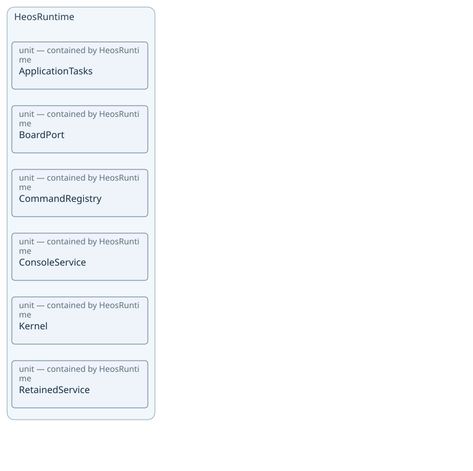

### Containment — 7–9 of 9 objects

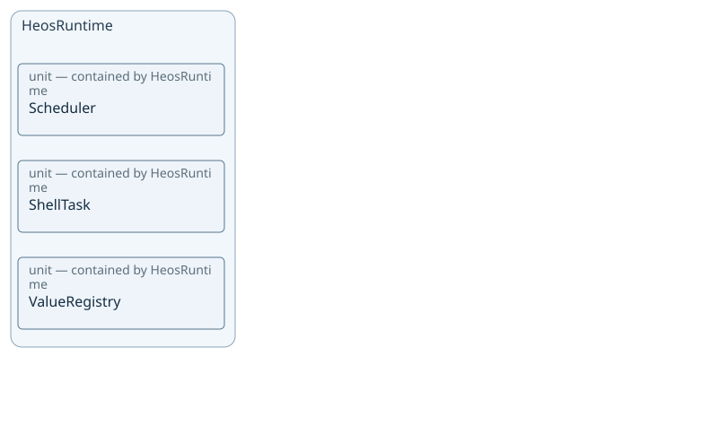

### NativeTaskApi — mode MicroCore

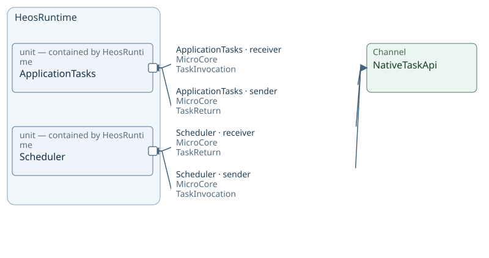

### NumericCommandApi — mode MicroConsole

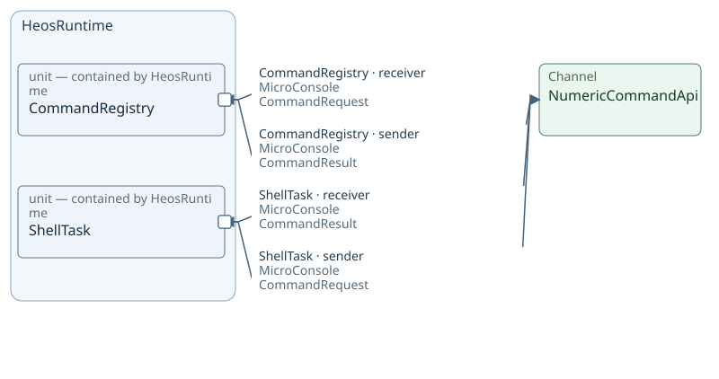

### NumericValueApi — mode MicroConsole

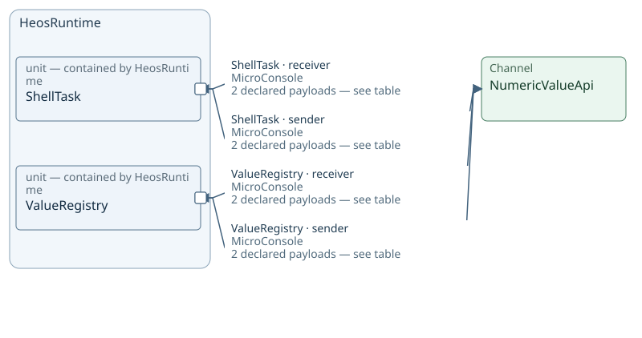

### RetainedApi — mode MicroRetained

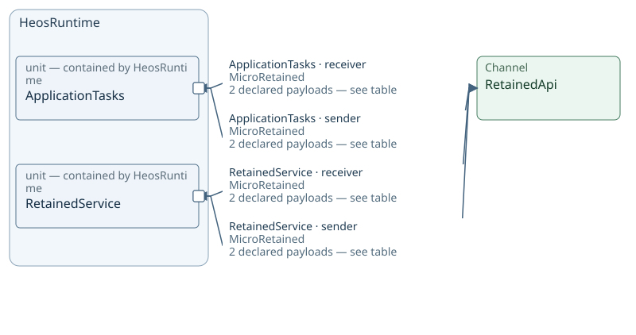

Containment is logical structure. Named attachments mark existing Channels at participant boundaries; they are not declared ports. Arrows describe sender/receiver roles for the stated payload and mode, not execution order.

All explicitly declared modes are shown; no mode inheritance is inferred.

Inspect: [ApplicationTasks](sdl-view://heos/VP02?projection=reading&focus=ApplicationTasks) · [BoardPort](sdl-view://heos/VP02?projection=reading&focus=BoardPort) · [CommandRegistry](sdl-view://heos/VP02?projection=reading&focus=CommandRegistry) · [ConsoleService](sdl-view://heos/VP02?projection=reading&focus=ConsoleService) · [Kernel](sdl-view://heos/VP02?projection=reading&focus=Kernel) · [RetainedService](sdl-view://heos/VP02?projection=reading&focus=RetainedService) · [Scheduler](sdl-view://heos/VP02?projection=reading&focus=Scheduler) · [ShellTask](sdl-view://heos/VP02?projection=reading&focus=ShellTask) · [ValueRegistry](sdl-view://heos/VP02?projection=reading&focus=ValueRegistry)

### NativeTaskApi payloads

| Participant | Role | Message / Datagram | Dataset origin | Mode |
| --- | --- | --- | --- | --- |
| ApplicationTasks | receiver | TaskInvocation | Not applicable | MicroCore |
| ApplicationTasks | sender | TaskReturn | Not applicable | MicroCore |
| Scheduler | receiver | TaskReturn | Not applicable | MicroCore |
| Scheduler | sender | TaskInvocation | Not applicable | MicroCore |

### NumericCommandApi payloads

| Participant | Role | Message / Datagram | Dataset origin | Mode |
| --- | --- | --- | --- | --- |
| CommandRegistry | receiver | CommandRequest | Not applicable | MicroConsole |
| CommandRegistry | sender | CommandResult | Not applicable | MicroConsole |
| ShellTask | receiver | CommandResult | Not applicable | MicroConsole |
| ShellTask | sender | CommandRequest | Not applicable | MicroConsole |

### NumericValueApi payloads

| Participant | Role | Message / Datagram | Dataset origin | Mode |
| --- | --- | --- | --- | --- |
| ShellTask | receiver | ReadValueResult | Not applicable | MicroConsole |
| ShellTask | receiver | WriteValueResult | Not applicable | MicroConsole |
| ShellTask | sender | ReadValueRequest | Not applicable | MicroConsole |
| ShellTask | sender | WriteValueRequest | Not applicable | MicroConsole |
| ValueRegistry | receiver | ReadValueRequest | Not applicable | MicroConsole |
| ValueRegistry | receiver | WriteValueRequest | Not applicable | MicroConsole |
| ValueRegistry | sender | ReadValueResult | Not applicable | MicroConsole |
| ValueRegistry | sender | WriteValueResult | Not applicable | MicroConsole |

### RetainedApi payloads

| Participant | Role | Message / Datagram | Dataset origin | Mode |
| --- | --- | --- | --- | --- |
| ApplicationTasks | receiver | CommitResult | Not applicable | MicroRetained |
| ApplicationTasks | receiver | RecoverResult | Not applicable | MicroRetained |
| ApplicationTasks | sender | CommitRequest | Not applicable | MicroRetained |
| ApplicationTasks | sender | RecoverRequest | Not applicable | MicroRetained |
| RetainedService | receiver | CommitRequest | Not applicable | MicroRetained |
| RetainedService | receiver | RecoverRequest | Not applicable | MicroRetained |
| RetainedService | sender | CommitResult | Not applicable | MicroRetained |
| RetainedService | sender | RecoverResult | Not applicable | MicroRetained |

## Reading chapters

- [Containers](sdl-view://heos/VP02?collection=containers&consumer=xfmd&projection=reading&target=main) — 1 objects.
  [HeosRuntime](sdl-view://heos/VP02?consumer=xfmd&focus=HeosRuntime&projection=reading&target=main).
- [Units](sdl-view://heos/VP02?collection=units&consumer=xfmd&projection=reading&target=main) — 10 objects.
  [ApplicationTasks](sdl-view://heos/VP02?consumer=xfmd&focus=ApplicationTasks&projection=reading&target=main).
  [BoardPort](sdl-view://heos/VP02?consumer=xfmd&focus=BoardPort&projection=reading&target=main).
  [BuildVerification](sdl-view://heos/VP02?consumer=xfmd&focus=BuildVerification&projection=reading&target=main).

## Interpretation and unspecified behavior

Contains describes logical structure. Deployment, scheduling, runtime calls, and unnamed internal units are not inferred. Channel endpoints refer to actual declared participants.

