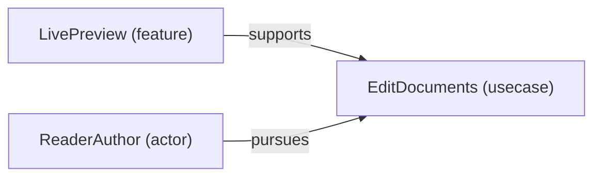

# Use case: EditDocuments

[Viewpoint](index.md) · [Navigator](../../navigator.md)

Revision: `3002709d67729fd3595ab27c484794d77b675ed28f927db0aec1e23234d288e2`.

## Use case: EditDocuments

Source facts: f0026, f0035.

