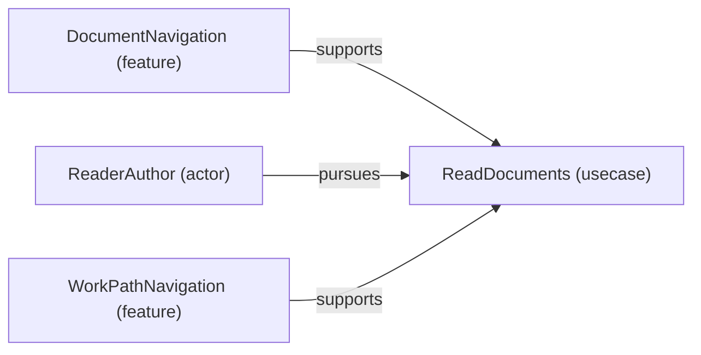

# Use case: ReadDocuments

[Viewpoint](index.md) · [Navigator](../../navigator.md)

Revision: `3002709d67729fd3595ab27c484794d77b675ed28f927db0aec1e23234d288e2`.

## Use case: ReadDocuments

Source facts: f0012, f0036, f0047.

