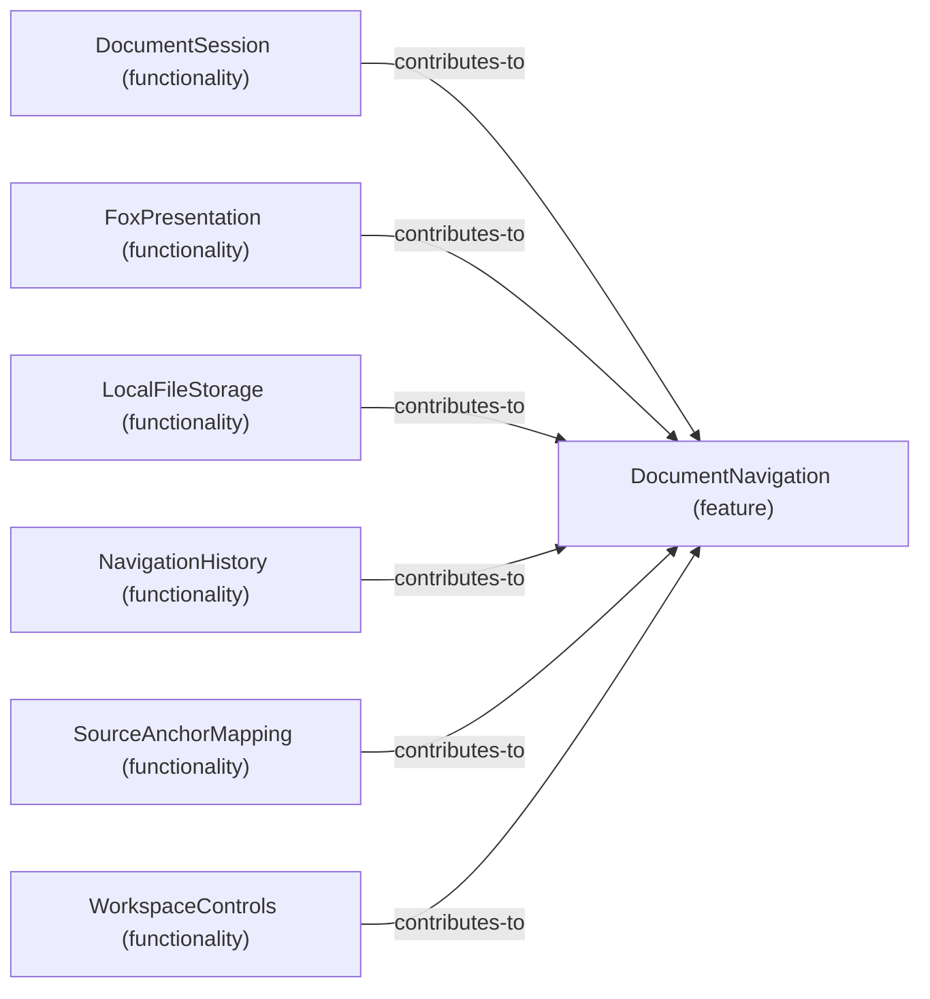

# Functionality contributions to Feature: DocumentNavigation

[Viewpoint](index.md) · [Navigator](../../navigator.md)

Revision: `3002709d67729fd3595ab27c484794d77b675ed28f927db0aec1e23234d288e2`.

## Functionality contributions to Feature: DocumentNavigation

Source facts: f0014, f0021, f0028, f0032, f0042, f0049.

