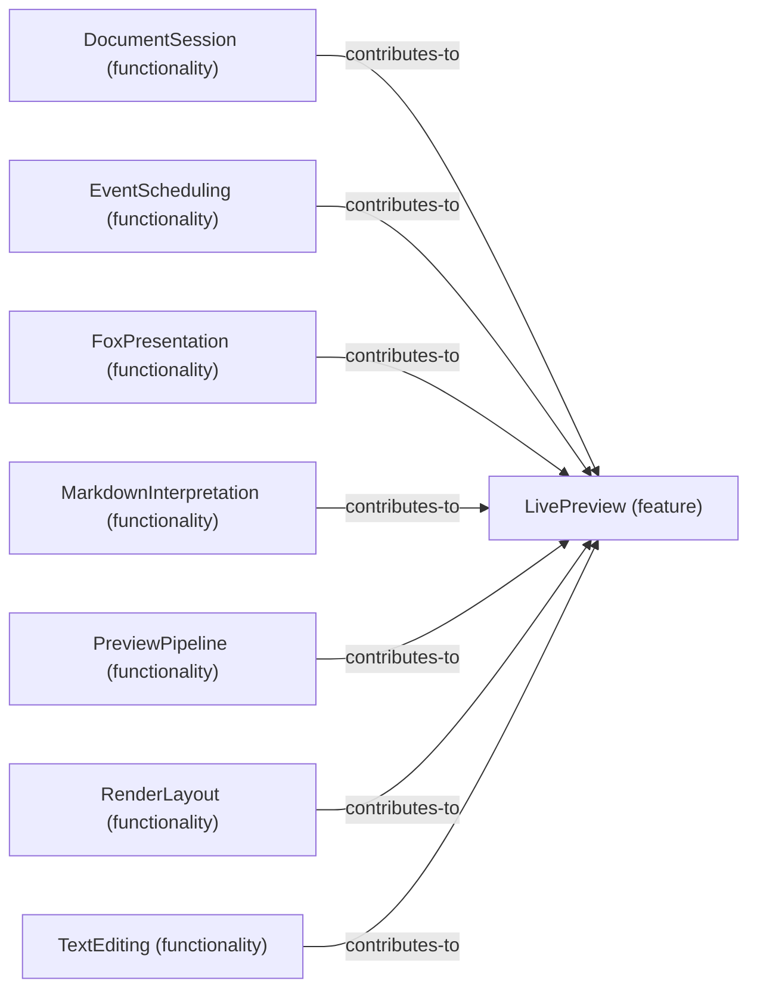

# Functionality contributions to Feature: LivePreview

[Viewpoint](index.md) · [Navigator](../../navigator.md)

Revision: `3002709d67729fd3595ab27c484794d77b675ed28f927db0aec1e23234d288e2`.

## Functionality contributions to Feature: LivePreview

Source facts: f0015, f0017, f0022, f0030, f0034, f0039, f0044.

