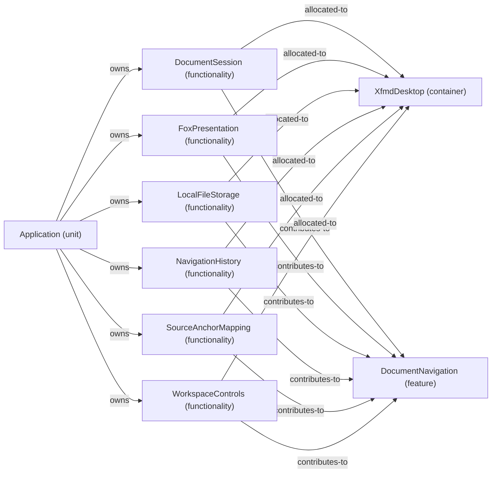

# Feature: DocumentNavigation — mode NormalDesktop

[Viewpoint](index.md) · [Navigator](../../navigator.md)

Revision: `3002709d67729fd3595ab27c484794d77b675ed28f927db0aec1e23234d288e2`.

## Feature: DocumentNavigation — mode NormalDesktop

Source facts: f0000, f0003, f0005, f0006, f0008, f0011, f0013, f0014, f0020, f0021, f0027, f0028, f0031, f0032, f0041, f0042, f0048, f0049.

