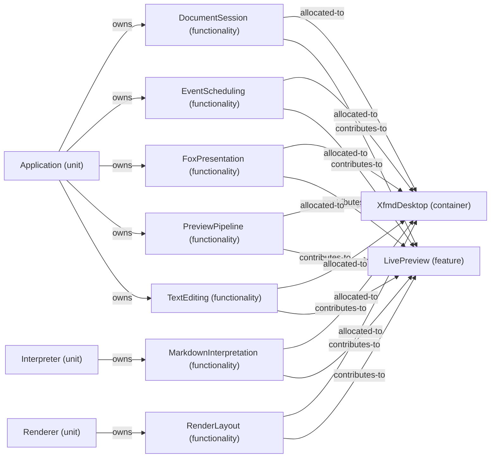

# Feature: LivePreview — mode NormalDesktop

[Viewpoint](index.md) · [Navigator](../../navigator.md)

Revision: `3002709d67729fd3595ab27c484794d77b675ed28f927db0aec1e23234d288e2`.

## Feature: LivePreview — mode NormalDesktop

Source facts: f0000, f0001, f0003, f0007, f0009, f0013, f0015, f0016, f0017, f0020, f0022, f0025, f0029, f0030, f0033, f0034, f0038, f0039, f0040, f0043, f0044.

