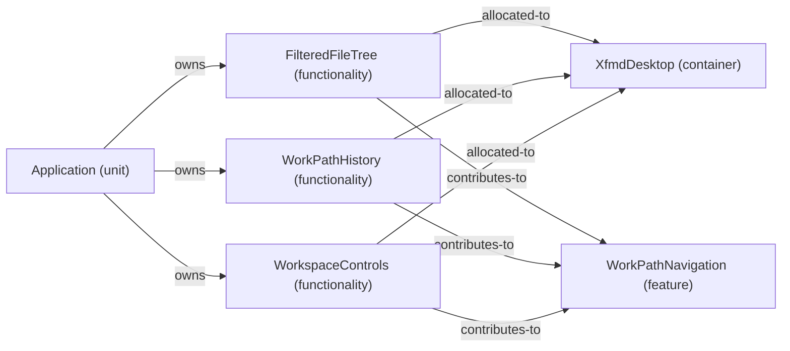

# Feature: WorkPathNavigation — mode NormalDesktop

[Viewpoint](index.md) · [Navigator](../../navigator.md)

Revision: `3002709d67729fd3595ab27c484794d77b675ed28f927db0aec1e23234d288e2`.

## Feature: WorkPathNavigation — mode NormalDesktop

Source facts: f0002, f0010, f0011, f0018, f0019, f0045, f0046, f0048, f0050.

