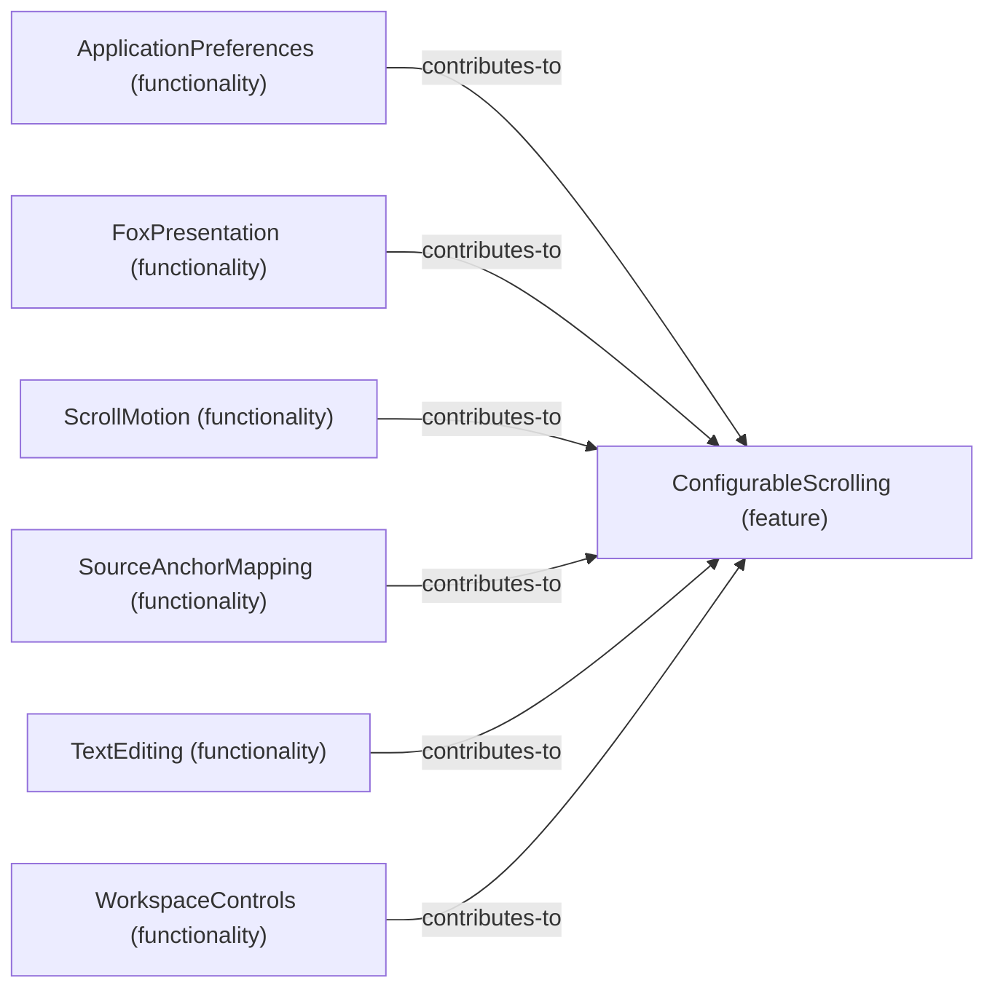

# Functionality contributions to Feature: ConfigurableScrolling

[Viewpoint](index.md) · [Navigator](../../navigator.md)

Revision: `e2a2f39e5c78476bb1bba08e406114367eb59953f02a63e952e435c880d24007`.

## Functionality contributions to Feature: ConfigurableScrolling

Source facts: f0047, f0352, f0890, f0909, f0937, f1015.

