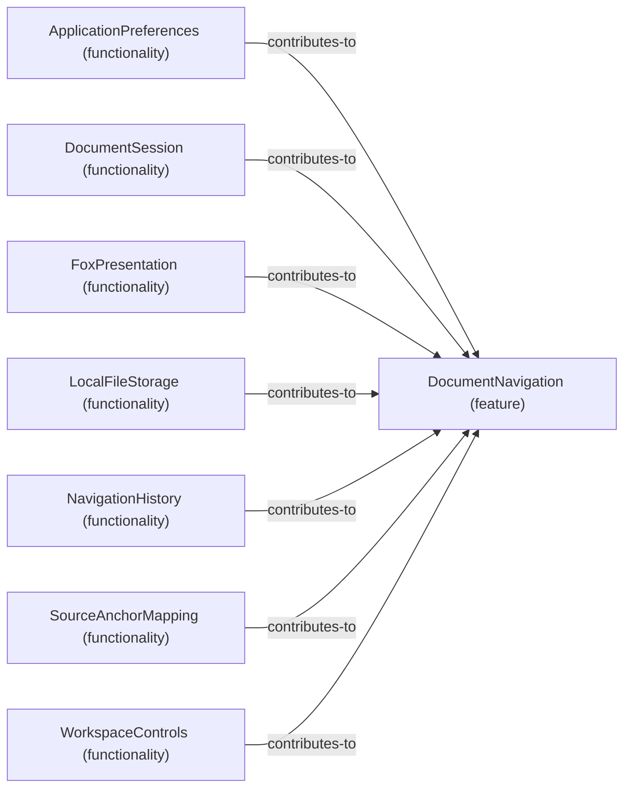

# Functionality contributions to Feature: DocumentNavigation

[Viewpoint](index.md) · [Navigator](../../navigator.md)

Revision: `e2a2f39e5c78476bb1bba08e406114367eb59953f02a63e952e435c880d24007`.

## Functionality contributions to Feature: DocumentNavigation

Source facts: f0049, f0208, f0353, f0524, f0589, f0910, f1016.

