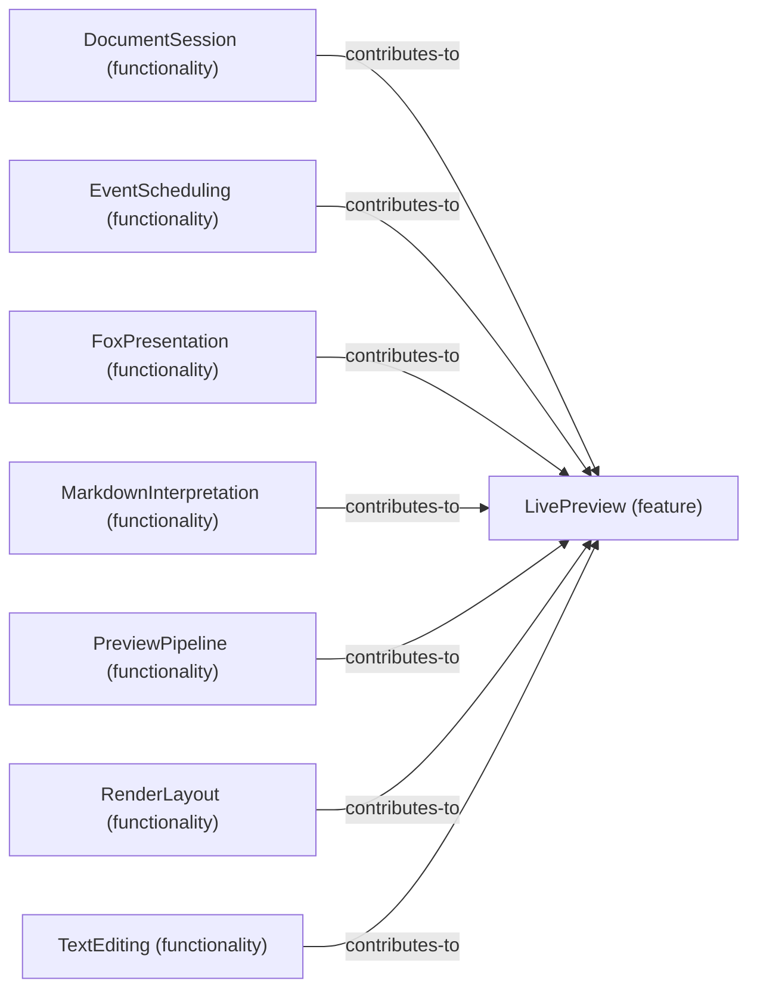

# Functionality contributions to Feature: LivePreview

[Viewpoint](index.md) · [Navigator](../../navigator.md)

Revision: `e2a2f39e5c78476bb1bba08e406114367eb59953f02a63e952e435c880d24007`.

## Functionality contributions to Feature: LivePreview

Source facts: f0209, f0281, f0354, f0532, f0718, f0838, f0938.

