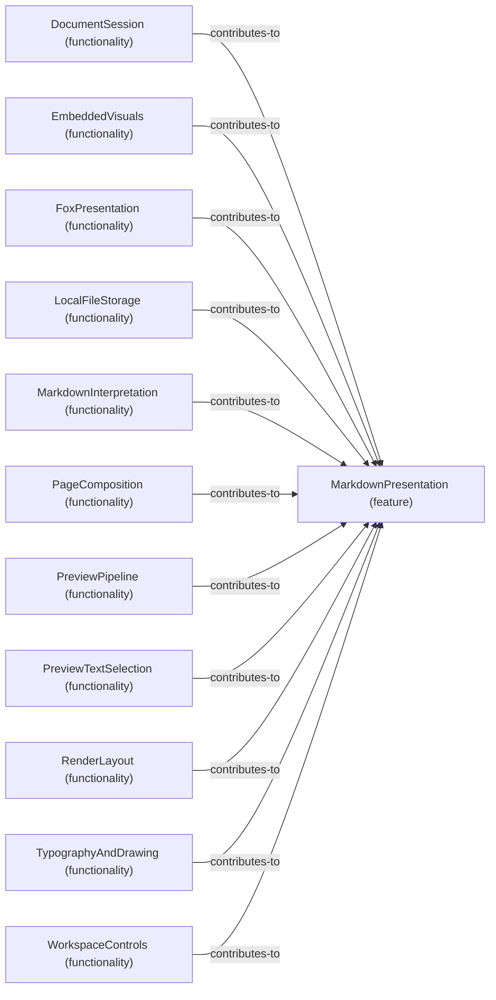

# Functionality contributions to Feature: MarkdownPresentation

[Viewpoint](index.md) · [Navigator](../../navigator.md)

Revision: `e2a2f39e5c78476bb1bba08e406114367eb59953f02a63e952e435c880d24007`.

## Functionality contributions to Feature: MarkdownPresentation

Source facts: f0210, f0275, f0355, f0525, f0533, f0601, f0719, f0741, f0839, f0947, f1018.

