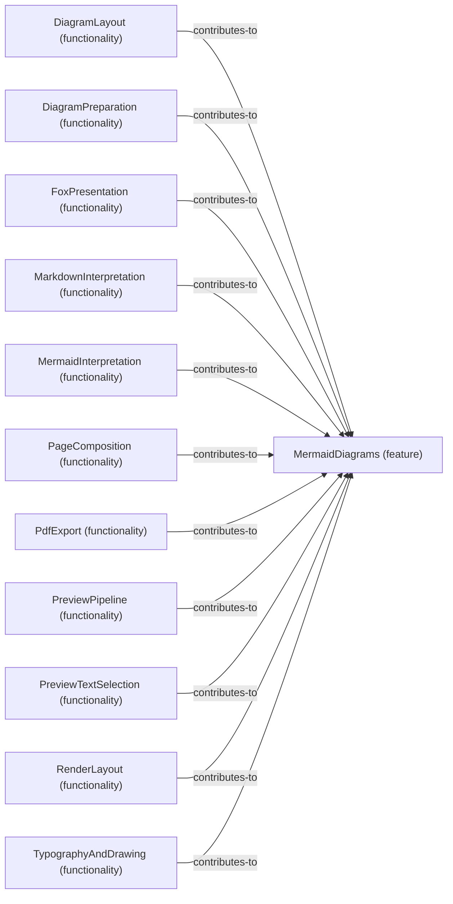

# Functionality contributions to Feature: MermaidDiagrams

[Viewpoint](index.md) · [Navigator](../../navigator.md)

Revision: `e2a2f39e5c78476bb1bba08e406114367eb59953f02a63e952e435c880d24007`.

## Functionality contributions to Feature: MermaidDiagrams

Source facts: f0130, f0136, f0356, f0534, f0540, f0602, f0626, f0720, f0742, f0840, f0948.

