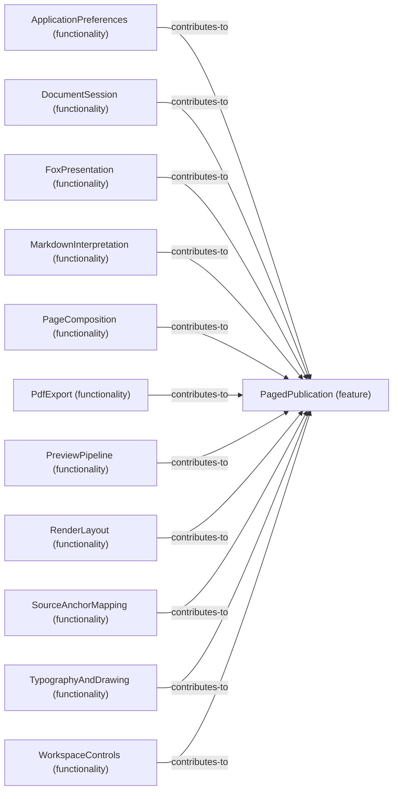

# Functionality contributions to Feature: PagedPublication

[Viewpoint](index.md) · [Navigator](../../navigator.md)

Revision: `e2a2f39e5c78476bb1bba08e406114367eb59953f02a63e952e435c880d24007`.

## Functionality contributions to Feature: PagedPublication

Source facts: f0051, f0211, f0357, f0535, f0603, f0627, f0721, f0841, f0912, f0949, f1019.

