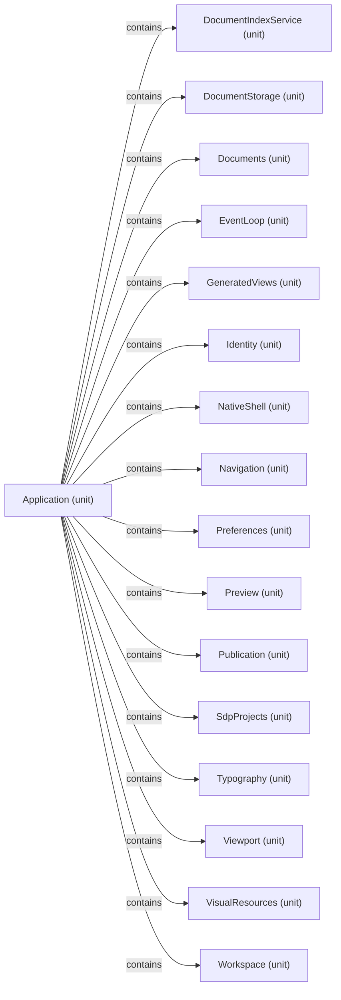

# Logical decomposition: Application

[Viewpoint](index.md) · [Navigator](../../navigator.md)

Revision: `e2a2f39e5c78476bb1bba08e406114367eb59953f02a63e952e435c880d24007`.

## Logical decomposition: Application

Source facts: f0019, f0020, f0021, f0022, f0023, f0024, f0025, f0026, f0027, f0028, f0029, f0030, f0031, f0032, f0033, f0034.

