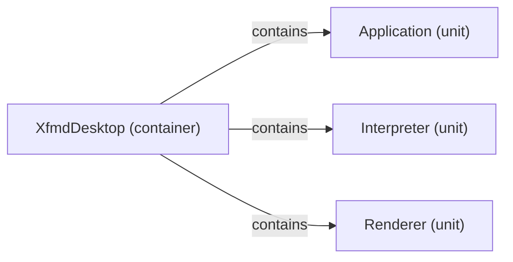

# Logical decomposition: XfmdDesktop

[Viewpoint](index.md) · [Navigator](../../navigator.md)

Revision: `e2a2f39e5c78476bb1bba08e406114367eb59953f02a63e952e435c880d24007`.

## Logical decomposition: XfmdDesktop

Source facts: f1031, f1032, f1033.

