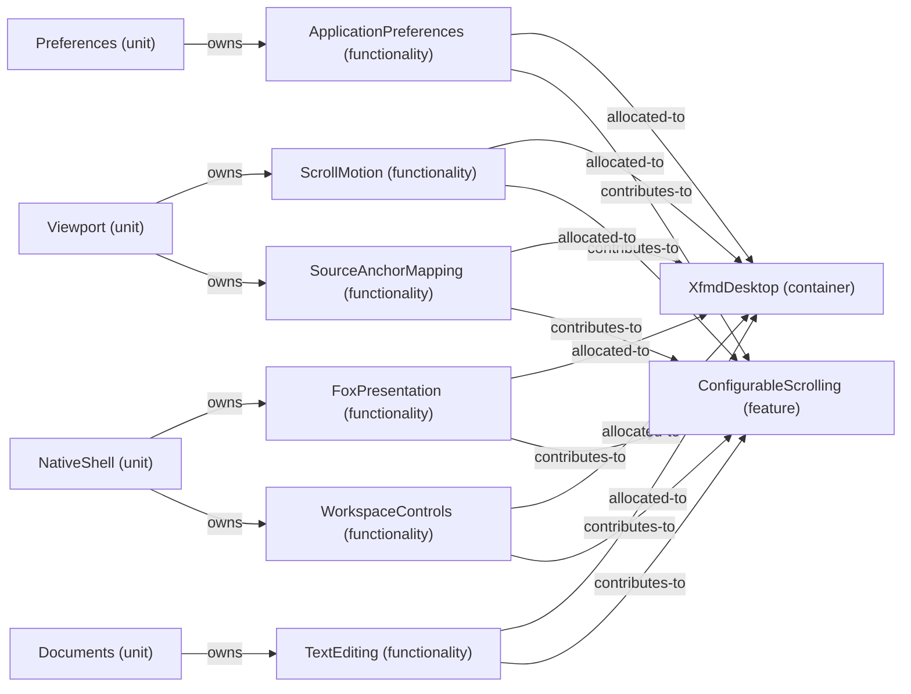

# Feature: ConfigurableScrolling — mode NormalDesktop

[Viewpoint](index.md) · [Navigator](../../navigator.md)

Revision: `e2a2f39e5c78476bb1bba08e406114367eb59953f02a63e952e435c880d24007`.

## Feature: ConfigurableScrolling — mode NormalDesktop

Source facts: f0046, f0047, f0233, f0351, f0352, f0544, f0545, f0652, f0889, f0890, f0907, f0909, f0936, f0937, f0965, f0966, f1013, f1015.

